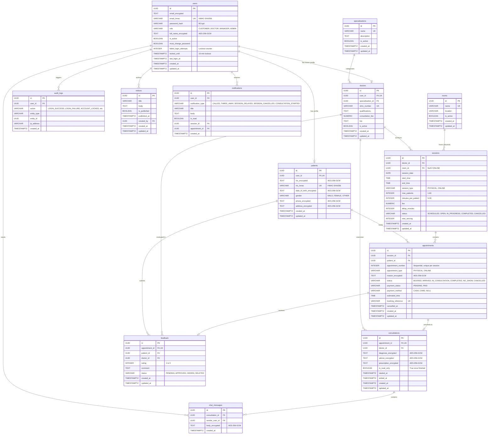

# MEDICHANNEL - COMPLETE MONOREPO SOURCE CODE & ARCHITECTURE ARCHIVE
# Lanka Care Hospital, Colombo | IT404050 Full Stack Development Assignment 2
# Author / Group Leader: Chalana Ananthadev (Member 1: Architecture, Security, Caching, Infra)
# Date: 2026-11-16T19:32:10.694Z
# Total Files Included: 139

================================================================================
TABLE OF CONTENTS (139 FILES)
================================================================================
  1. .env.example
  2. .github/modernize/java-upgrade/.gitignore
  3. .github/workflows/ci.yml
  4. .gitignore
  5. backend/.dockerignore
  6. backend/.env.example
  7. backend/Dockerfile
  8. backend/pom.xml
  9. backend/src/main/java/com/medichannel/bootstrap/DataSeeder.java
 10. backend/src/main/java/com/medichannel/config/CacheConfig.java
 11. backend/src/main/java/com/medichannel/config/SecurityConfig.java
 12. backend/src/main/java/com/medichannel/config/WebMvcConfig.java
 13. backend/src/main/java/com/medichannel/config/WebSocketConfig.java
 14. backend/src/main/java/com/medichannel/controller/AuthController.java
 15. backend/src/main/java/com/medichannel/controller/ClinicalGuardController.java
 16. backend/src/main/java/com/medichannel/controller/HealthController.java
 17. backend/src/main/java/com/medichannel/controller/PublicCatalogController.java
 18. backend/src/main/java/com/medichannel/dto/auth/AuthResponse.java
 19. backend/src/main/java/com/medichannel/dto/auth/ChangePasswordRequest.java
 20. backend/src/main/java/com/medichannel/dto/auth/LoginRequest.java
 21. backend/src/main/java/com/medichannel/dto/auth/MeResponse.java
 22. backend/src/main/java/com/medichannel/dto/auth/RegisterPatientRequest.java
 23. backend/src/main/java/com/medichannel/dto/catalog/NoticeDto.java
 24. backend/src/main/java/com/medichannel/dto/catalog/PublicDoctorDto.java
 25. backend/src/main/java/com/medichannel/dto/catalog/SpecialisationDto.java
 26. backend/src/main/java/com/medichannel/dto/common/ApiError.java
 27. backend/src/main/java/com/medichannel/entity/AppNotification.java
 28. backend/src/main/java/com/medichannel/entity/Appointment.java
 29. backend/src/main/java/com/medichannel/entity/AuditLog.java
 30. backend/src/main/java/com/medichannel/entity/ChannelSession.java
 31. backend/src/main/java/com/medichannel/entity/ChatMessage.java
 32. backend/src/main/java/com/medichannel/entity/Consultation.java
 33. backend/src/main/java/com/medichannel/entity/Doctor.java
 34. backend/src/main/java/com/medichannel/entity/Feedback.java
 35. backend/src/main/java/com/medichannel/entity/Notice.java
 36. backend/src/main/java/com/medichannel/entity/Patient.java
 37. backend/src/main/java/com/medichannel/entity/Room.java
 38. backend/src/main/java/com/medichannel/entity/Specialisation.java
 39. backend/src/main/java/com/medichannel/entity/UserAccount.java
 40. backend/src/main/java/com/medichannel/enums/AppointmentStatus.java
 41. backend/src/main/java/com/medichannel/enums/AuditAction.java
 42. backend/src/main/java/com/medichannel/enums/FeedbackStatus.java
 43. backend/src/main/java/com/medichannel/enums/Gender.java
 44. backend/src/main/java/com/medichannel/enums/NotificationType.java
 45. backend/src/main/java/com/medichannel/enums/PaymentMethod.java
 46. backend/src/main/java/com/medichannel/enums/PaymentStatus.java
 47. backend/src/main/java/com/medichannel/enums/Role.java
 48. backend/src/main/java/com/medichannel/enums/SessionStatus.java
 49. backend/src/main/java/com/medichannel/enums/SessionType.java
 50. backend/src/main/java/com/medichannel/exception/ApiException.java
 51. backend/src/main/java/com/medichannel/exception/GlobalExceptionHandler.java
 52. backend/src/main/java/com/medichannel/MediChannelApplication.java
 53. backend/src/main/java/com/medichannel/repository/AppNotificationRepository.java
 54. backend/src/main/java/com/medichannel/repository/AppointmentRepository.java
 55. backend/src/main/java/com/medichannel/repository/AuditLogRepository.java
 56. backend/src/main/java/com/medichannel/repository/ChannelSessionRepository.java
 57. backend/src/main/java/com/medichannel/repository/ChatMessageRepository.java
 58. backend/src/main/java/com/medichannel/repository/ConsultationRepository.java
 59. backend/src/main/java/com/medichannel/repository/DoctorRepository.java
 60. backend/src/main/java/com/medichannel/repository/FeedbackRepository.java
 61. backend/src/main/java/com/medichannel/repository/NoticeRepository.java
 62. backend/src/main/java/com/medichannel/repository/PatientRepository.java
 63. backend/src/main/java/com/medichannel/repository/RoomRepository.java
 64. backend/src/main/java/com/medichannel/repository/SpecialisationRepository.java
 65. backend/src/main/java/com/medichannel/repository/UserAccountRepository.java
 66. backend/src/main/java/com/medichannel/security/AesGcmAttributeConverter.java
 67. backend/src/main/java/com/medichannel/security/AuthenticatedUser.java
 68. backend/src/main/java/com/medichannel/security/EncryptionService.java
 69. backend/src/main/java/com/medichannel/security/HmacSha256Hasher.java
 70. backend/src/main/java/com/medichannel/security/JwtAuthenticationFilter.java
 71. backend/src/main/java/com/medichannel/security/JwtService.java
 72. backend/src/main/java/com/medichannel/security/MedicalPrivacyFilter.java
 73. backend/src/main/java/com/medichannel/security/MedicalPrivacyGuard.java
 74. backend/src/main/java/com/medichannel/security/RestAccessDeniedHandler.java
 75. backend/src/main/java/com/medichannel/security/RestAuthenticationEntryPoint.java
 76. backend/src/main/java/com/medichannel/service/AuditService.java
 77. backend/src/main/java/com/medichannel/service/AuthService.java
 78. backend/src/main/java/com/medichannel/service/PublicCatalogService.java
 79. backend/src/main/java/com/medichannel/service/PublicDoctorCatalogCache.java
 80. backend/src/main/java/com/medichannel/validation/SriLankanNic.java
 81. backend/src/main/java/com/medichannel/validation/SriLankanNicValidator.java
 82. backend/src/main/java/com/medichannel/validation/SriLankanPhone.java
 83. backend/src/main/java/com/medichannel/validation/SriLankanPhoneValidator.java
 84. backend/src/main/java/com/medichannel/validation/StrongPassword.java
 85. backend/src/main/java/com/medichannel/validation/StrongPasswordValidator.java
 86. backend/src/main/resources/application.yml
 87. backend/src/main/resources/db/schema.sql
 88. backend/src/main/resources/db/seed-data.sql
 89. backend/src/test/java/com/medichannel/exception/GlobalExceptionHandlerTest.java
 90. backend/src/test/java/com/medichannel/security/AesGcmAttributeConverterTest.java
 91. backend/src/test/java/com/medichannel/security/EncryptionServiceTest.java
 92. backend/src/test/java/com/medichannel/security/HmacSha256HasherTest.java
 93. backend/src/test/java/com/medichannel/security/JwtServiceTest.java
 94. backend/src/test/java/com/medichannel/security/MedicalPrivacyGuardTest.java
 95. backend/src/test/java/com/medichannel/security/SecurityIntegrationTest.java
 96. backend/src/test/java/com/medichannel/service/AuthServiceTest.java
 97. backend/src/test/java/com/medichannel/service/PublicCatalogServiceCacheTest.java
 98. backend/src/test/resources/application-test.yml
 99. backend/src/test/resources/application.yml
100. database/schema.sql
101. database/seed-data.sql
102. docker-compose.yml
103. docs/ai-usage-declaration.md
104. docs/architecture.md
105. docs/audit-log-immutability-verification.md
106. docs/erd.md
107. docs/pgadmin-setup-guide.md
108. docs/security-evidence-checklist.md
109. docs/websocket-security-contract.md
110. frontend/.dockerignore
111. frontend/.env.example
112. frontend/Dockerfile
113. frontend/next-env.d.ts
114. frontend/next.config.ts
115. frontend/package.json
116. frontend/src/app/(public)/change-password/page.tsx
117. frontend/src/app/(public)/doctors/page.tsx
118. frontend/src/app/(public)/login/page.tsx
119. frontend/src/app/(public)/page.tsx
120. frontend/src/app/(public)/register/page.tsx
121. frontend/src/app/admin/page.tsx
122. frontend/src/app/api/auth/change-password/route.ts
123. frontend/src/app/api/auth/login/route.ts
124. frontend/src/app/api/auth/logout/route.ts
125. frontend/src/app/api/auth/me/route.ts
126. frontend/src/app/api/auth/register/route.ts
127. frontend/src/app/api/proxy/[...path]/route.ts
128. frontend/src/app/doctor/page.tsx
129. frontend/src/app/globals.css
130. frontend/src/app/layout.tsx
131. frontend/src/app/manager/page.tsx
132. frontend/src/app/patient/page.tsx
133. frontend/src/components/LogoutButton.tsx
134. frontend/src/components/SiteHeader.tsx
135. frontend/src/lib/api.ts
136. frontend/src/lib/cookies.ts
137. frontend/src/middleware.ts
138. frontend/tsconfig.json
139. README.md


================================================================================
FILE: .env.example
================================================================================

# ==============================================================================
# MediChannel Hospital System - Environment Configuration Template
# ==============================================================================
# IMPORTANT: Never commit actual secret values to version control.
# Copy this file to .env and provide generated secrets before running.

# Database Configuration (PostgreSQL / Neon DB)
DATABASE_URL=jdbc:postgresql://localhost:5432/medichannel?sslmode=disable
DATABASE_USERNAME=postgres
DATABASE_PASSWORD=CHANGE_ME_DATABASE_PASSWORD

# Security & Cryptography Keys
# AES_256_KEY: Base64-encoded 32-byte key (Generate via: openssl rand -base64 32)
AES_256_KEY=CHANGE_ME_base64_32_bytes

# HMAC_SHA256_KEY: Base64-encoded 32-byte key (Generate via: openssl rand -base64 32)
HMAC_SHA256_KEY=CHANGE_ME_base64_32_bytes

# JWT Secret: Base64-encoded secret of at least 48 bytes (Generate via: openssl rand -base64 48)
JWT_SECRET=CHANGE_ME_base64_48_bytes
JWT_EXPIRATION_MS=28800000

# Initial System Administrator Credentials
ADMIN_EMAIL=admin@lankacare.lk
ADMIN_PASSWORD=CHANGE_ME_ADMIN_PASSWORD_StrongP@ss1
ADMIN_FULL_NAME=System Administrator

# Demo Data Seeding
# Set SEED_DEMO=true to seed initial doctor, manager, patient and appointments
SEED_DEMO=false
# Required if SEED_DEMO=true
SEED_PASSWORD=CHANGE_ME_DEMO_SEED_PASSWORD_StrongP@ss1

# Service Ports and URLs
FRONTEND_URL=http://localhost:3000
API_URL=http://localhost:8080
PORT=8080
COOKIE_SECURE=false

# Cache Settings
PUBLIC_CACHE_TTL_SECONDS=120


================================================================================
FILE: .github/modernize/java-upgrade/.gitignore
================================================================================


**/*


================================================================================
FILE: .github/workflows/ci.yml
================================================================================

name: CI Pipeline

on:
  push:
    branches: [main, develop, chalana, feature/*]
  pull_request:
    branches: [main, develop, chalana]

jobs:
  backend-test:
    name: Backend Build & Tests
    runs-on: ubuntu-latest
    steps:
      - name: Checkout Code
        uses: actions/checkout@v4

      - name: Set up JDK 21
        uses: actions/setup-java@v4
        with:
          java-version: '21'
          distribution: 'temurin'
          cache: maven

      - name: Generate throwaway runtime test secrets
        run: |
          echo "AES_256_KEY=$(openssl rand -base64 32)" >> $GITHUB_ENV
          echo "HMAC_SHA256_KEY=$(openssl rand -base64 32)" >> $GITHUB_ENV
          echo "JWT_SECRET=$(openssl rand -base64 48)" >> $GITHUB_ENV
          echo "ADMIN_PASSWORD=$(openssl rand -hex 16)A#1" >> $GITHUB_ENV
          echo "DATABASE_PASSWORD=$(openssl rand -hex 16)" >> $GITHUB_ENV

      - name: Build and Run Unit Tests
        working-directory: ./backend
        run: mvn clean test -B

  frontend-build:
    name: Frontend Typecheck & Build
    runs-on: ubuntu-latest
    steps:
      - name: Checkout Code
        uses: actions/checkout@v4

      - name: Set up Node.js 22
        uses: actions/setup-node@v4
        with:
          node-version: '22'
          cache: 'npm'
          cache-dependency-path: './frontend/package.json'

      - name: Install Dependencies
        working-directory: ./frontend
        run: npm install

      - name: Build Next.js
        working-directory: ./frontend
        run: npm run build
        env:
          API_URL: http://localhost:8080
          COOKIE_SECURE: 'false'


================================================================================
FILE: .gitignore
================================================================================

# Secrets & Environment variables
.env
.env.*
!.env.example
backend/.env
backend/.env.*
!backend/.env.example
frontend/.env
frontend/.env.local
frontend/.env.*.local
!frontend/.env.example
*.pem
*.p12
credentials*
secrets/

# Build outputs
target/
backend/target/
node_modules/
frontend/node_modules/
.next/
frontend/.next/
frontend/out/
frontend/.turbo/

# Java / Maven
*.class
*.jar
*.war
hs_err_pid*

# Logs
*.log
npm-debug.log*
yarn-error.log*
coverage/
.nyc_output/

# IDE / Editor configuration
.idea/
backend/.idea/
.vscode/
*.iml
.DS_Store
Thumbs.db


================================================================================
FILE: backend/.dockerignore
================================================================================

target/
.mvn/
*.iml
.idea/
.vscode/
.git
.gitignore
*.log


================================================================================
FILE: backend/.env.example
================================================================================

# ==============================================================================
# MediChannel Backend - Environment Configuration Template
# ==============================================================================
DATABASE_URL=jdbc:postgresql://localhost:5432/medichannel?sslmode=disable
DATABASE_USERNAME=postgres
DATABASE_PASSWORD=CHANGE_ME_DATABASE_PASSWORD

# Generate via: openssl rand -base64 48
JWT_SECRET=CHANGE_ME_base64_48_bytes
JWT_EXPIRATION_MS=28800000

# Generate via: openssl rand -base64 32
AES_256_KEY=CHANGE_ME_base64_32_bytes
HMAC_SHA256_KEY=CHANGE_ME_base64_32_bytes

ADMIN_EMAIL=admin@lankacare.lk
ADMIN_PASSWORD=CHANGE_ME_ADMIN_PASSWORD_StrongP@ss1
ADMIN_FULL_NAME=System Administrator

SEED_DEMO=false
SEED_PASSWORD=CHANGE_ME_DEMO_SEED_PASSWORD_StrongP@ss1

FRONTEND_URL=http://localhost:3000
PORT=8080
PUBLIC_CACHE_TTL_SECONDS=120


================================================================================
FILE: backend/Dockerfile
================================================================================

# Build stage
FROM maven:3.9.9-eclipse-temurin-21 AS build
WORKDIR /app

# Cache dependencies
COPY pom.xml .
RUN mvn dependency:go-offline -B

# Build application
COPY src ./src
RUN mvn clean package -DskipTests -B

# Runtime stage
FROM eclipse-temurin:21-jre-jammy
WORKDIR /app

# Create non-root user
RUN addgroup --system spring && adduser --system --ingroup spring spring
USER spring:spring

COPY --from=build /app/target/*.jar app.jar

ENV PORT=8080
EXPOSE 8080

ENTRYPOINT ["java", "-XX:+UseG1GC", "-XX:MaxRAMPercentage=75.0", "-jar", "app.jar"]


================================================================================
FILE: backend/pom.xml
================================================================================

<?xml version="1.0" encoding="UTF-8"?>
<project xmlns="http://maven.apache.org/POM/4.0.0"
         xmlns:xsi="http://www.w3.org/2001/XMLSchema-instance"
         xsi:schemaLocation="http://maven.apache.org/POM/4.0.0 https://maven.apache.org/xsd/maven-4.0.0.xsd">
    <modelVersion>4.0.0</modelVersion>

    <parent>
        <groupId>org.springframework.boot</groupId>
        <artifactId>spring-boot-starter-parent</artifactId>
        <version>3.4.5</version>
        <relativePath/>
    </parent>

    <groupId>com.medichannel</groupId>
    <artifactId>medichannel-api</artifactId>
    <version>0.1.0</version>
    <name>MediChannel API</name>
    <description>Lanka Care Hospital channelling API</description>

    <properties>
        <java.version>21</java.version>
        <jjwt.version>0.12.6</jjwt.version>
    </properties>

    <dependencies>
        <dependency>
            <groupId>org.springframework.boot</groupId>
            <artifactId>spring-boot-starter-web</artifactId>
        </dependency>
        <dependency>
            <groupId>org.springframework.boot</groupId>
            <artifactId>spring-boot-starter-data-jpa</artifactId>
        </dependency>
        <dependency>
            <groupId>org.springframework.boot</groupId>
            <artifactId>spring-boot-starter-security</artifactId>
        </dependency>
        <dependency>
            <groupId>org.springframework.boot</groupId>
            <artifactId>spring-boot-starter-validation</artifactId>
        </dependency>
        <dependency>
            <groupId>org.springframework.boot</groupId>
            <artifactId>spring-boot-starter-cache</artifactId>
        </dependency>
        <dependency>
            <groupId>org.springframework.boot</groupId>
            <artifactId>spring-boot-starter-actuator</artifactId>
        </dependency>
        <dependency>
            <groupId>org.springframework.boot</groupId>
            <artifactId>spring-boot-starter-websocket</artifactId>
        </dependency>
        <dependency>
            <groupId>org.springframework.boot</groupId>
            <artifactId>spring-boot-starter-aop</artifactId>
        </dependency>
        <dependency>
            <groupId>com.github.ben-manes.caffeine</groupId>
            <artifactId>caffeine</artifactId>
        </dependency>
        <dependency>
            <groupId>org.postgresql</groupId>
            <artifactId>postgresql</artifactId>
            <scope>runtime</scope>
        </dependency>
        <dependency>
            <groupId>io.jsonwebtoken</groupId>
            <artifactId>jjwt-api</artifactId>
            <version>${jjwt.version}</version>
        </dependency>
        <dependency>
            <groupId>io.jsonwebtoken</groupId>
            <artifactId>jjwt-impl</artifactId>
            <version>${jjwt.version}</version>
            <scope>runtime</scope>
        </dependency>
        <dependency>
            <groupId>io.jsonwebtoken</groupId>
            <artifactId>jjwt-jackson</artifactId>
            <version>${jjwt.version}</version>
            <scope>runtime</scope>
        </dependency>
        <dependency>
            <groupId>org.projectlombok</groupId>
            <artifactId>lombok</artifactId>
            <optional>true</optional>
        </dependency>
        <dependency>
            <groupId>org.springframework.boot</groupId>
            <artifactId>spring-boot-starter-test</artifactId>
            <scope>test</scope>
        </dependency>
        <dependency>
            <groupId>org.springframework.security</groupId>
            <artifactId>spring-security-test</artifactId>
            <scope>test</scope>
        </dependency>
    </dependencies>

    <build>
        <plugins>
            <plugin>
                <groupId>org.springframework.boot</groupId>
                <artifactId>spring-boot-maven-plugin</artifactId>
            </plugin>
        </plugins>
    </build>
</project>


================================================================================
FILE: backend/src/main/java/com/medichannel/bootstrap/DataSeeder.java
================================================================================

package com.medichannel.bootstrap;

import com.medichannel.entity.AppNotification;
import com.medichannel.entity.Appointment;
import com.medichannel.entity.ChannelSession;
import com.medichannel.entity.ChatMessage;
import com.medichannel.entity.Consultation;
import com.medichannel.entity.Doctor;
import com.medichannel.entity.Feedback;
import com.medichannel.entity.Notice;
import com.medichannel.entity.Patient;
import com.medichannel.entity.Room;
import com.medichannel.entity.Specialisation;
import com.medichannel.entity.UserAccount;
import com.medichannel.enums.AppointmentStatus;
import com.medichannel.enums.FeedbackStatus;
import com.medichannel.enums.Gender;
import com.medichannel.enums.NotificationType;
import com.medichannel.enums.PaymentMethod;
import com.medichannel.enums.PaymentStatus;
import com.medichannel.enums.Role;
import com.medichannel.enums.SessionStatus;
import com.medichannel.enums.SessionType;
import com.medichannel.repository.AppNotificationRepository;
import com.medichannel.repository.AppointmentRepository;
import com.medichannel.repository.ChannelSessionRepository;
import com.medichannel.repository.ChatMessageRepository;
import com.medichannel.repository.ConsultationRepository;
import com.medichannel.repository.DoctorRepository;
import com.medichannel.repository.FeedbackRepository;
import com.medichannel.repository.NoticeRepository;
import com.medichannel.repository.PatientRepository;
import com.medichannel.repository.RoomRepository;
import com.medichannel.repository.SpecialisationRepository;
import com.medichannel.repository.UserAccountRepository;
import com.medichannel.security.HmacSha256Hasher;
import org.springframework.beans.factory.annotation.Value;
import org.springframework.boot.ApplicationArguments;
import org.springframework.boot.ApplicationRunner;
import org.springframework.security.crypto.password.PasswordEncoder;
import org.springframework.stereotype.Component;
import org.springframework.transaction.annotation.Transactional;

import java.math.BigDecimal;
import java.time.Instant;
import java.time.LocalDate;
import java.time.LocalTime;
import java.util.LinkedHashMap;
import java.util.Map;

@Component
public class DataSeeder implements ApplicationRunner {

    private static final Map<String, String> SPECIALISATIONS = new LinkedHashMap<>();

    static {
        SPECIALISATIONS.put("Cardiology", "Heart and vascular care");
        SPECIALISATIONS.put("Dermatology", "Skin, hair and nail conditions");
        SPECIALISATIONS.put("ENT", "Ear, nose and throat");
        SPECIALISATIONS.put("General Medicine", "Adult general medical consultations");
        SPECIALISATIONS.put("Gynaecology", "Women's health");
        SPECIALISATIONS.put("Neurology", "Brain and nerve disorders");
        SPECIALISATIONS.put("Orthopaedics", "Bones, joints and sports injuries");
        SPECIALISATIONS.put("Paediatrics", "Child health");
        SPECIALISATIONS.put("Psychiatry", "Mental health consultations");
        SPECIALISATIONS.put("Radiology", "Imaging review clinics");
        SPECIALISATIONS.put("Surgery", "General surgical opinions");
        SPECIALISATIONS.put("Urology", "Urinary and men's health");
        SPECIALISATIONS.put("Ophthalmology", "Eye care");
        SPECIALISATIONS.put("Pulmonology", "Chest and lung clinics");
        SPECIALISATIONS.put("Endocrinology", "Hormone and diabetes care");
    }

    private final UserAccountRepository userAccountRepository;
    private final PatientRepository patientRepository;
    private final SpecialisationRepository specialisationRepository;
    private final DoctorRepository doctorRepository;
    private final RoomRepository roomRepository;
    private final NoticeRepository noticeRepository;
    private final ChannelSessionRepository channelSessionRepository;
    private final AppointmentRepository appointmentRepository;
    private final ConsultationRepository consultationRepository;
    private final ChatMessageRepository chatMessageRepository;
    private final FeedbackRepository feedbackRepository;
    private final AppNotificationRepository appNotificationRepository;
    private final PasswordEncoder passwordEncoder;
    private final HmacSha256Hasher hmacSha256Hasher;
    private final String adminEmail;
    private final String adminPassword;
    private final String adminName;
    private final boolean seedDemo;
    private final String seedPassword;

    public DataSeeder(
            UserAccountRepository userAccountRepository,
            PatientRepository patientRepository,
            SpecialisationRepository specialisationRepository,
            DoctorRepository doctorRepository,
            RoomRepository roomRepository,
            NoticeRepository noticeRepository,
            ChannelSessionRepository channelSessionRepository,
            AppointmentRepository appointmentRepository,
            ConsultationRepository consultationRepository,
            ChatMessageRepository chatMessageRepository,
            FeedbackRepository feedbackRepository,
            AppNotificationRepository appNotificationRepository,
            PasswordEncoder passwordEncoder,
            HmacSha256Hasher hmacSha256Hasher,
            @Value("${medichannel.admin.email}") String adminEmail,
            @Value("${medichannel.admin.password}") String adminPassword,
            @Value("${medichannel.admin.full-name}") String adminName,
            @Value("${medichannel.seed.demo:false}") boolean seedDemo,
            @Value("${medichannel.seed.password:}") String seedPassword
    ) {
        if (seedDemo && (seedPassword == null || seedPassword.trim().isEmpty())) {
            throw new IllegalStateException("medichannel.seed.demo is enabled (SEED_DEMO=true), but SEED_PASSWORD is missing or blank.");
        }
        this.userAccountRepository = userAccountRepository;
        this.patientRepository = patientRepository;
        this.specialisationRepository = specialisationRepository;
        this.doctorRepository = doctorRepository;
        this.roomRepository = roomRepository;
        this.noticeRepository = noticeRepository;
        this.channelSessionRepository = channelSessionRepository;
        this.appointmentRepository = appointmentRepository;
        this.consultationRepository = consultationRepository;
        this.chatMessageRepository = chatMessageRepository;
        this.feedbackRepository = feedbackRepository;
        this.appNotificationRepository = appNotificationRepository;
        this.passwordEncoder = passwordEncoder;
        this.hmacSha256Hasher = hmacSha256Hasher;
        this.adminEmail = adminEmail;
        this.adminPassword = adminPassword;
        this.adminName = adminName;
        this.seedDemo = seedDemo;
        this.seedPassword = seedPassword;
    }

    @Override
    @Transactional
    public void run(ApplicationArguments args) {
        seedSpecialisations();
        seedRooms();
        UserAccount admin = ensureUser(adminEmail, adminName, adminPassword, Role.ADMIN, false);

        if (seedDemo) {
            seedRichDemoDataset(admin);
        }
    }

    private void seedRichDemoDataset(UserAccount admin) {
        // Idempotency: skip if already seeded
        if (appointmentRepository.count() > 0) {
            return;
        }

        // 1. Manager (mustChangePassword = true for testing change-password flow)
        ensureUser("manager@lankacare.lk", "Nimali Fernando", seedPassword, Role.MANAGER, true);

        // 2. Three Doctors in distinct specialisations
        UserAccount doc1User = ensureUser("doctor.kavindu@lankacare.lk", "Dr. Kavindu Perera", seedPassword, Role.DOCTOR, false);
        Doctor doctor1 = ensureDoctor(
                doc1User,
                "Cardiology",
                "SLMC-44021",
                "MBBS (Colombo), MD (Cardiology)",
                new BigDecimal("3500.00"),
                "Consultant cardiologist at Lanka Care Hospital."
        );

        UserAccount doc2User = ensureUser("doctor.rohini@lankacare.lk", "Dr. Rohini Wickramasinghe", seedPassword, Role.DOCTOR, false);
        Doctor doctor2 = ensureDoctor(
                doc2User,
                "Dermatology",
                "SLMC-31890",
                "MBBS (Peradeniya), MD (Dermatology)",
                new BigDecimal("3000.00"),
                "Consultant dermatologist specialising in clinical and aesthetic dermatology."
        );

        UserAccount doc3User = ensureUser("doctor.asanka@lankacare.lk", "Dr. Asanka Senanayake", seedPassword, Role.DOCTOR, false);
        Doctor doctor3 = ensureDoctor(
                doc3User,
                "Paediatrics",
                "SLMC-52104",
                "MBBS (Ruhuna), DCH, MD (Paediatrics)",
                new BigDecimal("3200.00"),
                "Consultant paediatrician with 12+ years experience in child healthcare."
        );

        // 3. Four Patients (diverse NIC formats: new 12-digit and old 9-digit + V/X)
        UserAccount p1User = ensureUser("patient.amaya@lankacare.lk", "Amaya Silva", seedPassword, Role.CUSTOMER, false);
        Patient patient1 = ensurePatient(p1User, "199512345678", "1995-12-03", Gender.FEMALE, "0771234567", "12 Flower Road, Colombo 07");

        UserAccount p2User = ensureUser("patient.kamal@lankacare.lk", "Kamal Gunaratne", seedPassword, Role.CUSTOMER, false);
        Patient patient2 = ensurePatient(p2User, "851234567V", "1985-05-02", Gender.MALE, "0712345678", "45 Galle Road, Mount Lavinia");

        UserAccount p3User = ensureUser("patient.dilani@lankacare.lk", "Dilani Jayawardena", seedPassword, Role.CUSTOMER, false);
        Patient patient3 = ensurePatient(p3User, "200056789012", "2000-08-14", Gender.FEMALE, "0753456789", "78 Kandy Road, Kiribathgoda");

        UserAccount p4User = ensureUser("patient.saman@lankacare.lk", "Saman Kumara", seedPassword, Role.CUSTOMER, false);
        Patient patient4 = ensurePatient(p4User, "782345678X", "1978-08-21", Gender.MALE, "0764567890", "23 Temple Road, Nugegoda");

        // 4. Rooms
        Room room101 = roomRepository.findByName("Room 101").orElse(null);
        Room room102 = roomRepository.findByName("Room 102").orElse(null);

        // 5. Sessions: Today Morning, Today Evening, Tomorrow Morning, Next Week Cancelled
        LocalDate today = LocalDate.now();

        ChannelSession session1 = new ChannelSession();
        session1.setDoctor(doctor1);
        session1.setRoom(room101);
        session1.setSessionDate(today);
        session1.setStartTime(LocalTime.of(8, 30));
        session1.setEndTime(LocalTime.of(11, 30));
        session1.setSessionType(SessionType.PHYSICAL);
        session1.setMaxPatients(15);
        session1.setMinutesPerPatient(12);
        session1.setFee(doctor1.getConsultationFee());
        session1.setStatus(SessionStatus.IN_PROGRESS);
        session1.setNowServing(3);
        channelSessionRepository.save(session1);

        ChannelSession session2 = new ChannelSession();
        session2.setDoctor(doctor2);
        session2.setRoom(room102);
        session2.setSessionDate(today);
        session2.setStartTime(LocalTime.of(16, 0));
        session2.setEndTime(LocalTime.of(19, 0));
        session2.setSessionType(SessionType.PHYSICAL);
        session2.setMaxPatients(12);
        session2.setMinutesPerPatient(15);
        session2.setFee(doctor2.getConsultationFee());
        session2.setStatus(SessionStatus.OPEN);
        channelSessionRepository.save(session2);

        ChannelSession session3 = new ChannelSession();
        session3.setDoctor(doctor3);
        session3.setRoom(null); // ONLINE session must not have room
        session3.setSessionDate(today.plusDays(1));
        session3.setStartTime(LocalTime.of(9, 0));
        session3.setEndTime(LocalTime.of(12, 0));
        session3.setSessionType(SessionType.ONLINE);
        session3.setMaxPatients(10);
        session3.setMinutesPerPatient(15);
        session3.setFee(doctor3.getConsultationFee());
        session3.setStatus(SessionStatus.SCHEDULED);
        channelSessionRepository.save(session3);

        ChannelSession session4 = new ChannelSession();
        session4.setDoctor(doctor1);
        session4.setRoom(room101);
        session4.setSessionDate(today.plusDays(7));
        session4.setStartTime(LocalTime.of(8, 30));
        session4.setEndTime(LocalTime.of(11, 30));
        session4.setSessionType(SessionType.PHYSICAL);
        session4.setMaxPatients(15);
        session4.setMinutesPerPatient(12);
        session4.setFee(doctor1.getConsultationFee());
        session4.setStatus(SessionStatus.CANCELLED);
        channelSessionRepository.save(session4);

        // 6. Appointments covering all 6 statuses: BOOKED, ARRIVED, IN_CONSULTATION, COMPLETED, NO_SHOW, CANCELLED
        // Appointment 1: COMPLETED (Session 1, Patient 1)
        Appointment apt1 = new Appointment();
        apt1.setSession(session1);
        apt1.setPatient(patient1);
        apt1.setAppointmentNumber(1);
        apt1.setAppointmentType(SessionType.PHYSICAL);
        apt1.setReasonForVisit("Routine cardiac follow-up and ECG review");
        apt1.setStatus(AppointmentStatus.COMPLETED);
        apt1.setPaymentStatus(PaymentStatus.PAID);
        apt1.setPaymentMethod(PaymentMethod.CASH);
        apt1.setEstimatedTime(LocalTime.of(8, 30));
        apt1.setBookingReference("LC-" + today.toString().replace("-", "") + "-001");
        appointmentRepository.save(apt1);

        // Appointment 2: COMPLETED (Session 1, Patient 2)
        Appointment apt2 = new Appointment();
        apt2.setSession(session1);
        apt2.setPatient(patient2);
        apt2.setAppointmentNumber(2);
        apt2.setAppointmentType(SessionType.PHYSICAL);
        apt2.setReasonForVisit("Chest tightness during brisk exercise");
        apt2.setStatus(AppointmentStatus.COMPLETED);
        apt2.setPaymentStatus(PaymentStatus.PAID);
        apt2.setPaymentMethod(PaymentMethod.CARD);
        apt2.setEstimatedTime(LocalTime.of(8, 42));
        apt2.setBookingReference("LC-" + today.toString().replace("-", "") + "-002");
        appointmentRepository.save(apt2);

        // Appointment 3: IN_CONSULTATION (Session 1, Patient 3)
        Appointment apt3 = new Appointment();
        apt3.setSession(session1);
        apt3.setPatient(patient3);
        apt3.setAppointmentNumber(3);
        apt3.setAppointmentType(SessionType.PHYSICAL);
        apt3.setReasonForVisit("Mild palpitations and family history consultation");
        apt3.setStatus(AppointmentStatus.IN_CONSULTATION);
        apt3.setPaymentStatus(PaymentStatus.PAID);
        apt3.setPaymentMethod(PaymentMethod.CARD);
        apt3.setEstimatedTime(LocalTime.of(8, 54));
        apt3.setBookingReference("LC-" + today.toString().replace("-", "") + "-003");
        appointmentRepository.save(apt3);

        // Appointment 4: ARRIVED (Session 1, Patient 4)
        Appointment apt4 = new Appointment();
        apt4.setSession(session1);
        apt4.setPatient(patient4);
        apt4.setAppointmentNumber(4);
        apt4.setAppointmentType(SessionType.PHYSICAL);
        apt4.setReasonForVisit("Hypertension medication dosage check");
        apt4.setStatus(AppointmentStatus.ARRIVED);
        apt4.setPaymentStatus(PaymentStatus.PAID);
        apt4.setPaymentMethod(PaymentMethod.CASH);
        apt4.setEstimatedTime(LocalTime.of(9, 6));
        apt4.setBookingReference("LC-" + today.toString().replace("-", "") + "-004");
        appointmentRepository.save(apt4);

        // Appointment 5: BOOKED (Session 2, Patient 1)
        Appointment apt5 = new Appointment();
        apt5.setSession(session2);
        apt5.setPatient(patient1);
        apt5.setAppointmentNumber(1);
        apt5.setAppointmentType(SessionType.PHYSICAL);
        apt5.setReasonForVisit("Skin allergy and recurring dermatitis");
        apt5.setStatus(AppointmentStatus.BOOKED);
        apt5.setPaymentStatus(PaymentStatus.PENDING);
        apt5.setEstimatedTime(LocalTime.of(16, 0));
        apt5.setBookingReference("LC-" + today.toString().replace("-", "") + "-005");
        appointmentRepository.save(apt5);

        // Appointment 6: NO_SHOW (Session 2, Patient 2)
        Appointment apt6 = new Appointment();
        apt6.setSession(session2);
        apt6.setPatient(patient2);
        apt6.setAppointmentNumber(2);
        apt6.setAppointmentType(SessionType.PHYSICAL);
        apt6.setReasonForVisit("Eczema assessment");
        apt6.setStatus(AppointmentStatus.NO_SHOW);
        apt6.setPaymentStatus(PaymentStatus.PENDING);
        apt6.setEstimatedTime(LocalTime.of(16, 15));
        apt6.setBookingReference("LC-" + today.toString().replace("-", "") + "-006");
        appointmentRepository.save(apt6);

        // Appointment 7: BOOKED ONLINE (Session 3, Patient 3)
        Appointment apt7 = new Appointment();
        apt7.setSession(session3);
        apt7.setPatient(patient3);
        apt7.setAppointmentNumber(1);
        apt7.setAppointmentType(SessionType.ONLINE);
        apt7.setReasonForVisit("Paediatric recurring cough follow-up");
        apt7.setStatus(AppointmentStatus.BOOKED);
        apt7.setPaymentStatus(PaymentStatus.PAID);
        apt7.setPaymentMethod(PaymentMethod.CARD);
        apt7.setEstimatedTime(LocalTime.of(9, 0));
        apt7.setBookingReference("LC-" + today.toString().replace("-", "") + "-007");
        appointmentRepository.save(apt7);

        // Appointment 8: CANCELLED (Session 4, Patient 4)
        Appointment apt8 = new Appointment();
        apt8.setSession(session4);
        apt8.setPatient(patient4);
        apt8.setAppointmentNumber(1);
        apt8.setAppointmentType(SessionType.PHYSICAL);
        apt8.setReasonForVisit("Annual cardiac check-up");
        apt8.setStatus(AppointmentStatus.CANCELLED);
        apt8.setPaymentStatus(PaymentStatus.PAID);
        apt8.setPaymentMethod(PaymentMethod.CARD);
        apt8.setEstimatedTime(LocalTime.of(8, 30));
        apt8.setBookingReference("LC-" + today.toString().replace("-", "") + "-008");
        apt8.setCancelledAt(Instant.now());
        appointmentRepository.save(apt8);

        // 7. Consultation (completed, encrypted diagnosis, advice, and prescription)
        Consultation consultation1 = new Consultation();
        consultation1.setAppointment(apt1);
        consultation1.setDoctor(doctor1);
        consultation1.setDiagnosis("Stage 1 Essential Hypertension with normal sinus rhythm.");
        consultation1.setAdvice("Adopt DASH dietary pattern. Limit dietary sodium to < 2000mg/day. Regular walking 30 mins 5 days/week.");
        consultation1.setPrescription("Tab. Losartan Potassium 50mg - 1 tablet once daily in the morning for 30 days.\nTab. Atorvastatin 10mg - 1 tablet at bedtime for 30 days.");
        consultation1.setReadOnly(true);
        consultation1.setStartedAt(Instant.now().minusSeconds(3600));
        consultation1.setEndedAt(Instant.now().minusSeconds(2400));
        consultationRepository.save(consultation1);

        // 8. Online Consultation & Encrypted Chat Messages (Exercise AES-256-GCM converter)
        Consultation consultationOnline = new Consultation();
        consultationOnline.setAppointment(apt7);
        consultationOnline.setDoctor(doctor3);
        consultationOnline.setDiagnosis("Mild allergic bronchitis under observation.");
        consultationOnline.setAdvice("Maintain adequate hydration. Keep room ventilated.");
        consultationOnline.setPrescription("Syr. Cetirizine 5mg/5ml - 2.5ml once daily at night for 5 days.");
        consultationOnline.setReadOnly(false);
        consultationOnline.setStartedAt(Instant.now().minusSeconds(600));
        consultationRepository.save(consultationOnline);

        ChatMessage chatMsg1 = new ChatMessage();
        chatMsg1.setConsultation(consultationOnline);
        chatMsg1.setSender(p3User);
        chatMsg1.setBody("Good morning Doctor, I have uploaded the child's latest chest auscultation report.");
        chatMessageRepository.save(chatMsg1);

        ChatMessage chatMsg2 = new ChatMessage();
        chatMsg2.setConsultation(consultationOnline);
        chatMsg2.setSender(doc3User);
        chatMsg2.setBody("Good morning. The lungs sound clear; continue the cetirizine as prescribed for 5 days.");
        chatMessageRepository.save(chatMsg2);

        // 9. Feedback (one APPROVED, one PENDING)
        Feedback fb1 = new Feedback();
        fb1.setAppointment(apt1);
        fb1.setPatient(patient1);
        fb1.setDoctor(doctor1);
        fb1.setRating(5);
        fb1.setComment("Dr. Kavindu explained my ECG with exceptional clarity and gave practical lifestyle advice.");
        fb1.setStatus(FeedbackStatus.APPROVED);
        feedbackRepository.save(fb1);

        Feedback fb2 = new Feedback();
        fb2.setAppointment(apt2);
        fb2.setPatient(patient2);
        fb2.setDoctor(doctor1);
        fb2.setRating(4);
        fb2.setComment("Session was punctual and reception process was swift. Very satisfied.");
        fb2.setStatus(FeedbackStatus.PENDING);
        feedbackRepository.save(fb2);

        // 10. Notifications of each of the 5 types
        seedNotification(p1User, NotificationType.CALLED, "Now Calling Appointment #1",
                "Your number has been called for Room 101. Please enter the consultation room.", session1, apt1);

        seedNotification(p4User, NotificationType.THREE_AWAY, "Three Away Notice",
                "You are 3 numbers away from being served. Please be present at Waiting Area A.", session1, apt4);

        seedNotification(p3User, NotificationType.SESSION_DELAYED, "Doctor Delay Notice",
                "Dr. Kavindu Perera's clinic is running approximately 10 minutes delayed.", session1, apt3);

        seedNotification(p4User, NotificationType.SESSION_CANCELLED, "Session Cancellation Notice",
                "Dr. Kavindu Perera's clinic on next week has been cancelled.", session4, apt8);

        seedNotification(p3User, NotificationType.CONSULTATION_STARTED, "Online Consultation Ready",
                "Your doctor has started the consultation session. Tap to join chat.", session3, apt7);

        // 11. Notice
        seedNotice(admin);
    }

    private void seedNotification(
            UserAccount user,
            NotificationType type,
            String title,
            String body,
            ChannelSession session,
            Appointment appointment
    ) {
        AppNotification notification = new AppNotification();
        notification.setUser(user);
        notification.setNotificationType(type);
        notification.setTitle(title);
        notification.setBody(body);
        notification.setRead(false);
        notification.setSession(session);
        notification.setAppointment(appointment);
        appNotificationRepository.save(notification);
    }

    private void seedSpecialisations() {
        SPECIALISATIONS.forEach((name, description) -> {
            if (specialisationRepository.findByNameIgnoreCase(name).isEmpty()) {
                Specialisation specialisation = new Specialisation();
                specialisation.setName(name);
                specialisation.setDescription(description);
                specialisationRepository.save(specialisation);
            }
        });
    }

    private void seedRooms() {
        if (roomRepository.count() > 0) {
            return;
        }
        Map<String, String> rooms = Map.of(
                "Room 101", "Block A, Ground Floor",
                "Room 102", "Block A, Ground Floor",
                "Room 201", "Block B, First Floor",
                "Room 202", "Block B, First Floor",
                "Paediatric Clinic", "Block C, Ground Floor"
        );
        rooms.forEach((name, location) -> {
            Room room = new Room();
            room.setName(name);
            room.setLocation(location);
            roomRepository.save(room);
        });
    }

    private UserAccount ensureUser(String email, String fullName, String rawPassword, Role role, boolean mustChange) {
        String hmac = hmacSha256Hasher.hashEmail(email);
        return userAccountRepository.findByEmailHmac(hmac).orElseGet(() -> {
            UserAccount user = new UserAccount();
            user.setEmail(HmacSha256Hasher.normaliseEmail(email));
            user.setEmailHmac(hmac);
            user.setFullName(fullName);
            user.setPasswordHash(passwordEncoder.encode(rawPassword));
            user.setRole(role);
            user.setMustChangePassword(mustChange);
            return userAccountRepository.save(user);
        });
    }

    private Doctor ensureDoctor(
            UserAccount user,
            String specialisationName,
            String slmcNumber,
            String qualifications,
            BigDecimal fee,
            String bio
    ) {
        return doctorRepository.findAll().stream()
                .filter(d -> d.getSlmcNumber().equals(slmcNumber) || d.getUser().getId().equals(user.getId()))
                .findFirst()
                .orElseGet(() -> {
                    Specialisation specialisation = specialisationRepository.findByNameIgnoreCase(specialisationName)
                            .orElseThrow(() -> new IllegalStateException("Specialisation not found: " + specialisationName));
                    Doctor doctor = new Doctor();
                    doctor.setUser(user);
                    doctor.setSpecialisation(specialisation);
                    doctor.setSlmcNumber(slmcNumber);
                    doctor.setQualifications(qualifications);
                    doctor.setConsultationFee(fee);
                    doctor.setBio(bio);
                    return doctorRepository.save(doctor);
                });
    }

    private Patient ensurePatient(UserAccount user, String nic, String dob, Gender gender, String phone, String address) {
        String nicHmac = hmacSha256Hasher.hashNic(nic);
        return patientRepository.findAll().stream()
                .filter(p -> (p.getNicHmac() != null && p.getNicHmac().equals(nicHmac)) || p.getUser().getId().equals(user.getId()))
                .findFirst()
                .orElseGet(() -> {
                    Patient patient = new Patient();
                    patient.setUser(user);
                    patient.setNic(HmacSha256Hasher.normaliseNic(nic));
                    patient.setNicHmac(nicHmac);
                    patient.setDateOfBirth(dob);
                    patient.setGender(gender);
                    patient.setPhone(phone);
                    patient.setAddress(address);
                    return patientRepository.save(patient);
                });
    }

    private void seedNotice(UserAccount admin) {
        if (!noticeRepository.findByPublishedTrueOrderByPublishedAtDesc().isEmpty()) {
            return;
        }
        Notice notice = new Notice();
        notice.setTitle("Channelling desk hours");
        notice.setBody("The channelling centre is open 7:00–20:00 daily. Please arrive 15 minutes before your number.");
        notice.setPublished(true);
        notice.setPublishedAt(Instant.now());
        notice.setCreatedBy(admin);
        noticeRepository.save(notice);
    }
}


================================================================================
FILE: backend/src/main/java/com/medichannel/config/CacheConfig.java
================================================================================

package com.medichannel.config;

import com.github.benmanes.caffeine.cache.Caffeine;
import org.springframework.beans.factory.annotation.Value;
import org.springframework.cache.CacheManager;
import org.springframework.cache.annotation.EnableCaching;
import org.springframework.cache.caffeine.CaffeineCacheManager;
import org.springframework.context.annotation.Bean;
import org.springframework.context.annotation.Configuration;

import java.time.Duration;

@Configuration
@EnableCaching
public class CacheConfig {

    @Bean
    public CacheManager cacheManager(@Value("${medichannel.cache.public-ttl-seconds}") long ttlSeconds) {
        CaffeineCacheManager manager = new CaffeineCacheManager("publicDoctors", "publicSpecialisations");
        manager.setCaffeine(Caffeine.newBuilder()
                .expireAfterWrite(Duration.ofSeconds(ttlSeconds))
                .maximumSize(500));
        return manager;
    }
}


================================================================================
FILE: backend/src/main/java/com/medichannel/config/SecurityConfig.java
================================================================================

package com.medichannel.config;

import com.medichannel.security.JwtAuthenticationFilter;
import com.medichannel.security.MedicalPrivacyFilter;
import com.medichannel.security.RestAccessDeniedHandler;
import com.medichannel.security.RestAuthenticationEntryPoint;
import org.springframework.beans.factory.annotation.Value;
import org.springframework.context.annotation.Bean;
import org.springframework.context.annotation.Configuration;
import org.springframework.http.HttpMethod;
import org.springframework.security.config.annotation.method.configuration.EnableMethodSecurity;
import org.springframework.security.config.annotation.web.builders.HttpSecurity;
import org.springframework.security.config.annotation.web.configurers.AbstractHttpConfigurer;
import org.springframework.security.config.http.SessionCreationPolicy;
import org.springframework.security.crypto.bcrypt.BCryptPasswordEncoder;
import org.springframework.security.crypto.password.PasswordEncoder;
import org.springframework.security.web.SecurityFilterChain;
import org.springframework.security.web.authentication.UsernamePasswordAuthenticationFilter;
import org.springframework.web.cors.CorsConfiguration;
import org.springframework.web.cors.CorsConfigurationSource;
import org.springframework.web.cors.UrlBasedCorsConfigurationSource;

import java.util.List;

@Configuration
@EnableMethodSecurity
public class SecurityConfig {

    private final JwtAuthenticationFilter jwtAuthenticationFilter;
    private final MedicalPrivacyFilter medicalPrivacyFilter;
    private final RestAuthenticationEntryPoint authenticationEntryPoint;
    private final RestAccessDeniedHandler accessDeniedHandler;
    private final String allowedOrigin;

    public SecurityConfig(
            JwtAuthenticationFilter jwtAuthenticationFilter,
            MedicalPrivacyFilter medicalPrivacyFilter,
            RestAuthenticationEntryPoint authenticationEntryPoint,
            RestAccessDeniedHandler accessDeniedHandler,
            @Value("${medichannel.cors.allowed-origin}") String allowedOrigin
    ) {
        this.jwtAuthenticationFilter = jwtAuthenticationFilter;
        this.medicalPrivacyFilter = medicalPrivacyFilter;
        this.authenticationEntryPoint = authenticationEntryPoint;
        this.accessDeniedHandler = accessDeniedHandler;
        this.allowedOrigin = allowedOrigin;
    }

    @Bean
    public SecurityFilterChain securityFilterChain(HttpSecurity http) throws Exception {
        http
                .csrf(AbstractHttpConfigurer::disable)
                .cors(cors -> cors.configurationSource(corsConfigurationSource()))
                .sessionManagement(session -> session.sessionCreationPolicy(SessionCreationPolicy.STATELESS))
                .exceptionHandling(ex -> ex
                        .authenticationEntryPoint(authenticationEntryPoint)
                        .accessDeniedHandler(accessDeniedHandler))
                .authorizeHttpRequests(auth -> auth
                        .requestMatchers(HttpMethod.OPTIONS, "/**").permitAll()
                        .requestMatchers(
                                "/api/health",
                                "/actuator/health",
                                "/api/auth/login",
                                "/api/auth/register",
                                "/api/public/**",
                                "/ws/**"
                        ).permitAll()
                        .requestMatchers("/api/admin/**").hasRole("ADMIN")
                        .requestMatchers("/api/manager/**").hasAnyRole("MANAGER", "ADMIN")
                        .requestMatchers("/api/doctor/**").hasRole("DOCTOR")
                        .requestMatchers("/api/patient/**").hasRole("CUSTOMER")
                        .requestMatchers("/api/consultations/**", "/api/chat/**", "/api/clinical/**")
                        .hasAnyRole("CUSTOMER", "DOCTOR")
                        .anyRequest().authenticated())
                .addFilterBefore(jwtAuthenticationFilter, UsernamePasswordAuthenticationFilter.class)
                .addFilterAfter(medicalPrivacyFilter, JwtAuthenticationFilter.class);
        return http.build();
    }

    @Bean
    public PasswordEncoder passwordEncoder() {
        return new BCryptPasswordEncoder();
    }

    @Bean
    public CorsConfigurationSource corsConfigurationSource() {
        CorsConfiguration configuration = new CorsConfiguration();
        configuration.setAllowedOrigins(List.of(allowedOrigin));
        configuration.setAllowedMethods(List.of("GET", "POST", "PUT", "PATCH", "DELETE", "OPTIONS"));
        configuration.setAllowedHeaders(List.of("Authorization", "Content-Type", "X-Requested-With"));
        configuration.setAllowCredentials(true);
        configuration.setMaxAge(3600L);
        UrlBasedCorsConfigurationSource source = new UrlBasedCorsConfigurationSource();
        source.registerCorsConfiguration("/**", configuration);
        return source;
    }
}


================================================================================
FILE: backend/src/main/java/com/medichannel/config/WebMvcConfig.java
================================================================================

package com.medichannel.config;

import jakarta.servlet.http.HttpServletRequest;
import jakarta.servlet.http.HttpServletResponse;
import org.springframework.context.annotation.Configuration;
import org.springframework.web.servlet.HandlerInterceptor;
import org.springframework.web.servlet.config.annotation.InterceptorRegistry;
import org.springframework.web.servlet.config.annotation.WebMvcConfigurer;

@Configuration
public class WebMvcConfig implements WebMvcConfigurer {

    @Override
    public void addInterceptors(InterceptorRegistry registry) {
        registry.addInterceptor(new CacheControlInterceptor());
    }

    static class CacheControlInterceptor implements HandlerInterceptor {
        @Override
        public boolean preHandle(HttpServletRequest request, HttpServletResponse response, Object handler) {
            // Default security headers: disable caching for all responses.
            // Public 2xx endpoints explicitly override Cache-Control via ResponseEntity.cacheControl().
            response.setHeader("Cache-Control", "no-store, no-cache, must-revalidate, private");
            response.setHeader("Pragma", "no-cache");
            response.setHeader("X-Content-Type-Options", "nosniff");
            response.setHeader("X-Frame-Options", "DENY");
            return true;
        }
    }
}


================================================================================
FILE: backend/src/main/java/com/medichannel/config/WebSocketConfig.java
================================================================================

package com.medichannel.config;

import org.springframework.beans.factory.annotation.Value;
import org.springframework.context.annotation.Configuration;
import org.springframework.messaging.simp.config.MessageBrokerRegistry;
import org.springframework.web.socket.config.annotation.EnableWebSocketMessageBroker;
import org.springframework.web.socket.config.annotation.StompEndpointRegistry;
import org.springframework.web.socket.config.annotation.WebSocketMessageBrokerConfigurer;

/**
 * STOMP broker skeleton. Member 4 adds JWT handshake authorization,
 * live queue, slot counters, consultation chat and notifications.
 */
@Configuration
@EnableWebSocketMessageBroker
public class WebSocketConfig implements WebSocketMessageBrokerConfigurer {

    private final String allowedOrigin;

    public WebSocketConfig(@Value("${medichannel.cors.allowed-origin}") String allowedOrigin) {
        this.allowedOrigin = allowedOrigin;
    }

    @Override
    public void registerStompEndpoints(StompEndpointRegistry registry) {
        registry.addEndpoint("/ws")
                .setAllowedOrigins(allowedOrigin)
                .withSockJS();
    }

    @Override
    public void configureMessageBroker(MessageBrokerRegistry registry) {
        registry.enableSimpleBroker("/topic", "/queue");
        registry.setApplicationDestinationPrefixes("/app");
        registry.setUserDestinationPrefix("/user");
    }
}


================================================================================
FILE: backend/src/main/java/com/medichannel/controller/AuthController.java
================================================================================

package com.medichannel.controller;

import com.medichannel.dto.auth.AuthResponse;
import com.medichannel.dto.auth.ChangePasswordRequest;
import com.medichannel.dto.auth.LoginRequest;
import com.medichannel.dto.auth.MeResponse;
import com.medichannel.dto.auth.RegisterPatientRequest;
import com.medichannel.security.AuthenticatedUser;
import com.medichannel.service.AuthService;
import jakarta.servlet.http.HttpServletRequest;
import jakarta.validation.Valid;
import org.springframework.http.CacheControl;
import org.springframework.http.HttpStatus;
import org.springframework.http.ResponseEntity;
import org.springframework.security.core.annotation.AuthenticationPrincipal;
import org.springframework.web.bind.annotation.GetMapping;
import org.springframework.web.bind.annotation.PostMapping;
import org.springframework.web.bind.annotation.RequestBody;
import org.springframework.web.bind.annotation.RequestMapping;
import org.springframework.web.bind.annotation.RestController;

@RestController
@RequestMapping("/api/auth")
public class AuthController {

    private final AuthService authService;

    public AuthController(AuthService authService) {
        this.authService = authService;
    }

    @PostMapping("/login")
    public ResponseEntity<AuthResponse> login(@Valid @RequestBody LoginRequest request, HttpServletRequest http) {
        AuthResponse body = authService.login(request, http.getRemoteAddr());
        return ResponseEntity.ok()
                .cacheControl(CacheControl.noStore())
                .body(body);
    }

    @PostMapping("/register")
    public ResponseEntity<AuthResponse> register(
            @Valid @RequestBody RegisterPatientRequest request,
            HttpServletRequest http
    ) {
        AuthResponse body = authService.registerPatient(request, http.getRemoteAddr());
        return ResponseEntity.status(HttpStatus.CREATED)
                .cacheControl(CacheControl.noStore())
                .body(body);
    }

    @GetMapping("/me")
    public ResponseEntity<MeResponse> me(@AuthenticationPrincipal AuthenticatedUser principal) {
        return ResponseEntity.ok()
                .cacheControl(CacheControl.noStore())
                .body(authService.me(principal.getUser()));
    }

    @PostMapping("/change-password")
    public ResponseEntity<Void> changePassword(
            @Valid @RequestBody ChangePasswordRequest request,
            @AuthenticationPrincipal AuthenticatedUser principal,
            HttpServletRequest http
    ) {
        authService.changePassword(principal.getUser(), request, http.getRemoteAddr());
        return ResponseEntity.noContent()
                .cacheControl(CacheControl.noStore())
                .build();
    }
}


================================================================================
FILE: backend/src/main/java/com/medichannel/controller/ClinicalGuardController.java
================================================================================

package com.medichannel.controller;

import com.medichannel.security.AuthenticatedUser;
import com.medichannel.security.MedicalPrivacyGuard;
import org.springframework.http.CacheControl;
import org.springframework.http.ResponseEntity;
import org.springframework.security.core.annotation.AuthenticationPrincipal;
import org.springframework.web.bind.annotation.GetMapping;
import org.springframework.web.bind.annotation.RequestMapping;
import org.springframework.web.bind.annotation.RestController;

import java.util.Map;

/**
 * Placeholder clinical endpoints so privacy rules can be verified before
 * Members 2–4 implement consultations and chat.
 */
@RestController
@RequestMapping("/api/clinical")
public class ClinicalGuardController {

    private final MedicalPrivacyGuard medicalPrivacyGuard;

    public ClinicalGuardController(MedicalPrivacyGuard medicalPrivacyGuard) {
        this.medicalPrivacyGuard = medicalPrivacyGuard;
    }

    @GetMapping("/notes")
    public ResponseEntity<Map<String, String>> notes(@AuthenticationPrincipal AuthenticatedUser principal) {
        medicalPrivacyGuard.assertNotStaffClinicalAccess(principal.getUser());
        return ResponseEntity.ok()
                .cacheControl(CacheControl.noStore())
                .body(Map.of("status", "restricted-to-patient-and-doctor"));
    }
}


================================================================================
FILE: backend/src/main/java/com/medichannel/controller/HealthController.java
================================================================================

package com.medichannel.controller;

import org.springframework.http.ResponseEntity;
import org.springframework.web.bind.annotation.GetMapping;
import org.springframework.web.bind.annotation.RestController;

import java.util.Map;

@RestController
public class HealthController {

    @GetMapping("/api/health")
    public ResponseEntity<Map<String, String>> health() {
        return ResponseEntity.ok(Map.of("status", "UP", "service", "medichannel-api"));
    }
}


================================================================================
FILE: backend/src/main/java/com/medichannel/controller/PublicCatalogController.java
================================================================================

package com.medichannel.controller;

import com.medichannel.dto.catalog.NoticeDto;
import com.medichannel.dto.catalog.PublicDoctorDto;
import com.medichannel.dto.catalog.SpecialisationDto;
import com.medichannel.service.PublicCatalogService;
import org.springframework.http.CacheControl;
import org.springframework.http.ResponseEntity;
import org.springframework.web.bind.annotation.GetMapping;
import org.springframework.web.bind.annotation.RequestMapping;
import org.springframework.web.bind.annotation.RequestParam;
import org.springframework.web.bind.annotation.RestController;

import java.time.Duration;
import java.util.List;
import java.util.UUID;

@RestController
@RequestMapping("/api/public")
public class PublicCatalogController {

    private final PublicCatalogService publicCatalogService;

    public PublicCatalogController(PublicCatalogService publicCatalogService) {
        this.publicCatalogService = publicCatalogService;
    }

    @GetMapping("/specialisations")
    public ResponseEntity<List<SpecialisationDto>> specialisations() {
        return ResponseEntity.ok()
                .cacheControl(CacheControl.maxAge(Duration.ofMinutes(2)).cachePublic())
                .body(publicCatalogService.listSpecialisations());
    }

    @GetMapping("/doctors")
    public ResponseEntity<List<PublicDoctorDto>> doctors(
            @RequestParam(required = false) UUID specialisationId,
            @RequestParam(required = false) String name
    ) {
        return ResponseEntity.ok()
                .cacheControl(CacheControl.maxAge(Duration.ofMinutes(2)).cachePublic())
                .body(publicCatalogService.searchDoctors(specialisationId, name));
    }

    @GetMapping("/notices")
    public ResponseEntity<List<NoticeDto>> notices() {
        return ResponseEntity.ok()
                .cacheControl(CacheControl.maxAge(Duration.ofMinutes(2)).cachePublic())
                .body(publicCatalogService.listNotices());
    }
}


================================================================================
FILE: backend/src/main/java/com/medichannel/dto/auth/AuthResponse.java
================================================================================

package com.medichannel.dto.auth;

import com.medichannel.enums.Role;

import java.util.UUID;

public record AuthResponse(
        String accessToken,
        UUID userId,
        Role role,
        String fullName,
        boolean mustChangePassword
) {
}


================================================================================
FILE: backend/src/main/java/com/medichannel/dto/auth/ChangePasswordRequest.java
================================================================================

package com.medichannel.dto.auth;

import com.medichannel.validation.StrongPassword;
import jakarta.validation.constraints.NotBlank;
import jakarta.validation.constraints.Size;

public record ChangePasswordRequest(
        @NotBlank @Size(max = 72) String currentPassword,
        @NotBlank @StrongPassword @Size(max = 72) String newPassword
) {
}


================================================================================
FILE: backend/src/main/java/com/medichannel/dto/auth/LoginRequest.java
================================================================================

package com.medichannel.dto.auth;

import jakarta.validation.constraints.Email;
import jakarta.validation.constraints.NotBlank;
import jakarta.validation.constraints.Size;

public record LoginRequest(
        @NotBlank @Email String email,
        @NotBlank @Size(max = 72) String password
) {
}


================================================================================
FILE: backend/src/main/java/com/medichannel/dto/auth/MeResponse.java
================================================================================

package com.medichannel.dto.auth;

import com.medichannel.enums.Role;

import java.util.UUID;

public record MeResponse(
        UUID userId,
        Role role,
        String fullName,
        String email,
        boolean mustChangePassword
) {
}


================================================================================
FILE: backend/src/main/java/com/medichannel/dto/auth/RegisterPatientRequest.java
================================================================================

package com.medichannel.dto.auth;

import com.medichannel.enums.Gender;
import com.medichannel.validation.SriLankanNic;
import com.medichannel.validation.SriLankanPhone;
import com.medichannel.validation.StrongPassword;
import jakarta.validation.constraints.Email;
import jakarta.validation.constraints.NotBlank;
import jakarta.validation.constraints.NotNull;
import jakarta.validation.constraints.Past;
import jakarta.validation.constraints.Size;

import java.time.LocalDate;

public record RegisterPatientRequest(
        @NotBlank @Size(max = 120) String fullName,
        @NotBlank @Email String email,
        @SriLankanNic String nic,
        @NotNull @Past LocalDate dateOfBirth,
        @NotNull Gender gender,
        @SriLankanPhone String phone,
        @NotBlank @Size(max = 250) String address,
        @StrongPassword @Size(max = 72) String password
) {
}


================================================================================
FILE: backend/src/main/java/com/medichannel/dto/catalog/NoticeDto.java
================================================================================

package com.medichannel.dto.catalog;

import java.time.Instant;
import java.util.UUID;

public record NoticeDto(UUID id, String title, String body, Instant publishedAt) {
}


================================================================================
FILE: backend/src/main/java/com/medichannel/dto/catalog/PublicDoctorDto.java
================================================================================

package com.medichannel.dto.catalog;

import java.math.BigDecimal;
import java.util.UUID;

public record PublicDoctorDto(
        UUID id,
        String fullName,
        String specialisation,
        UUID specialisationId,
        String qualifications,
        BigDecimal consultationFee,
        String bio
) {
}


================================================================================
FILE: backend/src/main/java/com/medichannel/dto/catalog/SpecialisationDto.java
================================================================================

package com.medichannel.dto.catalog;

import java.util.UUID;

public record SpecialisationDto(UUID id, String name, String description) {
}


================================================================================
FILE: backend/src/main/java/com/medichannel/dto/common/ApiError.java
================================================================================

package com.medichannel.dto.common;

import java.time.Instant;
import java.util.List;

public record ApiError(
        Instant timestamp,
        int status,
        String error,
        String message,
        String path,
        List<FieldError> fieldErrors
) {
    public record FieldError(String field, String message) {
    }
}


================================================================================
FILE: backend/src/main/java/com/medichannel/entity/AppNotification.java
================================================================================

package com.medichannel.entity;

import com.medichannel.enums.NotificationType;
import jakarta.persistence.Column;
import jakarta.persistence.Entity;
import jakarta.persistence.EnumType;
import jakarta.persistence.Enumerated;
import jakarta.persistence.FetchType;
import jakarta.persistence.GeneratedValue;
import jakarta.persistence.GenerationType;
import jakarta.persistence.Id;
import jakarta.persistence.JoinColumn;
import jakarta.persistence.ManyToOne;
import jakarta.persistence.PrePersist;
import jakarta.persistence.Table;

import java.time.Instant;
import java.util.UUID;

@Entity
@Table(name = "notifications")
public class AppNotification {

    @Id
    @GeneratedValue(strategy = GenerationType.UUID)
    private UUID id;

    @ManyToOne(fetch = FetchType.LAZY, optional = false)
    @JoinColumn(name = "user_id", nullable = false)
    private UserAccount user;

    @Enumerated(EnumType.STRING)
    @Column(name = "notification_type", nullable = false, length = 40)
    private NotificationType notificationType;

    @Column(nullable = false, length = 160)
    private String title;

    @Column(nullable = false, columnDefinition = "TEXT")
    private String body;

    @Column(name = "is_read", nullable = false)
    private boolean read = false;

    @ManyToOne(fetch = FetchType.LAZY)
    @JoinColumn(name = "session_id")
    private ChannelSession session;

    @ManyToOne(fetch = FetchType.LAZY)
    @JoinColumn(name = "appointment_id")
    private Appointment appointment;

    @Column(name = "created_at", nullable = false)
    private Instant createdAt;

    public AppNotification() {}

    public UUID getId() { return id; }
    public void setId(UUID id) { this.id = id; }

    public UserAccount getUser() { return user; }
    public void setUser(UserAccount user) { this.user = user; }

    public NotificationType getNotificationType() { return notificationType; }
    public void setNotificationType(NotificationType notificationType) { this.notificationType = notificationType; }

    public String getTitle() { return title; }
    public void setTitle(String title) { this.title = title; }

    public String getBody() { return body; }
    public void setBody(String body) { this.body = body; }

    public boolean isRead() { return read; }
    public void setRead(boolean read) { this.read = read; }

    public ChannelSession getSession() { return session; }
    public void setSession(ChannelSession session) { this.session = session; }

    public Appointment getAppointment() { return appointment; }
    public void setAppointment(Appointment appointment) { this.appointment = appointment; }

    public Instant getCreatedAt() { return createdAt; }
    public void setCreatedAt(Instant createdAt) { this.createdAt = createdAt; }

    @PrePersist
    void onCreate() {
        createdAt = Instant.now();
    }
}


================================================================================
FILE: backend/src/main/java/com/medichannel/entity/Appointment.java
================================================================================

package com.medichannel.entity;

import com.medichannel.enums.AppointmentStatus;
import com.medichannel.enums.PaymentMethod;
import com.medichannel.enums.PaymentStatus;
import com.medichannel.enums.SessionType;
import com.medichannel.security.AesGcmAttributeConverter;
import jakarta.persistence.Column;
import jakarta.persistence.Convert;
import jakarta.persistence.Entity;
import jakarta.persistence.EnumType;
import jakarta.persistence.Enumerated;
import jakarta.persistence.FetchType;
import jakarta.persistence.GeneratedValue;
import jakarta.persistence.GenerationType;
import jakarta.persistence.Id;
import jakarta.persistence.JoinColumn;
import jakarta.persistence.ManyToOne;
import jakarta.persistence.PrePersist;
import jakarta.persistence.PreUpdate;
import jakarta.persistence.Table;

import java.time.Instant;
import java.time.LocalTime;
import java.util.UUID;

@Entity
@Table(name = "appointments")
public class Appointment {

    @Id
    @GeneratedValue(strategy = GenerationType.UUID)
    private UUID id;

    @ManyToOne(fetch = FetchType.LAZY, optional = false)
    @JoinColumn(name = "session_id", nullable = false)
    private ChannelSession session;

    @ManyToOne(fetch = FetchType.LAZY, optional = false)
    @JoinColumn(name = "patient_id", nullable = false)
    private Patient patient;

    @Column(name = "appointment_number", nullable = false)
    private int appointmentNumber;

    @Enumerated(EnumType.STRING)
    @Column(name = "appointment_type", nullable = false, length = 20)
    private SessionType appointmentType;

    @Convert(converter = AesGcmAttributeConverter.class)
    @Column(name = "reason_encrypted", nullable = false, columnDefinition = "TEXT")
    private String reasonForVisit;

    @Enumerated(EnumType.STRING)
    @Column(nullable = false, length = 30)
    private AppointmentStatus status = AppointmentStatus.BOOKED;

    @Enumerated(EnumType.STRING)
    @Column(name = "payment_status", nullable = false, length = 20)
    private PaymentStatus paymentStatus = PaymentStatus.PENDING;

    @Enumerated(EnumType.STRING)
    @Column(name = "payment_method", length = 20)
    private PaymentMethod paymentMethod;

    @Column(name = "estimated_time", nullable = false)
    private LocalTime estimatedTime;

    @Column(name = "booking_reference", nullable = false, unique = true, length = 20)
    private String bookingReference;

    @Column(name = "cancelled_at")
    private Instant cancelledAt;

    @Column(name = "created_at", nullable = false)
    private Instant createdAt;

    @Column(name = "updated_at", nullable = false)
    private Instant updatedAt;

    public Appointment() {}

    public UUID getId() { return id; }
    public void setId(UUID id) { this.id = id; }

    public ChannelSession getSession() { return session; }
    public void setSession(ChannelSession session) { this.session = session; }

    public Patient getPatient() { return patient; }
    public void setPatient(Patient patient) { this.patient = patient; }

    public int getAppointmentNumber() { return appointmentNumber; }
    public void setAppointmentNumber(int appointmentNumber) { this.appointmentNumber = appointmentNumber; }

    public SessionType getAppointmentType() { return appointmentType; }
    public void setAppointmentType(SessionType appointmentType) { this.appointmentType = appointmentType; }

    public String getReasonForVisit() { return reasonForVisit; }
    public void setReasonForVisit(String reasonForVisit) { this.reasonForVisit = reasonForVisit; }

    public AppointmentStatus getStatus() { return status; }
    public void setStatus(AppointmentStatus status) { this.status = status; }

    public PaymentStatus getPaymentStatus() { return paymentStatus; }
    public void setPaymentStatus(PaymentStatus paymentStatus) { this.paymentStatus = paymentStatus; }

    public PaymentMethod getPaymentMethod() { return paymentMethod; }
    public void setPaymentMethod(PaymentMethod paymentMethod) { this.paymentMethod = paymentMethod; }

    public LocalTime getEstimatedTime() { return estimatedTime; }
    public void setEstimatedTime(LocalTime estimatedTime) { this.estimatedTime = estimatedTime; }

    public String getBookingReference() { return bookingReference; }
    public void setBookingReference(String bookingReference) { this.bookingReference = bookingReference; }

    public Instant getCancelledAt() { return cancelledAt; }
    public void setCancelledAt(Instant cancelledAt) { this.cancelledAt = cancelledAt; }

    public Instant getCreatedAt() { return createdAt; }
    public void setCreatedAt(Instant createdAt) { this.createdAt = createdAt; }

    public Instant getUpdatedAt() { return updatedAt; }
    public void setUpdatedAt(Instant updatedAt) { this.updatedAt = updatedAt; }

    @PrePersist
    void onCreate() {
        Instant now = Instant.now();
        createdAt = now;
        updatedAt = now;
    }

    @PreUpdate
    void onUpdate() {
        updatedAt = Instant.now();
    }
}


================================================================================
FILE: backend/src/main/java/com/medichannel/entity/AuditLog.java
================================================================================

package com.medichannel.entity;

import com.medichannel.enums.AuditAction;
import jakarta.persistence.Column;
import jakarta.persistence.Entity;
import jakarta.persistence.EnumType;
import jakarta.persistence.Enumerated;
import jakarta.persistence.FetchType;
import jakarta.persistence.GeneratedValue;
import jakarta.persistence.GenerationType;
import jakarta.persistence.Id;
import jakarta.persistence.JoinColumn;
import jakarta.persistence.ManyToOne;
import jakarta.persistence.PrePersist;
import jakarta.persistence.Table;
import org.hibernate.annotations.Immutable;

import java.time.Instant;
import java.util.UUID;

/**
 * Immutable operational audit log.
 * Enforces append-only storage at the entity level via @Immutable and updatable=false.
 */
@Entity
@Table(name = "audit_logs")
@Immutable
public class AuditLog {

    @Id
    @GeneratedValue(strategy = GenerationType.UUID)
    @Column(updatable = false)
    private UUID id;

    @ManyToOne(fetch = FetchType.LAZY)
    @JoinColumn(name = "user_id", updatable = false)
    private UserAccount user;

    @Enumerated(EnumType.STRING)
    @Column(nullable = false, length = 80, updatable = false)
    private AuditAction action;

    @Column(name = "entity_type", nullable = false, length = 40, updatable = false)
    private String entityType;

    @Column(name = "entity_id", updatable = false)
    private UUID entityId;

    @Column(name = "ip_address", length = 64, updatable = false)
    private String ipAddress;

    @Column(name = "created_at", nullable = false, updatable = false)
    private Instant createdAt;

    public AuditLog() {}

    public UUID getId() { return id; }
    public void setId(UUID id) { this.id = id; }

    public UserAccount getUser() { return user; }
    public void setUser(UserAccount user) { this.user = user; }

    public AuditAction getAction() { return action; }
    public void setAction(AuditAction action) { this.action = action; }

    public String getEntityType() { return entityType; }
    public void setEntityType(String entityType) { this.entityType = entityType; }

    public UUID getEntityId() { return entityId; }
    public void setEntityId(UUID entityId) { this.entityId = entityId; }

    public String getIpAddress() { return ipAddress; }
    public void setIpAddress(String ipAddress) { this.ipAddress = ipAddress; }

    public Instant getCreatedAt() { return createdAt; }
    public void setCreatedAt(Instant createdAt) { this.createdAt = createdAt; }

    @PrePersist
    void onCreate() {
        createdAt = Instant.now();
    }
}


================================================================================
FILE: backend/src/main/java/com/medichannel/entity/ChannelSession.java
================================================================================

package com.medichannel.entity;

import com.medichannel.enums.SessionStatus;
import com.medichannel.enums.SessionType;
import jakarta.persistence.Column;
import jakarta.persistence.Entity;
import jakarta.persistence.EnumType;
import jakarta.persistence.Enumerated;
import jakarta.persistence.FetchType;
import jakarta.persistence.GeneratedValue;
import jakarta.persistence.GenerationType;
import jakarta.persistence.Id;
import jakarta.persistence.JoinColumn;
import jakarta.persistence.ManyToOne;
import jakarta.persistence.PrePersist;
import jakarta.persistence.PreUpdate;
import jakarta.persistence.Table;

import java.math.BigDecimal;
import java.time.Instant;
import java.time.LocalDate;
import java.time.LocalTime;
import java.util.UUID;

@Entity
@Table(name = "sessions")
public class ChannelSession {

    @Id
    @GeneratedValue(strategy = GenerationType.UUID)
    private UUID id;

    @ManyToOne(fetch = FetchType.LAZY, optional = false)
    @JoinColumn(name = "doctor_id", nullable = false)
    private Doctor doctor;

    @ManyToOne(fetch = FetchType.LAZY)
    @JoinColumn(name = "room_id")
    private Room room;

    @Column(name = "session_date", nullable = false)
    private LocalDate sessionDate;

    @Column(name = "start_time", nullable = false)
    private LocalTime startTime;

    @Column(name = "end_time", nullable = false)
    private LocalTime endTime;

    @Enumerated(EnumType.STRING)
    @Column(name = "session_type", nullable = false, length = 20)
    private SessionType sessionType;

    @Column(name = "max_patients", nullable = false)
    private int maxPatients;

    @Column(name = "minutes_per_patient", nullable = false)
    private int minutesPerPatient;

    @Column(nullable = false, precision = 12, scale = 2)
    private BigDecimal fee;

    @Column(name = "delay_minutes", nullable = false)
    private int delayMinutes = 0;

    @Enumerated(EnumType.STRING)
    @Column(nullable = false, length = 20)
    private SessionStatus status = SessionStatus.SCHEDULED;

    @Column(name = "now_serving")
    private Integer nowServing;

    @Column(name = "created_at", nullable = false)
    private Instant createdAt;

    @Column(name = "updated_at", nullable = false)
    private Instant updatedAt;

    public ChannelSession() {}

    public UUID getId() { return id; }
    public void setId(UUID id) { this.id = id; }

    public Doctor getDoctor() { return doctor; }
    public void setDoctor(Doctor doctor) { this.doctor = doctor; }

    public Room getRoom() { return room; }
    public void setRoom(Room room) { this.room = room; }

    public LocalDate getSessionDate() { return sessionDate; }
    public void setSessionDate(LocalDate sessionDate) { this.sessionDate = sessionDate; }

    public LocalTime getStartTime() { return startTime; }
    public void setStartTime(LocalTime startTime) { this.startTime = startTime; }

    public LocalTime getEndTime() { return endTime; }
    public void setEndTime(LocalTime endTime) { this.endTime = endTime; }

    public SessionType getSessionType() { return sessionType; }
    public void setSessionType(SessionType sessionType) { this.sessionType = sessionType; }

    public int getMaxPatients() { return maxPatients; }
    public void setMaxPatients(int maxPatients) { this.maxPatients = maxPatients; }

    public int getMinutesPerPatient() { return minutesPerPatient; }
    public void setMinutesPerPatient(int minutesPerPatient) { this.minutesPerPatient = minutesPerPatient; }

    public BigDecimal getFee() { return fee; }
    public void setFee(BigDecimal fee) { this.fee = fee; }

    public int getDelayMinutes() { return delayMinutes; }
    public void setDelayMinutes(int delayMinutes) { this.delayMinutes = delayMinutes; }

    public SessionStatus getStatus() { return status; }
    public void setStatus(SessionStatus status) { this.status = status; }

    public Integer getNowServing() { return nowServing; }
    public void setNowServing(Integer nowServing) { this.nowServing = nowServing; }

    public Instant getCreatedAt() { return createdAt; }
    public void setCreatedAt(Instant createdAt) { this.createdAt = createdAt; }

    public Instant getUpdatedAt() { return updatedAt; }
    public void setUpdatedAt(Instant updatedAt) { this.updatedAt = updatedAt; }

    @PrePersist
    void onCreate() {
        Instant now = Instant.now();
        createdAt = now;
        updatedAt = now;
    }

    @PreUpdate
    void onUpdate() {
        updatedAt = Instant.now();
    }
}


================================================================================
FILE: backend/src/main/java/com/medichannel/entity/ChatMessage.java
================================================================================

package com.medichannel.entity;

import com.medichannel.security.AesGcmAttributeConverter;
import jakarta.persistence.Column;
import jakarta.persistence.Convert;
import jakarta.persistence.Entity;
import jakarta.persistence.FetchType;
import jakarta.persistence.GeneratedValue;
import jakarta.persistence.GenerationType;
import jakarta.persistence.Id;
import jakarta.persistence.JoinColumn;
import jakarta.persistence.ManyToOne;
import jakarta.persistence.PrePersist;
import jakarta.persistence.Table;

import java.time.Instant;
import java.util.UUID;

@Entity
@Table(name = "chat_messages")
public class ChatMessage {

    @Id
    @GeneratedValue(strategy = GenerationType.UUID)
    private UUID id;

    @ManyToOne(fetch = FetchType.LAZY, optional = false)
    @JoinColumn(name = "consultation_id", nullable = false)
    private Consultation consultation;

    @ManyToOne(fetch = FetchType.LAZY, optional = false)
    @JoinColumn(name = "sender_user_id", nullable = false)
    private UserAccount sender;

    @Convert(converter = AesGcmAttributeConverter.class)
    @Column(name = "body_encrypted", nullable = false, columnDefinition = "TEXT")
    private String body;

    @Column(name = "created_at", nullable = false)
    private Instant createdAt;

    public ChatMessage() {}

    public UUID getId() { return id; }
    public void setId(UUID id) { this.id = id; }

    public Consultation getConsultation() { return consultation; }
    public void setConsultation(Consultation consultation) { this.consultation = consultation; }

    public UserAccount getSender() { return sender; }
    public void setSender(UserAccount sender) { this.sender = sender; }

    public String getBody() { return body; }
    public void setBody(String body) { this.body = body; }

    public Instant getCreatedAt() { return createdAt; }
    public void setCreatedAt(Instant createdAt) { this.createdAt = createdAt; }

    @PrePersist
    void onCreate() {
        createdAt = Instant.now();
    }
}


================================================================================
FILE: backend/src/main/java/com/medichannel/entity/Consultation.java
================================================================================

package com.medichannel.entity;

import com.medichannel.security.AesGcmAttributeConverter;
import jakarta.persistence.Column;
import jakarta.persistence.Convert;
import jakarta.persistence.Entity;
import jakarta.persistence.FetchType;
import jakarta.persistence.GeneratedValue;
import jakarta.persistence.GenerationType;
import jakarta.persistence.Id;
import jakarta.persistence.JoinColumn;
import jakarta.persistence.ManyToOne;
import jakarta.persistence.OneToOne;
import jakarta.persistence.PrePersist;
import jakarta.persistence.PreUpdate;
import jakarta.persistence.Table;

import java.time.Instant;
import java.util.UUID;

@Entity
@Table(name = "consultations")
public class Consultation {

    @Id
    @GeneratedValue(strategy = GenerationType.UUID)
    private UUID id;

    @OneToOne(fetch = FetchType.LAZY, optional = false)
    @JoinColumn(name = "appointment_id", nullable = false, unique = true)
    private Appointment appointment;

    @ManyToOne(fetch = FetchType.LAZY, optional = false)
    @JoinColumn(name = "doctor_id", nullable = false)
    private Doctor doctor;

    @Convert(converter = AesGcmAttributeConverter.class)
    @Column(name = "diagnosis_encrypted", columnDefinition = "TEXT")
    private String diagnosis;

    @Convert(converter = AesGcmAttributeConverter.class)
    @Column(name = "advice_encrypted", columnDefinition = "TEXT")
    private String advice;

    @Convert(converter = AesGcmAttributeConverter.class)
    @Column(name = "prescription_encrypted", columnDefinition = "TEXT")
    private String prescription;

    @Column(name = "is_read_only", nullable = false)
    private boolean readOnly = false;

    @Column(name = "started_at", nullable = false)
    private Instant startedAt;

    @Column(name = "ended_at")
    private Instant endedAt;

    @Column(name = "created_at", nullable = false)
    private Instant createdAt;

    @Column(name = "updated_at", nullable = false)
    private Instant updatedAt;

    public Consultation() {}

    public UUID getId() { return id; }
    public void setId(UUID id) { this.id = id; }

    public Appointment getAppointment() { return appointment; }
    public void setAppointment(Appointment appointment) { this.appointment = appointment; }

    public Doctor getDoctor() { return doctor; }
    public void setDoctor(Doctor doctor) { this.doctor = doctor; }

    public String getDiagnosis() { return diagnosis; }
    public void setDiagnosis(String diagnosis) { this.diagnosis = diagnosis; }

    public String getAdvice() { return advice; }
    public void setAdvice(String advice) { this.advice = advice; }

    public String getPrescription() { return prescription; }
    public void setPrescription(String prescription) { this.prescription = prescription; }

    public boolean isReadOnly() { return readOnly; }
    public void setReadOnly(boolean readOnly) { this.readOnly = readOnly; }

    public Instant getStartedAt() { return startedAt; }
    public void setStartedAt(Instant startedAt) { this.startedAt = startedAt; }

    public Instant getEndedAt() { return endedAt; }
    public void setEndedAt(Instant endedAt) { this.endedAt = endedAt; }

    public Instant getCreatedAt() { return createdAt; }
    public void setCreatedAt(Instant createdAt) { this.createdAt = createdAt; }

    public Instant getUpdatedAt() { return updatedAt; }
    public void setUpdatedAt(Instant updatedAt) { this.updatedAt = updatedAt; }

    @PrePersist
    void onCreate() {
        Instant now = Instant.now();
        createdAt = now;
        updatedAt = now;
        if (startedAt == null) {
            startedAt = now;
        }
    }

    @PreUpdate
    void onUpdate() {
        updatedAt = Instant.now();
    }
}


================================================================================
FILE: backend/src/main/java/com/medichannel/entity/Doctor.java
================================================================================

package com.medichannel.entity;

import jakarta.persistence.Column;
import jakarta.persistence.Entity;
import jakarta.persistence.FetchType;
import jakarta.persistence.GeneratedValue;
import jakarta.persistence.GenerationType;
import jakarta.persistence.Id;
import jakarta.persistence.JoinColumn;
import jakarta.persistence.ManyToOne;
import jakarta.persistence.OneToOne;
import jakarta.persistence.PrePersist;
import jakarta.persistence.PreUpdate;
import jakarta.persistence.Table;

import java.math.BigDecimal;
import java.time.Instant;
import java.util.UUID;

@Entity
@Table(name = "doctors")
public class Doctor {

    @Id
    @GeneratedValue(strategy = GenerationType.UUID)
    private UUID id;

    @OneToOne(fetch = FetchType.LAZY, optional = false)
    @JoinColumn(name = "user_id", nullable = false, unique = true)
    private UserAccount user;

    @ManyToOne(fetch = FetchType.LAZY, optional = false)
    @JoinColumn(name = "specialisation_id", nullable = false)
    private Specialisation specialisation;

    @Column(name = "slmc_number", nullable = false, unique = true, length = 30)
    private String slmcNumber;

    @Column(nullable = false, columnDefinition = "TEXT")
    private String qualifications;

    @Column(name = "consultation_fee", nullable = false, precision = 12, scale = 2)
    private BigDecimal consultationFee;

    @Column(columnDefinition = "TEXT")
    private String bio;

    @Column(name = "is_active", nullable = false)
    private boolean active = true;

    @Column(name = "created_at", nullable = false)
    private Instant createdAt;

    @Column(name = "updated_at", nullable = false)
    private Instant updatedAt;

    public Doctor() {}

    public UUID getId() { return id; }
    public void setId(UUID id) { this.id = id; }

    public UserAccount getUser() { return user; }
    public void setUser(UserAccount user) { this.user = user; }

    public Specialisation getSpecialisation() { return specialisation; }
    public void setSpecialisation(Specialisation specialisation) { this.specialisation = specialisation; }

    public String getSlmcNumber() { return slmcNumber; }
    public void setSlmcNumber(String slmcNumber) { this.slmcNumber = slmcNumber; }

    public String getQualifications() { return qualifications; }
    public void setQualifications(String qualifications) { this.qualifications = qualifications; }

    public BigDecimal getConsultationFee() { return consultationFee; }
    public void setConsultationFee(BigDecimal consultationFee) { this.consultationFee = consultationFee; }

    public String getBio() { return bio; }
    public void setBio(String bio) { this.bio = bio; }

    public boolean isActive() { return active; }
    public void setActive(boolean active) { this.active = active; }

    public Instant getCreatedAt() { return createdAt; }
    public void setCreatedAt(Instant createdAt) { this.createdAt = createdAt; }

    public Instant getUpdatedAt() { return updatedAt; }
    public void setUpdatedAt(Instant updatedAt) { this.updatedAt = updatedAt; }

    @PrePersist
    void onCreate() {
        Instant now = Instant.now();
        createdAt = now;
        updatedAt = now;
    }

    @PreUpdate
    void onUpdate() {
        updatedAt = Instant.now();
    }
}


================================================================================
FILE: backend/src/main/java/com/medichannel/entity/Feedback.java
================================================================================

package com.medichannel.entity;

import com.medichannel.enums.FeedbackStatus;
import jakarta.persistence.Column;
import jakarta.persistence.Entity;
import jakarta.persistence.EnumType;
import jakarta.persistence.Enumerated;
import jakarta.persistence.FetchType;
import jakarta.persistence.GeneratedValue;
import jakarta.persistence.GenerationType;
import jakarta.persistence.Id;
import jakarta.persistence.JoinColumn;
import jakarta.persistence.ManyToOne;
import jakarta.persistence.OneToOne;
import jakarta.persistence.PrePersist;
import jakarta.persistence.PreUpdate;
import jakarta.persistence.Table;

import java.time.Instant;
import java.util.UUID;

@Entity
@Table(name = "feedback")
public class Feedback {

    @Id
    @GeneratedValue(strategy = GenerationType.UUID)
    private UUID id;

    @OneToOne(fetch = FetchType.LAZY, optional = false)
    @JoinColumn(name = "appointment_id", nullable = false, unique = true)
    private Appointment appointment;

    @ManyToOne(fetch = FetchType.LAZY, optional = false)
    @JoinColumn(name = "patient_id", nullable = false)
    private Patient patient;

    @ManyToOne(fetch = FetchType.LAZY, optional = false)
    @JoinColumn(name = "doctor_id", nullable = false)
    private Doctor doctor;

    @Column(nullable = false)
    private int rating;

    @Column(columnDefinition = "TEXT")
    private String comment;

    @Enumerated(EnumType.STRING)
    @Column(nullable = false, length = 20)
    private FeedbackStatus status = FeedbackStatus.PENDING;

    @Column(name = "created_at", nullable = false)
    private Instant createdAt;

    @Column(name = "updated_at", nullable = false)
    private Instant updatedAt;

    public Feedback() {}

    public UUID getId() { return id; }
    public void setId(UUID id) { this.id = id; }

    public Appointment getAppointment() { return appointment; }
    public void setAppointment(Appointment appointment) { this.appointment = appointment; }

    public Patient getPatient() { return patient; }
    public void setPatient(Patient patient) { this.patient = patient; }

    public Doctor getDoctor() { return doctor; }
    public void setDoctor(Doctor doctor) { this.doctor = doctor; }

    public int getRating() { return rating; }
    public void setRating(int rating) { this.rating = rating; }

    public String getComment() { return comment; }
    public void setComment(String comment) { this.comment = comment; }

    public FeedbackStatus getStatus() { return status; }
    public void setStatus(FeedbackStatus status) { this.status = status; }

    public Instant getCreatedAt() { return createdAt; }
    public void setCreatedAt(Instant createdAt) { this.createdAt = createdAt; }

    public Instant getUpdatedAt() { return updatedAt; }
    public void setUpdatedAt(Instant updatedAt) { this.updatedAt = updatedAt; }

    @PrePersist
    void onCreate() {
        Instant now = Instant.now();
        createdAt = now;
        updatedAt = now;
    }

    @PreUpdate
    void onUpdate() {
        updatedAt = Instant.now();
    }
}


================================================================================
FILE: backend/src/main/java/com/medichannel/entity/Notice.java
================================================================================

package com.medichannel.entity;

import jakarta.persistence.Column;
import jakarta.persistence.Entity;
import jakarta.persistence.FetchType;
import jakarta.persistence.GeneratedValue;
import jakarta.persistence.GenerationType;
import jakarta.persistence.Id;
import jakarta.persistence.JoinColumn;
import jakarta.persistence.ManyToOne;
import jakarta.persistence.PrePersist;
import jakarta.persistence.PreUpdate;
import jakarta.persistence.Table;

import java.time.Instant;
import java.util.UUID;

@Entity
@Table(name = "notices")
public class Notice {

    @Id
    @GeneratedValue(strategy = GenerationType.UUID)
    private UUID id;

    @Column(nullable = false, length = 160)
    private String title;

    @Column(nullable = false, columnDefinition = "TEXT")
    private String body;

    @Column(name = "is_published", nullable = false)
    private boolean published = false;

    @Column(name = "published_at")
    private Instant publishedAt;

    @ManyToOne(fetch = FetchType.LAZY, optional = false)
    @JoinColumn(name = "created_by", nullable = false)
    private UserAccount createdBy;

    @Column(name = "created_at", nullable = false)
    private Instant createdAt;

    @Column(name = "updated_at", nullable = false)
    private Instant updatedAt;

    public Notice() {}

    public UUID getId() { return id; }
    public void setId(UUID id) { this.id = id; }

    public String getTitle() { return title; }
    public void setTitle(String title) { this.title = title; }

    public String getBody() { return body; }
    public void setBody(String body) { this.body = body; }

    public boolean isPublished() { return published; }
    public void setPublished(boolean published) { this.published = published; }

    public Instant getPublishedAt() { return publishedAt; }
    public void setPublishedAt(Instant publishedAt) { this.publishedAt = publishedAt; }

    public UserAccount getCreatedBy() { return createdBy; }
    public void setCreatedBy(UserAccount createdBy) { this.createdBy = createdBy; }

    public Instant getCreatedAt() { return createdAt; }
    public void setCreatedAt(Instant createdAt) { this.createdAt = createdAt; }

    public Instant getUpdatedAt() { return updatedAt; }
    public void setUpdatedAt(Instant updatedAt) { this.updatedAt = updatedAt; }

    @PrePersist
    void onCreate() {
        Instant now = Instant.now();
        createdAt = now;
        updatedAt = now;
    }

    @PreUpdate
    void onUpdate() {
        updatedAt = Instant.now();
    }
}


================================================================================
FILE: backend/src/main/java/com/medichannel/entity/Patient.java
================================================================================

package com.medichannel.entity;

import com.medichannel.enums.Gender;
import com.medichannel.security.AesGcmAttributeConverter;
import jakarta.persistence.Column;
import jakarta.persistence.Convert;
import jakarta.persistence.Entity;
import jakarta.persistence.EnumType;
import jakarta.persistence.Enumerated;
import jakarta.persistence.FetchType;
import jakarta.persistence.GeneratedValue;
import jakarta.persistence.GenerationType;
import jakarta.persistence.Id;
import jakarta.persistence.JoinColumn;
import jakarta.persistence.OneToOne;
import jakarta.persistence.PrePersist;
import jakarta.persistence.PreUpdate;
import jakarta.persistence.Table;

import java.time.Instant;
import java.util.UUID;

@Entity
@Table(name = "patients")
public class Patient {

    @Id
    @GeneratedValue(strategy = GenerationType.UUID)
    private UUID id;

    @OneToOne(fetch = FetchType.LAZY, optional = false)
    @JoinColumn(name = "user_id", nullable = false, unique = true)
    private UserAccount user;

    @Convert(converter = AesGcmAttributeConverter.class)
    @Column(name = "nic_encrypted", nullable = false)
    private String nic;

    @Column(name = "nic_hmac", nullable = false, unique = true, length = 64)
    private String nicHmac;

    @Convert(converter = AesGcmAttributeConverter.class)
    @Column(name = "date_of_birth_encrypted", nullable = false)
    private String dateOfBirth;

    @Enumerated(EnumType.STRING)
    @Column(nullable = false, length = 20)
    private Gender gender;

    @Convert(converter = AesGcmAttributeConverter.class)
    @Column(name = "phone_encrypted", nullable = false)
    private String phone;

    @Convert(converter = AesGcmAttributeConverter.class)
    @Column(name = "address_encrypted", nullable = false)
    private String address;

    @Column(name = "created_at", nullable = false)
    private Instant createdAt;

    @Column(name = "updated_at", nullable = false)
    private Instant updatedAt;

    public Patient() {}

    public UUID getId() { return id; }
    public void setId(UUID id) { this.id = id; }

    public UserAccount getUser() { return user; }
    public void setUser(UserAccount user) { this.user = user; }

    public String getNic() { return nic; }
    public void setNic(String nic) { this.nic = nic; }

    public String getNicHmac() { return nicHmac; }
    public void setNicHmac(String nicHmac) { this.nicHmac = nicHmac; }

    public String getDateOfBirth() { return dateOfBirth; }
    public void setDateOfBirth(String dateOfBirth) { this.dateOfBirth = dateOfBirth; }

    public Gender getGender() { return gender; }
    public void setGender(Gender gender) { this.gender = gender; }

    public String getPhone() { return phone; }
    public void setPhone(String phone) { this.phone = phone; }

    public String getAddress() { return address; }
    public void setAddress(String address) { this.address = address; }

    public Instant getCreatedAt() { return createdAt; }
    public void setCreatedAt(Instant createdAt) { this.createdAt = createdAt; }

    public Instant getUpdatedAt() { return updatedAt; }
    public void setUpdatedAt(Instant updatedAt) { this.updatedAt = updatedAt; }

    @PrePersist
    void onCreate() {
        Instant now = Instant.now();
        createdAt = now;
        updatedAt = now;
    }

    @PreUpdate
    void onUpdate() {
        updatedAt = Instant.now();
    }
}


================================================================================
FILE: backend/src/main/java/com/medichannel/entity/Room.java
================================================================================

package com.medichannel.entity;

import jakarta.persistence.Column;
import jakarta.persistence.Entity;
import jakarta.persistence.GeneratedValue;
import jakarta.persistence.GenerationType;
import jakarta.persistence.Id;
import jakarta.persistence.PrePersist;
import jakarta.persistence.PreUpdate;
import jakarta.persistence.Table;

import java.time.Instant;
import java.util.UUID;

@Entity
@Table(name = "rooms")
public class Room {

    @Id
    @GeneratedValue(strategy = GenerationType.UUID)
    private UUID id;

    @Column(nullable = false, unique = true, length = 40)
    private String name;

    @Column(length = 120)
    private String location;

    @Column(name = "is_active", nullable = false)
    private boolean active = true;

    @Column(name = "created_at", nullable = false)
    private Instant createdAt;

    @Column(name = "updated_at", nullable = false)
    private Instant updatedAt;

    public Room() {}

    public UUID getId() { return id; }
    public void setId(UUID id) { this.id = id; }

    public String getName() { return name; }
    public void setName(String name) { this.name = name; }

    public String getLocation() { return location; }
    public void setLocation(String location) { this.location = location; }

    public boolean isActive() { return active; }
    public void setActive(boolean active) { this.active = active; }

    public Instant getCreatedAt() { return createdAt; }
    public void setCreatedAt(Instant createdAt) { this.createdAt = createdAt; }

    public Instant getUpdatedAt() { return updatedAt; }
    public void setUpdatedAt(Instant updatedAt) { this.updatedAt = updatedAt; }

    @PrePersist
    void onCreate() {
        Instant now = Instant.now();
        createdAt = now;
        updatedAt = now;
    }

    @PreUpdate
    void onUpdate() {
        updatedAt = Instant.now();
    }
}


================================================================================
FILE: backend/src/main/java/com/medichannel/entity/Specialisation.java
================================================================================

package com.medichannel.entity;

import jakarta.persistence.Column;
import jakarta.persistence.Entity;
import jakarta.persistence.GeneratedValue;
import jakarta.persistence.GenerationType;
import jakarta.persistence.Id;
import jakarta.persistence.PrePersist;
import jakarta.persistence.PreUpdate;
import jakarta.persistence.Table;

import java.time.Instant;
import java.util.UUID;

@Entity
@Table(name = "specialisations")
public class Specialisation {

    @Id
    @GeneratedValue(strategy = GenerationType.UUID)
    private UUID id;

    @Column(nullable = false, unique = true, length = 80)
    private String name;

    @Column(columnDefinition = "TEXT")
    private String description;

    @Column(name = "is_active", nullable = false)
    private boolean active = true;

    @Column(name = "created_at", nullable = false)
    private Instant createdAt;

    @Column(name = "updated_at", nullable = false)
    private Instant updatedAt;

    public Specialisation() {}

    public UUID getId() { return id; }
    public void setId(UUID id) { this.id = id; }

    public String getName() { return name; }
    public void setName(String name) { this.name = name; }

    public String getDescription() { return description; }
    public void setDescription(String description) { this.description = description; }

    public boolean isActive() { return active; }
    public void setActive(boolean active) { this.active = active; }

    public Instant getCreatedAt() { return createdAt; }
    public void setCreatedAt(Instant createdAt) { this.createdAt = createdAt; }

    public Instant getUpdatedAt() { return updatedAt; }
    public void setUpdatedAt(Instant updatedAt) { this.updatedAt = updatedAt; }

    @PrePersist
    void onCreate() {
        Instant now = Instant.now();
        createdAt = now;
        updatedAt = now;
    }

    @PreUpdate
    void onUpdate() {
        updatedAt = Instant.now();
    }
}


================================================================================
FILE: backend/src/main/java/com/medichannel/entity/UserAccount.java
================================================================================

package com.medichannel.entity;

import com.medichannel.enums.Role;
import com.medichannel.security.AesGcmAttributeConverter;
import jakarta.persistence.Column;
import jakarta.persistence.Convert;
import jakarta.persistence.Entity;
import jakarta.persistence.EnumType;
import jakarta.persistence.Enumerated;
import jakarta.persistence.GeneratedValue;
import jakarta.persistence.GenerationType;
import jakarta.persistence.Id;
import jakarta.persistence.PrePersist;
import jakarta.persistence.PreUpdate;
import jakarta.persistence.Table;

import java.time.Instant;
import java.util.UUID;

@Entity
@Table(name = "users")
public class UserAccount {

    @Id
    @GeneratedValue(strategy = GenerationType.UUID)
    private UUID id;

    @Convert(converter = AesGcmAttributeConverter.class)
    @Column(name = "email_encrypted", nullable = false)
    private String email;

    @Column(name = "email_hmac", nullable = false, unique = true, length = 64)
    private String emailHmac;

    @Column(name = "password_hash", nullable = false, length = 100)
    private String passwordHash;

    @Enumerated(EnumType.STRING)
    @Column(nullable = false, length = 20)
    private Role role;

    @Convert(converter = AesGcmAttributeConverter.class)
    @Column(name = "full_name_encrypted", nullable = false)
    private String fullName;

    @Column(name = "is_active", nullable = false)
    private boolean active = true;

    @Column(name = "must_change_password", nullable = false)
    private boolean mustChangePassword = false;

    @Column(name = "failed_login_attempts", nullable = false)
    private int failedLoginAttempts = 0;

    @Column(name = "locked_until")
    private Instant lockedUntil;

    @Column(name = "last_login_at")
    private Instant lastLoginAt;

    @Column(name = "created_at", nullable = false)
    private Instant createdAt;

    @Column(name = "updated_at", nullable = false)
    private Instant updatedAt;

    public UserAccount() {}

    public UUID getId() { return id; }
    public void setId(UUID id) { this.id = id; }

    public String getEmail() { return email; }
    public void setEmail(String email) { this.email = email; }

    public String getEmailHmac() { return emailHmac; }
    public void setEmailHmac(String emailHmac) { this.emailHmac = emailHmac; }

    public String getPasswordHash() { return passwordHash; }
    public void setPasswordHash(String passwordHash) { this.passwordHash = passwordHash; }

    public Role getRole() { return role; }
    public void setRole(Role role) { this.role = role; }

    public String getFullName() { return fullName; }
    public void setFullName(String fullName) { this.fullName = fullName; }

    public boolean isActive() { return active; }
    public void setActive(boolean active) { this.active = active; }

    public boolean isMustChangePassword() { return mustChangePassword; }
    public void setMustChangePassword(boolean mustChangePassword) { this.mustChangePassword = mustChangePassword; }

    public int getFailedLoginAttempts() { return failedLoginAttempts; }
    public void setFailedLoginAttempts(int failedLoginAttempts) { this.failedLoginAttempts = failedLoginAttempts; }

    public Instant getLockedUntil() { return lockedUntil; }
    public void setLockedUntil(Instant lockedUntil) { this.lockedUntil = lockedUntil; }

    public Instant getLastLoginAt() { return lastLoginAt; }
    public void setLastLoginAt(Instant lastLoginAt) { this.lastLoginAt = lastLoginAt; }

    public Instant getCreatedAt() { return createdAt; }
    public void setCreatedAt(Instant createdAt) { this.createdAt = createdAt; }

    public Instant getUpdatedAt() { return updatedAt; }
    public void setUpdatedAt(Instant updatedAt) { this.updatedAt = updatedAt; }

    public boolean isLocked(Instant now) {
        return lockedUntil != null && lockedUntil.isAfter(now);
    }

    @PrePersist
    void onCreate() {
        Instant now = Instant.now();
        createdAt = now;
        updatedAt = now;
    }

    @PreUpdate
    void onUpdate() {
        updatedAt = Instant.now();
    }
}


================================================================================
FILE: backend/src/main/java/com/medichannel/enums/AppointmentStatus.java
================================================================================

package com.medichannel.enums;

public enum AppointmentStatus {
    BOOKED,
    ARRIVED,
    IN_CONSULTATION,
    COMPLETED,
    NO_SHOW,
    CANCELLED
}


================================================================================
FILE: backend/src/main/java/com/medichannel/enums/AuditAction.java
================================================================================

package com.medichannel.enums;

public enum AuditAction {
    LOGIN_SUCCESS,
    LOGIN_FAILURE,
    ACCOUNT_LOCKED,
    ACCOUNT_CREATED,
    ACCOUNT_UPDATED,
    SESSION_CANCELLED,
    CLINICAL_RECORD_OPENED,
    PASSWORD_CHANGED
}


================================================================================
FILE: backend/src/main/java/com/medichannel/enums/FeedbackStatus.java
================================================================================

package com.medichannel.enums;

public enum FeedbackStatus {
    PENDING,
    APPROVED,
    HIDDEN,
    DELETED
}


================================================================================
FILE: backend/src/main/java/com/medichannel/enums/Gender.java
================================================================================

package com.medichannel.enums;

public enum Gender {
    MALE,
    FEMALE,
    OTHER
}


================================================================================
FILE: backend/src/main/java/com/medichannel/enums/NotificationType.java
================================================================================

package com.medichannel.enums;

public enum NotificationType {
    CALLED,
    THREE_AWAY,
    SESSION_DELAYED,
    SESSION_CANCELLED,
    CONSULTATION_STARTED
}


================================================================================
FILE: backend/src/main/java/com/medichannel/enums/PaymentMethod.java
================================================================================

package com.medichannel.enums;

public enum PaymentMethod {
    CASH,
    CARD
}


================================================================================
FILE: backend/src/main/java/com/medichannel/enums/PaymentStatus.java
================================================================================

package com.medichannel.enums;

public enum PaymentStatus {
    PENDING,
    PAID
}


================================================================================
FILE: backend/src/main/java/com/medichannel/enums/Role.java
================================================================================

package com.medichannel.enums;

public enum Role {
    CUSTOMER,
    DOCTOR,
    MANAGER,
    ADMIN
}


================================================================================
FILE: backend/src/main/java/com/medichannel/enums/SessionStatus.java
================================================================================

package com.medichannel.enums;

public enum SessionStatus {
    SCHEDULED,
    OPEN,
    IN_PROGRESS,
    COMPLETED,
    CANCELLED
}


================================================================================
FILE: backend/src/main/java/com/medichannel/enums/SessionType.java
================================================================================

package com.medichannel.enums;

public enum SessionType {
    PHYSICAL,
    ONLINE
}


================================================================================
FILE: backend/src/main/java/com/medichannel/exception/ApiException.java
================================================================================

package com.medichannel.exception;

import org.springframework.http.HttpStatus;

public class ApiException extends RuntimeException {

    private final HttpStatus status;

    public ApiException(HttpStatus status, String message) {
        super(message);
        this.status = status;
    }

    public HttpStatus getStatus() {
        return status;
    }
}


================================================================================
FILE: backend/src/main/java/com/medichannel/exception/GlobalExceptionHandler.java
================================================================================

package com.medichannel.exception;

import com.medichannel.dto.common.ApiError;
import jakarta.servlet.http.HttpServletRequest;
import jakarta.validation.ConstraintViolationException;
import org.slf4j.Logger;
import org.slf4j.LoggerFactory;
import org.springframework.dao.CannotAcquireLockException;
import org.springframework.dao.DataIntegrityViolationException;
import org.springframework.dao.PessimisticLockingFailureException;
import org.springframework.http.HttpStatus;
import org.springframework.http.ResponseEntity;
import org.springframework.http.converter.HttpMessageNotReadableException;
import org.springframework.orm.ObjectOptimisticLockingFailureException;
import org.springframework.security.access.AccessDeniedException;
import org.springframework.security.core.AuthenticationException;
import org.springframework.web.HttpMediaTypeNotSupportedException;
import org.springframework.web.HttpRequestMethodNotSupportedException;
import org.springframework.web.bind.MethodArgumentNotValidException;
import org.springframework.web.bind.MissingServletRequestParameterException;
import org.springframework.web.bind.annotation.ExceptionHandler;
import org.springframework.web.bind.annotation.RestControllerAdvice;
import org.springframework.web.method.annotation.MethodArgumentTypeMismatchException;
import org.springframework.web.servlet.NoHandlerFoundException;
import org.springframework.web.servlet.resource.NoResourceFoundException;

import java.time.Instant;
import java.util.List;

@RestControllerAdvice
public class GlobalExceptionHandler {

    private static final Logger logger = LoggerFactory.getLogger(GlobalExceptionHandler.class);

    @ExceptionHandler(ApiException.class)
    public ResponseEntity<ApiError> handleApi(ApiException ex, HttpServletRequest request) {
        return build(ex.getStatus(), ex.getMessage(), request, List.of());
    }

    @ExceptionHandler(MethodArgumentNotValidException.class)
    public ResponseEntity<ApiError> handleValidation(MethodArgumentNotValidException ex, HttpServletRequest request) {
        List<ApiError.FieldError> fields = ex.getBindingResult().getFieldErrors().stream()
                .map(error -> new ApiError.FieldError(error.getField(), error.getDefaultMessage()))
                .toList();
        return build(HttpStatus.BAD_REQUEST, "Validation failed", request, fields);
    }

    @ExceptionHandler(ConstraintViolationException.class)
    public ResponseEntity<ApiError> handleConstraint(ConstraintViolationException ex, HttpServletRequest request) {
        return build(HttpStatus.BAD_REQUEST, "Validation failed", request, List.of());
    }

    @ExceptionHandler(HttpMessageNotReadableException.class)
    public ResponseEntity<ApiError> handleNotReadable(HttpMessageNotReadableException ex, HttpServletRequest request) {
        return build(HttpStatus.BAD_REQUEST, "Malformed request body", request, List.of());
    }

    @ExceptionHandler({MethodArgumentTypeMismatchException.class, MissingServletRequestParameterException.class})
    public ResponseEntity<ApiError> handleParamMismatch(Exception ex, HttpServletRequest request) {
        return build(HttpStatus.BAD_REQUEST, "Invalid request parameter", request, List.of());
    }

    @ExceptionHandler(HttpRequestMethodNotSupportedException.class)
    public ResponseEntity<ApiError> handleMethodNotSupported(HttpRequestMethodNotSupportedException ex, HttpServletRequest request) {
        return build(HttpStatus.METHOD_NOT_ALLOWED, "Method not allowed", request, List.of());
    }

    @ExceptionHandler(HttpMediaTypeNotSupportedException.class)
    public ResponseEntity<ApiError> handleMediaTypeNotSupported(HttpMediaTypeNotSupportedException ex, HttpServletRequest request) {
        return build(HttpStatus.UNSUPPORTED_MEDIA_TYPE, "Unsupported media type", request, List.of());
    }

    @ExceptionHandler({NoResourceFoundException.class, NoHandlerFoundException.class})
    public ResponseEntity<ApiError> handleNotFound(Exception ex, HttpServletRequest request) {
        return build(HttpStatus.NOT_FOUND, "Resource not found", request, List.of());
    }

    @ExceptionHandler(DataIntegrityViolationException.class)
    public ResponseEntity<ApiError> handleDataIntegrity(DataIntegrityViolationException ex, HttpServletRequest request) {
        // Do not leak database constraint details or table names to the client
        return build(HttpStatus.CONFLICT, "The request conflicts with existing data", request, List.of());
    }

    @ExceptionHandler({
            ObjectOptimisticLockingFailureException.class,
            PessimisticLockingFailureException.class,
            CannotAcquireLockException.class
    })
    public ResponseEntity<ApiError> handleLockFailure(Exception ex, HttpServletRequest request) {
        return build(HttpStatus.CONFLICT, "Please retry", request, List.of());
    }

    @ExceptionHandler(AccessDeniedException.class)
    public ResponseEntity<ApiError> handleDenied(AccessDeniedException ex, HttpServletRequest request) {
        return build(HttpStatus.FORBIDDEN, "You do not have permission to access this resource", request, List.of());
    }

    @ExceptionHandler(AuthenticationException.class)
    public ResponseEntity<ApiError> handleAuth(AuthenticationException ex, HttpServletRequest request) {
        return build(HttpStatus.UNAUTHORIZED, "Authentication required", request, List.of());
    }

    @ExceptionHandler(Exception.class)
    public ResponseEntity<ApiError> handleUnknown(Exception ex, HttpServletRequest request) {
        // Log only the exception class name and URI without leaking request body or user PII
        logger.error("Unhandled exception [{}] on path [{}]: {}", ex.getClass().getSimpleName(), request.getRequestURI(), ex.getMessage());
        return build(HttpStatus.INTERNAL_SERVER_ERROR, "An unexpected error occurred", request, List.of());
    }

    private ResponseEntity<ApiError> build(
            HttpStatus status,
            String message,
            HttpServletRequest request,
            List<ApiError.FieldError> fieldErrors
    ) {
        ApiError body = new ApiError(
                Instant.now(),
                status.value(),
                status.getReasonPhrase(),
                message,
                request.getRequestURI(),
                fieldErrors.isEmpty() ? null : fieldErrors
        );
        return ResponseEntity.status(status).body(body);
    }
}


================================================================================
FILE: backend/src/main/java/com/medichannel/MediChannelApplication.java
================================================================================

package com.medichannel;

import org.springframework.boot.SpringApplication;
import org.springframework.boot.autoconfigure.SpringBootApplication;
import org.springframework.boot.autoconfigure.security.servlet.UserDetailsServiceAutoConfiguration;

@SpringBootApplication(exclude = {UserDetailsServiceAutoConfiguration.class})
public class MediChannelApplication {

    public static void main(String[] args) {
        SpringApplication.run(MediChannelApplication.class, args);
    }
}


================================================================================
FILE: backend/src/main/java/com/medichannel/repository/AppNotificationRepository.java
================================================================================

package com.medichannel.repository;

import com.medichannel.entity.AppNotification;
import org.springframework.data.jpa.repository.JpaRepository;

import java.util.UUID;

public interface AppNotificationRepository extends JpaRepository<AppNotification, UUID> {
}


================================================================================
FILE: backend/src/main/java/com/medichannel/repository/AppointmentRepository.java
================================================================================

package com.medichannel.repository;

import com.medichannel.entity.Appointment;
import org.springframework.data.jpa.repository.JpaRepository;
import org.springframework.data.jpa.repository.Query;
import org.springframework.data.repository.query.Param;

import java.util.UUID;

public interface AppointmentRepository extends JpaRepository<Appointment, UUID> {

    @Query("select coalesce(max(a.appointmentNumber), 0) from Appointment a where a.session.id = :sessionId")
    int findMaxNumberBySessionId(@Param("sessionId") UUID sessionId);
}


================================================================================
FILE: backend/src/main/java/com/medichannel/repository/AuditLogRepository.java
================================================================================

package com.medichannel.repository;

import com.medichannel.entity.AuditLog;
import org.springframework.data.jpa.repository.JpaRepository;

import java.util.UUID;

public interface AuditLogRepository extends JpaRepository<AuditLog, UUID> {
}


================================================================================
FILE: backend/src/main/java/com/medichannel/repository/ChannelSessionRepository.java
================================================================================

package com.medichannel.repository;

import com.medichannel.entity.ChannelSession;
import jakarta.persistence.LockModeType;
import org.springframework.data.jpa.repository.JpaRepository;
import org.springframework.data.jpa.repository.Lock;
import org.springframework.data.jpa.repository.Query;
import org.springframework.data.repository.query.Param;

import java.util.Optional;
import java.util.UUID;

public interface ChannelSessionRepository extends JpaRepository<ChannelSession, UUID> {

    /**
     * Used by Member 3 (Booking) to serialize concurrent bookings and enforce BR-03 (max_patients cap) under row-level lock.
     */
    @Lock(LockModeType.PESSIMISTIC_WRITE)
    @Query("select s from ChannelSession s where s.id = :id")
    Optional<ChannelSession> findByIdForUpdate(@Param("id") UUID id);
}


================================================================================
FILE: backend/src/main/java/com/medichannel/repository/ChatMessageRepository.java
================================================================================

package com.medichannel.repository;

import com.medichannel.entity.ChatMessage;
import org.springframework.data.jpa.repository.JpaRepository;

import java.util.UUID;

public interface ChatMessageRepository extends JpaRepository<ChatMessage, UUID> {
}


================================================================================
FILE: backend/src/main/java/com/medichannel/repository/ConsultationRepository.java
================================================================================

package com.medichannel.repository;

import com.medichannel.entity.Consultation;
import org.springframework.data.jpa.repository.JpaRepository;

import java.util.UUID;

public interface ConsultationRepository extends JpaRepository<Consultation, UUID> {
}


================================================================================
FILE: backend/src/main/java/com/medichannel/repository/DoctorRepository.java
================================================================================

package com.medichannel.repository;

import com.medichannel.entity.Doctor;
import org.springframework.data.jpa.repository.EntityGraph;
import org.springframework.data.jpa.repository.JpaRepository;
import org.springframework.data.jpa.repository.Query;
import org.springframework.data.repository.query.Param;

import java.util.List;
import java.util.UUID;

public interface DoctorRepository extends JpaRepository<Doctor, UUID> {

    @EntityGraph(attributePaths = {"user", "specialisation"})
    List<Doctor> findByActiveTrue();

    @Query("""
            SELECT d FROM Doctor d
            JOIN FETCH d.user u
            JOIN FETCH d.specialisation s
            WHERE d.active = TRUE
              AND (:specialisationId IS NULL OR s.id = :specialisationId)
            """)
    List<Doctor> findPublicCatalog(@Param("specialisationId") UUID specialisationId);
}


================================================================================
FILE: backend/src/main/java/com/medichannel/repository/FeedbackRepository.java
================================================================================

package com.medichannel.repository;

import com.medichannel.entity.Feedback;
import org.springframework.data.jpa.repository.JpaRepository;

import java.util.UUID;

public interface FeedbackRepository extends JpaRepository<Feedback, UUID> {
}


================================================================================
FILE: backend/src/main/java/com/medichannel/repository/NoticeRepository.java
================================================================================

package com.medichannel.repository;

import com.medichannel.entity.Notice;
import org.springframework.data.jpa.repository.JpaRepository;

import java.util.List;
import java.util.UUID;

public interface NoticeRepository extends JpaRepository<Notice, UUID> {

    List<Notice> findByPublishedTrueOrderByPublishedAtDesc();
}


================================================================================
FILE: backend/src/main/java/com/medichannel/repository/PatientRepository.java
================================================================================

package com.medichannel.repository;

import com.medichannel.entity.Patient;
import org.springframework.data.jpa.repository.JpaRepository;

import java.util.Optional;
import java.util.UUID;

public interface PatientRepository extends JpaRepository<Patient, UUID> {

    boolean existsByNicHmac(String nicHmac);

    Optional<Patient> findByUserId(UUID userId);
}


================================================================================
FILE: backend/src/main/java/com/medichannel/repository/RoomRepository.java
================================================================================

package com.medichannel.repository;

import com.medichannel.entity.Room;
import org.springframework.data.jpa.repository.JpaRepository;

import java.util.Optional;
import java.util.UUID;

public interface RoomRepository extends JpaRepository<Room, UUID> {
    Optional<Room> findByName(String name);
}


================================================================================
FILE: backend/src/main/java/com/medichannel/repository/SpecialisationRepository.java
================================================================================

package com.medichannel.repository;

import com.medichannel.entity.Specialisation;
import org.springframework.data.jpa.repository.JpaRepository;

import java.util.List;
import java.util.Optional;
import java.util.UUID;

public interface SpecialisationRepository extends JpaRepository<Specialisation, UUID> {

    List<Specialisation> findByActiveTrueOrderByNameAsc();

    Optional<Specialisation> findByNameIgnoreCase(String name);
}


================================================================================
FILE: backend/src/main/java/com/medichannel/repository/UserAccountRepository.java
================================================================================

package com.medichannel.repository;

import com.medichannel.entity.UserAccount;
import com.medichannel.enums.Role;
import org.springframework.data.jpa.repository.JpaRepository;

import java.util.Optional;
import java.util.UUID;

public interface UserAccountRepository extends JpaRepository<UserAccount, UUID> {

    Optional<UserAccount> findByEmailHmac(String emailHmac);

    boolean existsByEmailHmac(String emailHmac);

    boolean existsByRole(Role role);
}


================================================================================
FILE: backend/src/main/java/com/medichannel/security/AesGcmAttributeConverter.java
================================================================================

package com.medichannel.security;

import jakarta.persistence.AttributeConverter;
import jakarta.persistence.Converter;

@Converter
public class AesGcmAttributeConverter implements AttributeConverter<String, String> {

    @Override
    public String convertToDatabaseColumn(String attribute) {
        if (attribute == null || attribute.isBlank()) {
            return attribute;
        }
        return EncryptionService.get().encrypt(attribute);
    }

    @Override
    public String convertToEntityAttribute(String dbData) {
        if (dbData == null || dbData.isBlank()) {
            return dbData;
        }
        return EncryptionService.get().decrypt(dbData);
    }
}


================================================================================
FILE: backend/src/main/java/com/medichannel/security/AuthenticatedUser.java
================================================================================

package com.medichannel.security;

import com.medichannel.entity.UserAccount;
import com.medichannel.enums.Role;
import org.springframework.security.core.GrantedAuthority;
import org.springframework.security.core.authority.SimpleGrantedAuthority;
import org.springframework.security.core.userdetails.UserDetails;

import java.util.Collection;
import java.util.List;
import java.util.UUID;

public class AuthenticatedUser implements UserDetails {

    private final UserAccount user;

    public AuthenticatedUser(UserAccount user) {
        this.user = user;
    }

    public UserAccount getUser() {
        return user;
    }

    public UUID getId() {
        return user.getId();
    }

    public Role getRole() {
        return user.getRole();
    }

    @Override
    public Collection<? extends GrantedAuthority> getAuthorities() {
        return List.of(new SimpleGrantedAuthority("ROLE_" + user.getRole().name()));
    }

    @Override
    public String getPassword() {
        return user.getPasswordHash();
    }

    @Override
    public String getUsername() {
        return user.getId().toString();
    }

    @Override
    public boolean isAccountNonExpired() {
        return true;
    }

    @Override
    public boolean isAccountNonLocked() {
        return !user.isLocked(java.time.Instant.now());
    }

    @Override
    public boolean isCredentialsNonExpired() {
        return true;
    }

    @Override
    public boolean isEnabled() {
        return user.isActive();
    }
}


================================================================================
FILE: backend/src/main/java/com/medichannel/security/EncryptionService.java
================================================================================

package com.medichannel.security;

import jakarta.annotation.PostConstruct;
import org.springframework.beans.factory.annotation.Value;
import org.springframework.stereotype.Component;

import javax.crypto.Cipher;
import javax.crypto.SecretKey;
import javax.crypto.spec.GCMParameterSpec;
import javax.crypto.spec.SecretKeySpec;
import java.nio.ByteBuffer;
import java.nio.charset.StandardCharsets;
import java.security.GeneralSecurityException;
import java.security.SecureRandom;
import java.util.Base64;

/**
 * AES-256-GCM with a fresh 12-byte IV for every value.
 * Stored format: Base64(IV || ciphertext || 128-bit tag).
 */
@Component
public class EncryptionService {

    private static final String TRANSFORMATION = "AES/GCM/NoPadding";
    private static final int GCM_IV_LENGTH = 12;
    private static final int GCM_TAG_LENGTH_BITS = 128;

    private static volatile EncryptionService instance;

    private final String aesKeyBase64;
    private SecretKey secretKey;
    private final SecureRandom secureRandom = new SecureRandom();

    public EncryptionService(@Value("${medichannel.crypto.aes-key}") String aesKeyBase64) {
        if (aesKeyBase64 == null || aesKeyBase64.isBlank()) {
            throw new IllegalStateException("AES_256_KEY must be provided via medichannel.crypto.aes-key");
        }
        byte[] keyBytes;
        try {
            keyBytes = Base64.getDecoder().decode(aesKeyBase64);
        } catch (IllegalArgumentException e) {
            throw new IllegalStateException("AES_256_KEY must be a valid Base64 string", e);
        }
        if (keyBytes.length != 32) {
            throw new IllegalStateException("AES_256_KEY must be a Base64-encoded 32-byte key");
        }
        this.aesKeyBase64 = aesKeyBase64;
        this.secretKey = new SecretKeySpec(keyBytes, "AES");
        instance = this;
    }

    @PostConstruct
    void init() {
        instance = this;
    }

    public static EncryptionService get() {
        EncryptionService current = instance;
        if (current == null) {
            throw new IllegalStateException("EncryptionService is not initialised");
        }
        return current;
    }

    public String encrypt(String plaintext) {
        if (plaintext == null || plaintext.isEmpty()) {
            return plaintext;
        }
        try {
            byte[] iv = new byte[GCM_IV_LENGTH];
            secureRandom.nextBytes(iv);

            Cipher cipher = Cipher.getInstance(TRANSFORMATION);
            cipher.init(Cipher.ENCRYPT_MODE, secretKey, new GCMParameterSpec(GCM_TAG_LENGTH_BITS, iv));
            byte[] cipherText = cipher.doFinal(plaintext.getBytes(StandardCharsets.UTF_8));

            ByteBuffer buffer = ByteBuffer.allocate(iv.length + cipherText.length);
            buffer.put(iv);
            buffer.put(cipherText);
            return Base64.getEncoder().encodeToString(buffer.array());
        } catch (GeneralSecurityException ex) {
            throw new IllegalStateException("Unable to encrypt value", ex);
        }
    }

    public String decrypt(String stored) {
        if (stored == null || stored.isEmpty()) {
            return stored;
        }
        try {
            byte[] combined = Base64.getDecoder().decode(stored);
            if (combined.length <= GCM_IV_LENGTH) {
                throw new IllegalStateException("Ciphertext is too short");
            }
            ByteBuffer buffer = ByteBuffer.wrap(combined);
            byte[] iv = new byte[GCM_IV_LENGTH];
            buffer.get(iv);
            byte[] cipherText = new byte[buffer.remaining()];
            buffer.get(cipherText);

            Cipher cipher = Cipher.getInstance(TRANSFORMATION);
            cipher.init(Cipher.DECRYPT_MODE, secretKey, new GCMParameterSpec(GCM_TAG_LENGTH_BITS, iv));
            return new String(cipher.doFinal(cipherText), StandardCharsets.UTF_8);
        } catch (GeneralSecurityException | IllegalArgumentException ex) {
            throw new IllegalStateException("Unable to decrypt value", ex);
        }
    }
}


================================================================================
FILE: backend/src/main/java/com/medichannel/security/HmacSha256Hasher.java
================================================================================

package com.medichannel.security;

import org.springframework.beans.factory.annotation.Value;
import org.springframework.stereotype.Component;

import javax.crypto.Mac;
import javax.crypto.spec.SecretKeySpec;
import java.nio.charset.StandardCharsets;
import java.security.GeneralSecurityException;
import java.util.Base64;
import java.util.HexFormat;
import java.util.Locale;

@Component
public class HmacSha256Hasher {

    private static final String HMAC_SHA256 = "HmacSHA256";

    private final byte[] hmacKey;

    public HmacSha256Hasher(@Value("${medichannel.crypto.hmac-key}") String hmacKeyBase64) {
        byte[] decoded = Base64.getDecoder().decode(hmacKeyBase64);
        if (decoded.length < 32) {
            throw new IllegalStateException("HMAC_SHA256_KEY must be a Base64-encoded key of at least 32 bytes");
        }
        this.hmacKey = decoded;
    }

    public String hashEmail(String email) {
        return hash(normaliseEmail(email));
    }

    public String hashNic(String nic) {
        return hash(normaliseNic(nic));
    }

    public static String normaliseEmail(String email) {
        return email == null ? "" : email.trim().toLowerCase(Locale.ROOT);
    }

    public static String normaliseNic(String nic) {
        return nic == null ? "" : nic.trim().toUpperCase(Locale.ROOT);
    }

    public String hash(String normalisedValue) {
        try {
            Mac mac = Mac.getInstance(HMAC_SHA256);
            mac.init(new SecretKeySpec(hmacKey, HMAC_SHA256));
            byte[] digest = mac.doFinal(normalisedValue.getBytes(StandardCharsets.UTF_8));
            return HexFormat.of().formatHex(digest);
        } catch (GeneralSecurityException ex) {
            throw new IllegalStateException("Unable to compute HMAC-SHA256", ex);
        }
    }
}


================================================================================
FILE: backend/src/main/java/com/medichannel/security/JwtAuthenticationFilter.java
================================================================================

package com.medichannel.security;

import com.medichannel.repository.UserAccountRepository;
import io.jsonwebtoken.JwtException;
import jakarta.servlet.FilterChain;
import jakarta.servlet.ServletException;
import jakarta.servlet.http.Cookie;
import jakarta.servlet.http.HttpServletRequest;
import jakarta.servlet.http.HttpServletResponse;
import org.springframework.http.HttpHeaders;
import org.springframework.security.authentication.UsernamePasswordAuthenticationToken;
import org.springframework.security.core.context.SecurityContextHolder;
import org.springframework.security.web.authentication.WebAuthenticationDetailsSource;
import org.springframework.stereotype.Component;
import org.springframework.web.filter.OncePerRequestFilter;

import java.io.IOException;
import java.util.Arrays;
import java.util.UUID;

@Component
public class JwtAuthenticationFilter extends OncePerRequestFilter {

    public static final String ACCESS_COOKIE = "mc_token";

    private final JwtService jwtService;
    private final UserAccountRepository userAccountRepository;

    public JwtAuthenticationFilter(JwtService jwtService, UserAccountRepository userAccountRepository) {
        this.jwtService = jwtService;
        this.userAccountRepository = userAccountRepository;
    }

    @Override
    protected void doFilterInternal(HttpServletRequest request, HttpServletResponse response, FilterChain filterChain)
            throws ServletException, IOException {
        String token = resolveToken(request);
        if (token != null && SecurityContextHolder.getContext().getAuthentication() == null) {
            try {
                UUID userId = jwtService.extractUserId(token);
                userAccountRepository.findById(userId)
                        .filter(user -> user.isActive() && !user.isLocked(java.time.Instant.now()))
                        .ifPresent(user -> {
                            AuthenticatedUser principal = new AuthenticatedUser(user);
                            UsernamePasswordAuthenticationToken authentication =
                                    new UsernamePasswordAuthenticationToken(principal, null, principal.getAuthorities());
                            authentication.setDetails(new WebAuthenticationDetailsSource().buildDetails(request));
                            SecurityContextHolder.getContext().setAuthentication(authentication);
                        });
            } catch (JwtException | IllegalArgumentException ignored) {
                SecurityContextHolder.clearContext();
            }
        }
        filterChain.doFilter(request, response);
    }

    private String resolveToken(HttpServletRequest request) {
        String header = request.getHeader(HttpHeaders.AUTHORIZATION);
        if (header != null && header.startsWith("Bearer ")) {
            return header.substring(7);
        }
        Cookie[] cookies = request.getCookies();
        if (cookies == null) {
            return null;
        }
        return Arrays.stream(cookies)
                .filter(cookie -> ACCESS_COOKIE.equals(cookie.getName()))
                .map(Cookie::getValue)
                .findFirst()
                .orElse(null);
    }
}


================================================================================
FILE: backend/src/main/java/com/medichannel/security/JwtService.java
================================================================================

package com.medichannel.security;

import com.medichannel.entity.UserAccount;
import io.jsonwebtoken.Claims;
import io.jsonwebtoken.Jwts;
import io.jsonwebtoken.security.Keys;
import org.springframework.beans.factory.annotation.Value;
import org.springframework.stereotype.Service;

import javax.crypto.SecretKey;
import java.nio.charset.StandardCharsets;
import java.time.Instant;
import java.util.Date;
import java.util.UUID;

@Service
public class JwtService {

    private final SecretKey key;
    private final long expirationMs;

    public JwtService(
            @Value("${medichannel.jwt.secret}") String secret,
            @Value("${medichannel.jwt.expiration-ms}") long expirationMs
    ) {
        if (secret == null || secret.getBytes(StandardCharsets.UTF_8).length < 32) {
            throw new IllegalStateException("JWT_SECRET must be at least 32 characters");
        }
        this.key = Keys.hmacShaKeyFor(secret.getBytes(StandardCharsets.UTF_8));
        this.expirationMs = expirationMs;
    }

    public String issueToken(UserAccount user) {
        Instant now = Instant.now();
        Instant expiry = now.plusMillis(expirationMs);
        return Jwts.builder()
                .subject(user.getId().toString())
                .claim("role", user.getRole().name())
                .issuedAt(Date.from(now))
                .expiration(Date.from(expiry))
                .signWith(key)
                .compact();
    }

    public Claims parse(String token) {
        return Jwts.parser()
                .verifyWith(key)
                .build()
                .parseSignedClaims(token)
                .getPayload();
    }

    public UUID extractUserId(String token) {
        return UUID.fromString(parse(token).getSubject());
    }

    public long expirationMs() {
        return expirationMs;
    }
}


================================================================================
FILE: backend/src/main/java/com/medichannel/security/MedicalPrivacyFilter.java
================================================================================

package com.medichannel.security;

import com.fasterxml.jackson.databind.ObjectMapper;
import com.medichannel.dto.common.ApiError;
import com.medichannel.enums.Role;
import jakarta.servlet.FilterChain;
import jakarta.servlet.ServletException;
import jakarta.servlet.http.HttpServletRequest;
import jakarta.servlet.http.HttpServletResponse;
import org.springframework.http.HttpStatus;
import org.springframework.http.MediaType;
import org.springframework.security.core.Authentication;
import org.springframework.security.core.context.SecurityContextHolder;
import org.springframework.stereotype.Component;
import org.springframework.web.filter.OncePerRequestFilter;

import java.io.IOException;
import java.time.Instant;
import java.util.List;
import java.util.Locale;

@Component
public class MedicalPrivacyFilter extends OncePerRequestFilter {

    private static final List<String> CLINICAL_PREFIXES = List.of(
            "/api/consultations",
            "/api/chat",
            "/api/clinical"
    );

    private final ObjectMapper objectMapper;
    private final MedicalPrivacyGuard medicalPrivacyGuard;

    public MedicalPrivacyFilter(ObjectMapper objectMapper, MedicalPrivacyGuard medicalPrivacyGuard) {
        this.objectMapper = objectMapper;
        this.medicalPrivacyGuard = medicalPrivacyGuard;
    }

    @Override
    protected void doFilterInternal(HttpServletRequest request, HttpServletResponse response, FilterChain filterChain)
            throws ServletException, IOException {
        if (isClinicalPath(request.getRequestURI())) {
            Authentication authentication = SecurityContextHolder.getContext().getAuthentication();
            if (authentication != null && authentication.getPrincipal() instanceof AuthenticatedUser principal
                    && medicalPrivacyGuard.isClinicalRoleBlocked(principal.getRole())) {
                deny(request, response);
                return;
            }
            if (authentication != null && authentication.getAuthorities().stream().anyMatch(a -> {
                try {
                    String role = a.getAuthority().replace("ROLE_", "");
                    return medicalPrivacyGuard.isClinicalRoleBlocked(Role.valueOf(role));
                } catch (IllegalArgumentException ignored) {
                    return false;
                }
            })) {
                deny(request, response);
                return;
            }
        }
        filterChain.doFilter(request, response);
    }

    private boolean isClinicalPath(String uri) {
        String path = uri.toLowerCase(Locale.ROOT);
        return CLINICAL_PREFIXES.stream().anyMatch(path::startsWith);
    }

    private void deny(HttpServletRequest request, HttpServletResponse response) throws IOException {
        response.setStatus(HttpStatus.FORBIDDEN.value());
        response.setContentType(MediaType.APPLICATION_JSON_VALUE);
        ApiError error = new ApiError(
                Instant.now(),
                HttpStatus.FORBIDDEN.value(),
                HttpStatus.FORBIDDEN.getReasonPhrase(),
                "Clinical records are restricted",
                request.getRequestURI(),
                null
        );
        objectMapper.writeValue(response.getOutputStream(), error);
    }
}


================================================================================
FILE: backend/src/main/java/com/medichannel/security/MedicalPrivacyGuard.java
================================================================================

package com.medichannel.security;

import com.medichannel.entity.UserAccount;
import com.medichannel.enums.Role;
import org.springframework.security.access.AccessDeniedException;
import org.springframework.stereotype.Component;

import java.util.UUID;

/**
 * Server-side medical privacy rule: ADMIN and MANAGER must never read
 * consultation notes, prescriptions, reasons for visit, or chat messages.
 * Clinical data is visible only to the patient and the treating doctor.
 */
@Component
public class MedicalPrivacyGuard {

    public boolean isClinicalRoleBlocked(Role role) {
        return role == Role.ADMIN || role == Role.MANAGER;
    }

    public void assertNotStaffClinicalAccess(UserAccount user) {
        if (user == null || isClinicalRoleBlocked(user.getRole())) {
            throw new AccessDeniedException("Clinical records are restricted");
        }
    }

    public void assertCanReadClinical(UserAccount actor, UUID patientUserId, UUID doctorUserId) {
        assertNotStaffClinicalAccess(actor);
        if (actor.getRole() == Role.CUSTOMER && !actor.getId().equals(patientUserId)) {
            throw new AccessDeniedException("Clinical records are restricted");
        }
        if (actor.getRole() == Role.DOCTOR && !actor.getId().equals(doctorUserId)) {
            throw new AccessDeniedException("Clinical records are restricted");
        }
    }
}


================================================================================
FILE: backend/src/main/java/com/medichannel/security/RestAccessDeniedHandler.java
================================================================================

package com.medichannel.security;

import com.fasterxml.jackson.databind.ObjectMapper;
import com.medichannel.dto.common.ApiError;
import jakarta.servlet.http.HttpServletRequest;
import jakarta.servlet.http.HttpServletResponse;
import org.springframework.http.HttpStatus;
import org.springframework.http.MediaType;
import org.springframework.security.access.AccessDeniedException;
import org.springframework.security.web.access.AccessDeniedHandler;
import org.springframework.stereotype.Component;

import java.io.IOException;
import java.time.Instant;

@Component
public class RestAccessDeniedHandler implements AccessDeniedHandler {

    private final ObjectMapper objectMapper;

    public RestAccessDeniedHandler(ObjectMapper objectMapper) {
        this.objectMapper = objectMapper;
    }

    @Override
    public void handle(
            HttpServletRequest request,
            HttpServletResponse response,
            AccessDeniedException accessDeniedException
    ) throws IOException {
        response.setStatus(HttpStatus.FORBIDDEN.value());
        response.setContentType(MediaType.APPLICATION_JSON_VALUE);
        ApiError error = new ApiError(
                Instant.now(),
                HttpStatus.FORBIDDEN.value(),
                HttpStatus.FORBIDDEN.getReasonPhrase(),
                "You do not have permission to access this resource",
                request.getRequestURI(),
                null
        );
        objectMapper.writeValue(response.getOutputStream(), error);
    }
}


================================================================================
FILE: backend/src/main/java/com/medichannel/security/RestAuthenticationEntryPoint.java
================================================================================

package com.medichannel.security;

import com.fasterxml.jackson.databind.ObjectMapper;
import com.medichannel.dto.common.ApiError;
import jakarta.servlet.http.HttpServletRequest;
import jakarta.servlet.http.HttpServletResponse;
import org.springframework.http.HttpStatus;
import org.springframework.http.MediaType;
import org.springframework.security.core.AuthenticationException;
import org.springframework.security.web.AuthenticationEntryPoint;
import org.springframework.stereotype.Component;

import java.io.IOException;
import java.time.Instant;

@Component
public class RestAuthenticationEntryPoint implements AuthenticationEntryPoint {

    private final ObjectMapper objectMapper;

    public RestAuthenticationEntryPoint(ObjectMapper objectMapper) {
        this.objectMapper = objectMapper;
    }

    @Override
    public void commence(HttpServletRequest request, HttpServletResponse response, AuthenticationException authException)
            throws IOException {
        response.setStatus(HttpStatus.UNAUTHORIZED.value());
        response.setContentType(MediaType.APPLICATION_JSON_VALUE);
        ApiError error = new ApiError(
                Instant.now(),
                HttpStatus.UNAUTHORIZED.value(),
                HttpStatus.UNAUTHORIZED.getReasonPhrase(),
                "Authentication required",
                request.getRequestURI(),
                null
        );
        objectMapper.writeValue(response.getOutputStream(), error);
    }
}


================================================================================
FILE: backend/src/main/java/com/medichannel/service/AuditService.java
================================================================================

package com.medichannel.service;

import com.medichannel.entity.AuditLog;
import com.medichannel.entity.UserAccount;
import com.medichannel.enums.AuditAction;
import com.medichannel.repository.AuditLogRepository;
import org.springframework.stereotype.Service;
import org.springframework.transaction.annotation.Propagation;
import org.springframework.transaction.annotation.Transactional;

import java.util.UUID;

@Service
public class AuditService {

    private final AuditLogRepository auditLogRepository;

    public AuditService(AuditLogRepository auditLogRepository) {
        this.auditLogRepository = auditLogRepository;
    }

    @Transactional(propagation = Propagation.REQUIRES_NEW)
    public void record(UserAccount user, AuditAction action, String entityType, UUID entityId, String ipAddress) {
        AuditLog log = new AuditLog();
        log.setUser(user);
        log.setAction(action);
        log.setEntityType(entityType);
        log.setEntityId(entityId);
        if (ipAddress != null && ipAddress.length() > 45) {
            ipAddress = ipAddress.substring(0, 45);
        }
        log.setIpAddress(ipAddress);
        auditLogRepository.save(log);
    }
}


================================================================================
FILE: backend/src/main/java/com/medichannel/service/AuthService.java
================================================================================

package com.medichannel.service;

import com.medichannel.dto.auth.AuthResponse;
import com.medichannel.dto.auth.ChangePasswordRequest;
import com.medichannel.dto.auth.LoginRequest;
import com.medichannel.dto.auth.MeResponse;
import com.medichannel.dto.auth.RegisterPatientRequest;
import com.medichannel.entity.Patient;
import com.medichannel.entity.UserAccount;
import com.medichannel.enums.AuditAction;
import com.medichannel.enums.Role;
import com.medichannel.exception.ApiException;
import com.medichannel.repository.PatientRepository;
import com.medichannel.repository.UserAccountRepository;
import com.medichannel.security.HmacSha256Hasher;
import com.medichannel.security.JwtService;
import org.springframework.beans.factory.annotation.Value;
import org.springframework.dao.DataIntegrityViolationException;
import org.springframework.http.HttpStatus;
import org.springframework.security.crypto.password.PasswordEncoder;
import org.springframework.stereotype.Service;
import org.springframework.transaction.annotation.Transactional;

import java.time.Instant;
import java.time.Duration;

@Service
public class AuthService {

    static final String GENERIC_LOGIN_ERROR = "Invalid email or password";
    private static final String DUMMY_BCRYPT = "$2a$10$7EqJtq98hPqEX7fNZaYDKO0dCnQ6N/j/3m.kYg3aQ1v3nG2p6q2eW";

    private final UserAccountRepository userAccountRepository;
    private final PatientRepository patientRepository;
    private final PasswordEncoder passwordEncoder;
    private final HmacSha256Hasher hmacSha256Hasher;
    private final JwtService jwtService;
    private final AuditService auditService;
    private final int maxAttempts;
    private final Duration lockDuration;

    public AuthService(
            UserAccountRepository userAccountRepository,
            PatientRepository patientRepository,
            PasswordEncoder passwordEncoder,
            HmacSha256Hasher hmacSha256Hasher,
            JwtService jwtService,
            AuditService auditService,
            @Value("${medichannel.lockout.max-attempts}") int maxAttempts,
            @Value("${medichannel.lockout.duration-minutes}") long lockMinutes
    ) {
        this.userAccountRepository = userAccountRepository;
        this.patientRepository = patientRepository;
        this.passwordEncoder = passwordEncoder;
        this.hmacSha256Hasher = hmacSha256Hasher;
        this.jwtService = jwtService;
        this.auditService = auditService;
        this.maxAttempts = maxAttempts;
        this.lockDuration = Duration.ofMinutes(lockMinutes);
    }

    @Transactional(noRollbackFor = ApiException.class)
    public AuthResponse login(LoginRequest request, String ipAddress) {
        String emailHmac = hmacSha256Hasher.hashEmail(request.email());
        UserAccount user = userAccountRepository.findByEmailHmac(emailHmac).orElse(null);

        if (user == null) {
            passwordEncoder.matches(request.password(), DUMMY_BCRYPT);
            throw invalidLogin();
        }

        Instant now = Instant.now();
        if (user.isLocked(now) || !user.isActive()) {
            auditService.record(user, AuditAction.LOGIN_FAILURE, "USER", user.getId(), ipAddress);
            throw invalidLogin();
        }

        if (!passwordEncoder.matches(request.password(), user.getPasswordHash())) {
            int attempts = user.getFailedLoginAttempts() + 1;
            user.setFailedLoginAttempts(attempts);
            if (attempts >= maxAttempts) {
                user.setLockedUntil(now.plus(lockDuration));
                auditService.record(user, AuditAction.ACCOUNT_LOCKED, "USER", user.getId(), ipAddress);
            }
            userAccountRepository.save(user);
            auditService.record(user, AuditAction.LOGIN_FAILURE, "USER", user.getId(), ipAddress);
            throw invalidLogin();
        }

        user.setFailedLoginAttempts(0);
        user.setLockedUntil(null);
        user.setLastLoginAt(now);
        userAccountRepository.save(user);
        auditService.record(user, AuditAction.LOGIN_SUCCESS, "USER", user.getId(), ipAddress);

        return toAuthResponse(user);
    }

    @Transactional
    public AuthResponse registerPatient(RegisterPatientRequest request, String ipAddress) {
        String emailHmac = hmacSha256Hasher.hashEmail(request.email());
        String nicHmac = hmacSha256Hasher.hashNic(request.nic());

        if (userAccountRepository.existsByEmailHmac(emailHmac) || patientRepository.existsByNicHmac(nicHmac)) {
            throw new ApiException(HttpStatus.CONFLICT, "An account with these details already exists");
        }

        try {
            UserAccount user = new UserAccount();
            user.setEmail(HmacSha256Hasher.normaliseEmail(request.email()));
            user.setEmailHmac(emailHmac);
            user.setFullName(request.fullName().trim());
            user.setPasswordHash(passwordEncoder.encode(request.password()));
            user.setRole(Role.CUSTOMER);
            userAccountRepository.save(user);

            Patient patient = new Patient();
            patient.setUser(user);
            patient.setNic(HmacSha256Hasher.normaliseNic(request.nic()));
            patient.setNicHmac(nicHmac);
            patient.setDateOfBirth(request.dateOfBirth().toString());
            patient.setGender(request.gender());
            patient.setPhone(request.phone().trim());
            patient.setAddress(request.address().trim());
            patientRepository.save(patient);

            auditService.record(user, AuditAction.ACCOUNT_CREATED, "USER", user.getId(), ipAddress);
            return toAuthResponse(user);
        } catch (DataIntegrityViolationException ex) {
            throw new ApiException(HttpStatus.CONFLICT, "An account with these details already exists");
        }
    }

    @Transactional(readOnly = true)
    public MeResponse me(UserAccount user) {
        return new MeResponse(
                user.getId(),
                user.getRole(),
                user.getFullName(),
                user.getEmail(),
                user.isMustChangePassword()
        );
    }

    @Transactional
    public void changePassword(UserAccount user, ChangePasswordRequest request, String ipAddress) {
        UserAccount target = userAccountRepository.findById(user.getId())
                .orElseThrow(() -> new ApiException(HttpStatus.NOT_FOUND, "User not found"));

        if (!passwordEncoder.matches(request.currentPassword(), target.getPasswordHash())) {
            throw new ApiException(HttpStatus.BAD_REQUEST, "Current password does not match");
        }

        if (request.newPassword().equals(request.currentPassword())) {
            throw new ApiException(HttpStatus.BAD_REQUEST, "New password cannot be the same as the current password");
        }

        target.setPasswordHash(passwordEncoder.encode(request.newPassword()));
        target.setMustChangePassword(false);
        target.setFailedLoginAttempts(0);
        userAccountRepository.save(target);

        auditService.record(target, AuditAction.PASSWORD_CHANGED, "USER", target.getId(), ipAddress);
    }

    private AuthResponse toAuthResponse(UserAccount user) {
        return new AuthResponse(
                jwtService.issueToken(user),
                user.getId(),
                user.getRole(),
                user.getFullName(),
                user.isMustChangePassword()
        );
    }

    private ApiException invalidLogin() {
        return new ApiException(HttpStatus.UNAUTHORIZED, GENERIC_LOGIN_ERROR);
    }
}


================================================================================
FILE: backend/src/main/java/com/medichannel/service/PublicCatalogService.java
================================================================================

package com.medichannel.service;

import com.medichannel.dto.catalog.NoticeDto;
import com.medichannel.dto.catalog.PublicDoctorDto;
import com.medichannel.dto.catalog.SpecialisationDto;
import com.medichannel.repository.NoticeRepository;
import com.medichannel.repository.SpecialisationRepository;
import org.springframework.cache.annotation.Cacheable;
import org.springframework.stereotype.Service;
import org.springframework.transaction.annotation.Transactional;

import java.util.List;
import java.util.Locale;
import java.util.UUID;

@Service
public class PublicCatalogService {

    private final SpecialisationRepository specialisationRepository;
    private final NoticeRepository noticeRepository;
    private final PublicDoctorCatalogCache doctorCatalogCache;

    public PublicCatalogService(
            SpecialisationRepository specialisationRepository,
            NoticeRepository noticeRepository,
            PublicDoctorCatalogCache doctorCatalogCache
    ) {
        this.specialisationRepository = specialisationRepository;
        this.noticeRepository = noticeRepository;
        this.doctorCatalogCache = doctorCatalogCache;
    }

    @Cacheable("publicSpecialisations")
    @Transactional(readOnly = true)
    public List<SpecialisationDto> listSpecialisations() {
        return specialisationRepository.findByActiveTrueOrderByNameAsc().stream()
                .map(item -> new SpecialisationDto(item.getId(), item.getName(), item.getDescription()))
                .toList();
    }

    public List<PublicDoctorDto> listDoctors(UUID specialisationId) {
        return doctorCatalogCache.getPublicDoctors(specialisationId);
    }

    public List<PublicDoctorDto> searchDoctors(UUID specialisationId, String name) {
        List<PublicDoctorDto> doctors = doctorCatalogCache.getPublicDoctors(specialisationId);
        if (name == null || name.isBlank()) {
            return doctors;
        }
        String needle = name.trim().toLowerCase(Locale.ROOT);
        return doctors.stream()
                .filter(doctor -> doctor.fullName().toLowerCase(Locale.ROOT).contains(needle))
                .toList();
    }

    @Transactional(readOnly = true)
    public List<NoticeDto> listNotices() {
        return noticeRepository.findByPublishedTrueOrderByPublishedAtDesc().stream()
                .map(notice -> new NoticeDto(notice.getId(), notice.getTitle(), notice.getBody(), notice.getPublishedAt()))
                .toList();
    }

    /**
     * Evicts cached doctor and specialisation catalog data.
     * Callable by other beans (e.g. Member 2 doctor/session services).
     * Delegates to {@link PublicDoctorCatalogCache#evictPublicCatalog()} across bean boundary
     * so Spring's AOP cache proxy processes the @CacheEvict annotation.
     */
    public void evictPublicCatalog() {
        doctorCatalogCache.evictPublicCatalog();
    }
}


================================================================================
FILE: backend/src/main/java/com/medichannel/service/PublicDoctorCatalogCache.java
================================================================================

package com.medichannel.service;

import com.medichannel.dto.catalog.PublicDoctorDto;
import com.medichannel.repository.DoctorRepository;
import org.springframework.cache.annotation.CacheEvict;
import org.springframework.cache.annotation.Cacheable;
import org.springframework.stereotype.Component;
import org.springframework.transaction.annotation.Transactional;

import java.util.List;
import java.util.UUID;

/**
 * Spring component managing cached public doctor catalog queries.
 * Separated from {@link PublicCatalogService} so that method invocations
 * pass through Spring's AOP proxy and properly trigger @Cacheable and @CacheEvict.
 */
@Component
public class PublicDoctorCatalogCache {

    private final DoctorRepository doctorRepository;

    public PublicDoctorCatalogCache(DoctorRepository doctorRepository) {
        this.doctorRepository = doctorRepository;
    }

    /**
     * Retrieves doctors for a given specialisation, caching the result in "publicDoctors".
     *
     * @param specialisationId specialisation ID, or null for all doctors
     * @return list of public doctor representations
     */
    @Cacheable(value = "publicDoctors", key = "#specialisationId ?: 'all'")
    @Transactional(readOnly = true)
    public List<PublicDoctorDto> getPublicDoctors(UUID specialisationId) {
        return doctorRepository.findPublicCatalog(specialisationId).stream()
                .map(doctor -> new PublicDoctorDto(
                        doctor.getId(),
                        doctor.getUser().getFullName(),
                        doctor.getSpecialisation().getName(),
                        doctor.getSpecialisation().getId(),
                        doctor.getQualifications(),
                        doctor.getConsultationFee(),
                        doctor.getBio()
                ))
                .toList();
    }

    /**
     * Evicts both "publicDoctors" and "publicSpecialisations" caches.
     * Must be invoked from outside this bean so Spring's AOP proxy intercepts the call.
     */
    @CacheEvict(value = {"publicDoctors", "publicSpecialisations"}, allEntries = true)
    public void evictPublicCatalog() {
        // Cache eviction interceptor handled by Spring Cache AOP proxy
    }
}


================================================================================
FILE: backend/src/main/java/com/medichannel/validation/SriLankanNic.java
================================================================================

package com.medichannel.validation;

import jakarta.validation.Constraint;
import jakarta.validation.Payload;

import java.lang.annotation.Documented;
import java.lang.annotation.ElementType;
import java.lang.annotation.Retention;
import java.lang.annotation.RetentionPolicy;
import java.lang.annotation.Target;

@Documented
@Constraint(validatedBy = SriLankanNicValidator.class)
@Target({ElementType.FIELD, ElementType.PARAMETER})
@Retention(RetentionPolicy.RUNTIME)
public @interface SriLankanNic {
    String message() default "NIC must be 9 digits followed by V or X, or 12 digits";
    Class<?>[] groups() default {};
    Class<? extends Payload>[] payload() default {};
}


================================================================================
FILE: backend/src/main/java/com/medichannel/validation/SriLankanNicValidator.java
================================================================================

package com.medichannel.validation;

import jakarta.validation.ConstraintValidator;
import jakarta.validation.ConstraintValidatorContext;

import java.util.regex.Pattern;

public class SriLankanNicValidator implements ConstraintValidator<SriLankanNic, String> {

    private static final Pattern NIC = Pattern.compile("^(\\d{9}[VXvx]|\\d{12})$");

    @Override
    public boolean isValid(String value, ConstraintValidatorContext context) {
        return value != null && NIC.matcher(value.trim()).matches();
    }
}


================================================================================
FILE: backend/src/main/java/com/medichannel/validation/SriLankanPhone.java
================================================================================

package com.medichannel.validation;

import jakarta.validation.Constraint;
import jakarta.validation.Payload;

import java.lang.annotation.Documented;
import java.lang.annotation.ElementType;
import java.lang.annotation.Retention;
import java.lang.annotation.RetentionPolicy;
import java.lang.annotation.Target;

@Documented
@Constraint(validatedBy = SriLankanPhoneValidator.class)
@Target({ElementType.FIELD, ElementType.PARAMETER})
@Retention(RetentionPolicy.RUNTIME)
public @interface SriLankanPhone {
    String message() default "Phone must match 07XXXXXXXX";
    Class<?>[] groups() default {};
    Class<? extends Payload>[] payload() default {};
}


================================================================================
FILE: backend/src/main/java/com/medichannel/validation/SriLankanPhoneValidator.java
================================================================================

package com.medichannel.validation;

import jakarta.validation.ConstraintValidator;
import jakarta.validation.ConstraintValidatorContext;

import java.util.regex.Pattern;

public class SriLankanPhoneValidator implements ConstraintValidator<SriLankanPhone, String> {

    private static final Pattern PHONE = Pattern.compile("^07\\d{8}$");

    @Override
    public boolean isValid(String value, ConstraintValidatorContext context) {
        return value != null && PHONE.matcher(value.trim()).matches();
    }
}


================================================================================
FILE: backend/src/main/java/com/medichannel/validation/StrongPassword.java
================================================================================

package com.medichannel.validation;

import jakarta.validation.Constraint;
import jakarta.validation.Payload;

import java.lang.annotation.Documented;
import java.lang.annotation.ElementType;
import java.lang.annotation.Retention;
import java.lang.annotation.RetentionPolicy;
import java.lang.annotation.Target;

@Documented
@Constraint(validatedBy = StrongPasswordValidator.class)
@Target({ElementType.FIELD, ElementType.PARAMETER})
@Retention(RetentionPolicy.RUNTIME)
public @interface StrongPassword {
    String message() default "Password must be 8+ characters with a letter, a number and a symbol";
    Class<?>[] groups() default {};
    Class<? extends Payload>[] payload() default {};
}


================================================================================
FILE: backend/src/main/java/com/medichannel/validation/StrongPasswordValidator.java
================================================================================

package com.medichannel.validation;

import jakarta.validation.ConstraintValidator;
import jakarta.validation.ConstraintValidatorContext;

import java.util.regex.Pattern;

public class StrongPasswordValidator implements ConstraintValidator<StrongPassword, String> {

    private static final Pattern PASSWORD = Pattern.compile("^(?=.*[A-Za-z])(?=.*\\d)(?=.*[^A-Za-z0-9]).{8,}$");

    @Override
    public boolean isValid(String value, ConstraintValidatorContext context) {
        return value != null && PASSWORD.matcher(value).matches();
    }
}


================================================================================
FILE: backend/src/main/resources/application.yml
================================================================================

spring:
  application:
    name: medichannel-api
  datasource:
    url: ${DATABASE_URL:jdbc:postgresql://localhost:5432/medichannel?sslmode=disable}
    username: ${DATABASE_USERNAME:postgres}
    password: ${DATABASE_PASSWORD}
  jpa:
    open-in-view: false
    hibernate:
      ddl-auto: validate
    properties:
      hibernate:
        jdbc:
          time_zone: Asia/Colombo
        format_sql: false
  jackson:
    default-property-inclusion: non_null
    serialization:
      write-dates-as-timestamps: false
  cache:
    type: caffeine
  sql:
    init:
      mode: never

server:
  port: ${PORT:8080}
  # Render/reverse proxy is the trusted upstream
  forward-headers-strategy: native
  compression:
    enabled: true
    mime-types: application/json,application/xml,text/html,text/xml,text/plain,application/javascript,text/css
    min-response-size: 1024
  error:
    include-message: never
    include-stacktrace: never
    include-binding-errors: never

management:
  endpoints:
    web:
      exposure:
        include: health
  endpoint:
    health:
      show-details: never

medichannel:
  jwt:
    secret: ${JWT_SECRET}
    expiration-ms: ${JWT_EXPIRATION_MS:28800000}
  crypto:
    aes-key: ${AES_256_KEY}
    hmac-key: ${HMAC_SHA256_KEY}
  cors:
    allowed-origin: ${FRONTEND_URL:http://localhost:3000}
  lockout:
    max-attempts: 5
    duration-minutes: 15
  cache:
    public-ttl-seconds: ${PUBLIC_CACHE_TTL_SECONDS:120}
  admin:
    email: ${ADMIN_EMAIL:admin@lankacare.lk}
    password: ${ADMIN_PASSWORD}
    full-name: ${ADMIN_FULL_NAME:System Administrator}
  seed:
    demo: ${SEED_DEMO:false}
    password: ${SEED_PASSWORD:}

logging:
  level:
    root: INFO
    org.springframework.security: WARN
    org.hibernate.SQL: WARN
  pattern:
    console: "%d{ISO8601} [%thread] %-5level %logger{36} - %msg%n"


================================================================================
FILE: backend/src/main/resources/db/schema.sql
================================================================================

-- MediChannel PostgreSQL schema
-- Time zone: Asia/Colombo. Money: NUMERIC. Historical rows are never deleted (BR-11).
-- Encrypted columns store AES-256-GCM ciphertext (random IV per value).
-- email_hmac / nic_hmac store HMAC-SHA256 of the normalised plaintext for lookup.

CREATE EXTENSION IF NOT EXISTS pgcrypto;
CREATE EXTENSION IF NOT EXISTS btree_gist;

CREATE TABLE users (
    id                      UUID PRIMARY KEY DEFAULT gen_random_uuid(),
    email_encrypted         TEXT NOT NULL,
    email_hmac              VARCHAR(64) NOT NULL,
    password_hash           VARCHAR(100) NOT NULL,
    role                    VARCHAR(20) NOT NULL,
    full_name_encrypted     TEXT NOT NULL,
    is_active               BOOLEAN NOT NULL DEFAULT TRUE,
    must_change_password    BOOLEAN NOT NULL DEFAULT FALSE,
    failed_login_attempts   INTEGER NOT NULL DEFAULT 0,
    locked_until            TIMESTAMPTZ,
    last_login_at           TIMESTAMPTZ,
    created_at              TIMESTAMPTZ NOT NULL DEFAULT NOW(),
    updated_at              TIMESTAMPTZ NOT NULL DEFAULT NOW(),
    CONSTRAINT chk_users_role CHECK (role IN ('CUSTOMER', 'DOCTOR', 'MANAGER', 'ADMIN')),
    CONSTRAINT chk_users_failed_attempts CHECK (failed_login_attempts >= 0),
    CONSTRAINT uq_users_email_hmac UNIQUE (email_hmac)
);

CREATE TABLE patients (
    id                  UUID PRIMARY KEY DEFAULT gen_random_uuid(),
    user_id             UUID NOT NULL REFERENCES users (id),
    nic_encrypted       TEXT NOT NULL,
    nic_hmac            VARCHAR(64) NOT NULL,
    date_of_birth_encrypted TEXT NOT NULL,
    gender              VARCHAR(20) NOT NULL,
    phone_encrypted     TEXT NOT NULL,
    address_encrypted   TEXT NOT NULL,
    created_at          TIMESTAMPTZ NOT NULL DEFAULT NOW(),
    updated_at          TIMESTAMPTZ NOT NULL DEFAULT NOW(),
    CONSTRAINT uq_patients_user UNIQUE (user_id),
    CONSTRAINT uq_patients_nic_hmac UNIQUE (nic_hmac),
    CONSTRAINT chk_patients_gender CHECK (gender IN ('MALE', 'FEMALE', 'OTHER'))
);

CREATE TABLE specialisations (
    id              UUID PRIMARY KEY DEFAULT gen_random_uuid(),
    name            VARCHAR(80) NOT NULL,
    description     TEXT,
    is_active       BOOLEAN NOT NULL DEFAULT TRUE,
    created_at      TIMESTAMPTZ NOT NULL DEFAULT NOW(),
    updated_at      TIMESTAMPTZ NOT NULL DEFAULT NOW(),
    CONSTRAINT uq_specialisations_name UNIQUE (name)
);

CREATE TABLE doctors (
    id                      UUID PRIMARY KEY DEFAULT gen_random_uuid(),
    user_id                 UUID NOT NULL REFERENCES users (id),
    specialisation_id       UUID NOT NULL REFERENCES specialisations (id),
    slmc_number             VARCHAR(30) NOT NULL,
    qualifications          TEXT NOT NULL,
    consultation_fee        NUMERIC(12, 2) NOT NULL,
    bio                     TEXT,
    is_active               BOOLEAN NOT NULL DEFAULT TRUE,
    created_at              TIMESTAMPTZ NOT NULL DEFAULT NOW(),
    updated_at              TIMESTAMPTZ NOT NULL DEFAULT NOW(),
    CONSTRAINT uq_doctors_user UNIQUE (user_id),
    CONSTRAINT uq_doctors_slmc UNIQUE (slmc_number),
    CONSTRAINT chk_doctors_fee CHECK (consultation_fee >= 0)
);

CREATE TABLE rooms (
    id              UUID PRIMARY KEY DEFAULT gen_random_uuid(),
    name            VARCHAR(40) NOT NULL,
    location        VARCHAR(120),
    is_active       BOOLEAN NOT NULL DEFAULT TRUE,
    created_at      TIMESTAMPTZ NOT NULL DEFAULT NOW(),
    updated_at      TIMESTAMPTZ NOT NULL DEFAULT NOW(),
    CONSTRAINT uq_rooms_name UNIQUE (name)
);

CREATE TABLE sessions (
    id                      UUID PRIMARY KEY DEFAULT gen_random_uuid(),
    doctor_id               UUID NOT NULL REFERENCES doctors (id),
    room_id                 UUID REFERENCES rooms (id),
    session_date            DATE NOT NULL,
    start_time              TIME NOT NULL,
    end_time                TIME NOT NULL,
    session_type            VARCHAR(20) NOT NULL,
    max_patients            INTEGER NOT NULL,
    minutes_per_patient     INTEGER NOT NULL,
    fee                     NUMERIC(12, 2) NOT NULL,
    delay_minutes           INTEGER NOT NULL DEFAULT 0,
    status                  VARCHAR(20) NOT NULL DEFAULT 'SCHEDULED',
    now_serving             INTEGER,
    created_at              TIMESTAMPTZ NOT NULL DEFAULT NOW(),
    updated_at              TIMESTAMPTZ NOT NULL DEFAULT NOW(),
    CONSTRAINT chk_sessions_type CHECK (session_type IN ('PHYSICAL', 'ONLINE')),
    CONSTRAINT chk_sessions_status CHECK (status IN ('SCHEDULED', 'OPEN', 'IN_PROGRESS', 'COMPLETED', 'CANCELLED')),
    CONSTRAINT chk_sessions_max_patients CHECK (max_patients BETWEEN 1 AND 60),
    CONSTRAINT chk_sessions_minutes CHECK (minutes_per_patient BETWEEN 5 AND 30),
    CONSTRAINT chk_sessions_fee CHECK (fee >= 0),
    CONSTRAINT chk_sessions_delay CHECK (delay_minutes >= 0),
    CONSTRAINT chk_sessions_time CHECK (end_time > start_time),
    CONSTRAINT chk_sessions_physical_room CHECK (
        (session_type = 'PHYSICAL' AND room_id IS NOT NULL)
        OR (session_type = 'ONLINE' AND room_id IS NULL)
    )
);

ALTER TABLE sessions ADD CONSTRAINT no_overlapping_doctor_sessions
    EXCLUDE USING gist (doctor_id WITH =, tsrange(session_date + start_time, session_date + end_time) WITH &&)
    WHERE (status <> 'CANCELLED');

ALTER TABLE sessions ADD CONSTRAINT no_overlapping_room_sessions
    EXCLUDE USING gist (room_id WITH =, tsrange(session_date + start_time, session_date + end_time) WITH &&)
    WHERE (status <> 'CANCELLED' AND room_id IS NOT NULL);

CREATE TABLE appointments (
    id                      UUID PRIMARY KEY DEFAULT gen_random_uuid(),
    session_id              UUID NOT NULL REFERENCES sessions (id),
    patient_id              UUID NOT NULL REFERENCES patients (id),
    appointment_number      INTEGER NOT NULL,
    appointment_type        VARCHAR(20) NOT NULL,
    reason_encrypted        TEXT NOT NULL,
    status                  VARCHAR(30) NOT NULL DEFAULT 'BOOKED',
    payment_status          VARCHAR(20) NOT NULL DEFAULT 'PENDING',
    payment_method          VARCHAR(20),
    estimated_time          TIME NOT NULL,
    booking_reference       VARCHAR(20) NOT NULL,
    cancelled_at            TIMESTAMPTZ,
    created_at              TIMESTAMPTZ NOT NULL DEFAULT NOW(),
    updated_at              TIMESTAMPTZ NOT NULL DEFAULT NOW(),
    CONSTRAINT uq_appointments_number UNIQUE (session_id, appointment_number),
    CONSTRAINT uq_appointments_reference UNIQUE (booking_reference),
    CONSTRAINT chk_appointments_number CHECK (appointment_number >= 1),
    CONSTRAINT chk_appointments_type CHECK (appointment_type IN ('PHYSICAL', 'ONLINE')),
    CONSTRAINT chk_appointments_status CHECK (status IN (
        'BOOKED', 'ARRIVED', 'IN_CONSULTATION', 'COMPLETED', 'NO_SHOW', 'CANCELLED'
    )),
    CONSTRAINT chk_appointments_payment_status CHECK (payment_status IN ('PENDING', 'PAID')),
    CONSTRAINT chk_appointments_payment_method CHECK (
        payment_method IS NULL OR payment_method IN ('CASH', 'CARD')
    )
);

-- BR-04: one active appointment per patient per session (history rows may remain)
CREATE UNIQUE INDEX uq_appointments_active_patient
    ON appointments (session_id, patient_id)
    WHERE status IN ('BOOKED', 'ARRIVED', 'IN_CONSULTATION');

CREATE TABLE consultations (
    id                          UUID PRIMARY KEY DEFAULT gen_random_uuid(),
    appointment_id              UUID NOT NULL REFERENCES appointments (id),
    doctor_id                   UUID NOT NULL REFERENCES doctors (id),
    diagnosis_encrypted         TEXT,
    advice_encrypted            TEXT,
    prescription_encrypted      TEXT,
    is_read_only                BOOLEAN NOT NULL DEFAULT FALSE,
    started_at                  TIMESTAMPTZ NOT NULL DEFAULT NOW(),
    ended_at                    TIMESTAMPTZ,
    created_at                  TIMESTAMPTZ NOT NULL DEFAULT NOW(),
    updated_at                  TIMESTAMPTZ NOT NULL DEFAULT NOW(),
    CONSTRAINT uq_consultations_appointment UNIQUE (appointment_id)
);

CREATE TABLE chat_messages (
    id                      UUID PRIMARY KEY DEFAULT gen_random_uuid(),
    consultation_id         UUID NOT NULL REFERENCES consultations (id),
    sender_user_id          UUID NOT NULL REFERENCES users (id),
    body_encrypted          TEXT NOT NULL,
    created_at              TIMESTAMPTZ NOT NULL DEFAULT NOW(),
    CONSTRAINT chk_chat_body_not_blank CHECK (length(body_encrypted) > 0)
);

CREATE TABLE notifications (
    id                      UUID PRIMARY KEY DEFAULT gen_random_uuid(),
    user_id                 UUID NOT NULL REFERENCES users (id),
    notification_type       VARCHAR(40) NOT NULL,
    title                   VARCHAR(160) NOT NULL,
    body                    TEXT NOT NULL,
    is_read                 BOOLEAN NOT NULL DEFAULT FALSE,
    session_id              UUID REFERENCES sessions (id),
    appointment_id          UUID REFERENCES appointments (id),
    created_at              TIMESTAMPTZ NOT NULL DEFAULT NOW(),
    CONSTRAINT chk_notifications_type CHECK (notification_type IN (
        'CALLED', 'THREE_AWAY', 'SESSION_DELAYED', 'SESSION_CANCELLED', 'CONSULTATION_STARTED'
    ))
);

CREATE TABLE feedback (
    id                      UUID PRIMARY KEY DEFAULT gen_random_uuid(),
    appointment_id          UUID NOT NULL REFERENCES appointments (id),
    patient_id              UUID NOT NULL REFERENCES patients (id),
    doctor_id               UUID NOT NULL REFERENCES doctors (id),
    rating                  INTEGER NOT NULL,
    comment                 TEXT,
    status                  VARCHAR(20) NOT NULL DEFAULT 'PENDING',
    created_at              TIMESTAMPTZ NOT NULL DEFAULT NOW(),
    updated_at              TIMESTAMPTZ NOT NULL DEFAULT NOW(),
    CONSTRAINT uq_feedback_appointment UNIQUE (appointment_id),
    CONSTRAINT chk_feedback_rating CHECK (rating BETWEEN 1 AND 5),
    CONSTRAINT chk_feedback_status CHECK (status IN ('PENDING', 'APPROVED', 'HIDDEN', 'DELETED'))
);

CREATE TABLE notices (
    id                      UUID PRIMARY KEY DEFAULT gen_random_uuid(),
    title                   VARCHAR(160) NOT NULL,
    body                    TEXT NOT NULL,
    is_published            BOOLEAN NOT NULL DEFAULT FALSE,
    published_at            TIMESTAMPTZ,
    created_by              UUID NOT NULL REFERENCES users (id),
    created_at              TIMESTAMPTZ NOT NULL DEFAULT NOW(),
    updated_at              TIMESTAMPTZ NOT NULL DEFAULT NOW()
);

-- Immutable operational log. Never store medical plaintext here.
CREATE TABLE audit_logs (
    id                      UUID PRIMARY KEY DEFAULT gen_random_uuid(),
    user_id                 UUID REFERENCES users (id),
    action                  VARCHAR(80) NOT NULL,
    entity_type             VARCHAR(40) NOT NULL,
    entity_id               UUID,
    ip_address              VARCHAR(64),
    created_at              TIMESTAMPTZ NOT NULL DEFAULT NOW()
);

-- Trigger preventing UPDATE, DELETE or TRUNCATE on audit_logs
CREATE OR REPLACE FUNCTION prevent_audit_log_change() RETURNS trigger AS $$
BEGIN
    RAISE EXCEPTION 'audit_logs is immutable';
END;
$$ LANGUAGE plpgsql;

DROP TRIGGER IF EXISTS trg_audit_logs_no_update ON audit_logs;
CREATE TRIGGER trg_audit_logs_no_update
    BEFORE UPDATE OR DELETE ON audit_logs
    FOR EACH ROW
    EXECUTE FUNCTION prevent_audit_log_change();

DROP TRIGGER IF EXISTS trg_audit_logs_no_truncate ON audit_logs;
CREATE TRIGGER trg_audit_logs_no_truncate
    BEFORE TRUNCATE ON audit_logs
    FOR EACH STATEMENT
    EXECUTE FUNCTION prevent_audit_log_change();

CREATE INDEX idx_sessions_doctor_date ON sessions (doctor_id, session_date);
CREATE INDEX idx_sessions_room_date ON sessions (room_id, session_date);
CREATE INDEX idx_appointments_session_status ON appointments (session_id, status);
CREATE INDEX idx_notifications_user_created ON notifications (user_id, created_at DESC);
CREATE INDEX idx_audit_logs_created ON audit_logs (created_at DESC);
CREATE INDEX idx_chat_messages_consultation ON chat_messages (consultation_id, created_at);

REVOKE UPDATE, DELETE, TRUNCATE ON audit_logs FROM PUBLIC;


================================================================================
FILE: backend/src/main/resources/db/seed-data.sql
================================================================================

-- Non-PII reference data. User/patient/clinical seed rows are created by
-- Spring DataSeeder so AES-256-GCM and HMAC-SHA256 are applied correctly.

INSERT INTO specialisations (id, name, description) VALUES
    ('11111111-1111-4111-8111-111111111001', 'Cardiology', 'Heart and vascular care'),
    ('11111111-1111-4111-8111-111111111002', 'Dermatology', 'Skin, hair and nail conditions'),
    ('11111111-1111-4111-8111-111111111003', 'ENT', 'Ear, nose and throat'),
    ('11111111-1111-4111-8111-111111111004', 'General Medicine', 'Adult general medical consultations'),
    ('11111111-1111-4111-8111-111111111005', 'Gynaecology', 'Women''s health'),
    ('11111111-1111-4111-8111-111111111006', 'Neurology', 'Brain and nerve disorders'),
    ('11111111-1111-4111-8111-111111111007', 'Orthopaedics', 'Bones, joints and sports injuries'),
    ('11111111-1111-4111-8111-111111111008', 'Paediatrics', 'Child health'),
    ('11111111-1111-4111-8111-111111111009', 'Psychiatry', 'Mental health consultations'),
    ('11111111-1111-4111-8111-111111111010', 'Radiology', 'Imaging review clinics'),
    ('11111111-1111-4111-8111-111111111011', 'Surgery', 'General surgical opinions'),
    ('11111111-1111-4111-8111-111111111012', 'Urology', 'Urinary and men''s health'),
    ('11111111-1111-4111-8111-111111111013', 'Ophthalmology', 'Eye care'),
    ('11111111-1111-4111-8111-111111111014', 'Pulmonology', 'Chest and lung clinics'),
    ('11111111-1111-4111-8111-111111111015', 'Endocrinology', 'Hormone and diabetes care')
ON CONFLICT (name) DO NOTHING;

INSERT INTO rooms (id, name, location) VALUES
    ('22222222-2222-4222-8222-222222222001', 'Room 101', 'Block A, Ground Floor'),
    ('22222222-2222-4222-8222-222222222002', 'Room 102', 'Block A, Ground Floor'),
    ('22222222-2222-4222-8222-222222222003', 'Room 201', 'Block B, First Floor'),
    ('22222222-2222-4222-8222-222222222004', 'Room 202', 'Block B, First Floor'),
    ('22222222-2222-4222-8222-222222222005', 'Paediatric Clinic', 'Block C, Ground Floor')
ON CONFLICT (name) DO NOTHING;


================================================================================
FILE: backend/src/test/java/com/medichannel/exception/GlobalExceptionHandlerTest.java
================================================================================

package com.medichannel.exception;

import com.medichannel.controller.AuthController;
import com.medichannel.dto.auth.LoginRequest;
import com.medichannel.service.AuthService;
import org.junit.jupiter.api.BeforeEach;
import org.junit.jupiter.api.DisplayName;
import org.junit.jupiter.api.Test;
import org.junit.jupiter.api.extension.ExtendWith;
import org.mockito.Mock;
import org.mockito.junit.jupiter.MockitoExtension;
import org.springframework.dao.DataIntegrityViolationException;
import org.springframework.http.MediaType;
import org.springframework.test.web.servlet.MockMvc;
import org.springframework.test.web.servlet.setup.MockMvcBuilders;

import static org.mockito.ArgumentMatchers.any;
import static org.mockito.Mockito.when;
import static org.springframework.test.web.servlet.request.MockMvcRequestBuilders.get;
import static org.springframework.test.web.servlet.request.MockMvcRequestBuilders.post;
import static org.springframework.test.web.servlet.result.MockMvcResultMatchers.jsonPath;
import static org.springframework.test.web.servlet.result.MockMvcResultMatchers.status;

@ExtendWith(MockitoExtension.class)
class GlobalExceptionHandlerTest {

    private MockMvc mockMvc;

    @Mock
    private AuthService authService;

    @BeforeEach
    void setUp() {
        AuthController controller = new AuthController(authService);
        mockMvc = MockMvcBuilders.standaloneSetup(controller)
                .setControllerAdvice(new GlobalExceptionHandler())
                .build();
    }

    @Test
    @DisplayName("Invalid or malformed JSON returns 400 Bad Request")
    void testMalformedJsonReturns400() throws Exception {
        mockMvc.perform(post("/api/auth/login")
                        .contentType(MediaType.APPLICATION_JSON)
                        .content("{invalid-json-body"))
                .andExpect(status().isBadRequest())
                .andExpect(jsonPath("$.status").value(400))
                .andExpect(jsonPath("$.message").value("Malformed request body"));
    }

    @Test
    @DisplayName("Invalid enum value in request body returns 400 Bad Request")
    void testInvalidEnumReturns400() throws Exception {
        String invalidPayload = """
                {
                  "email": "patient@test.com",
                  "password": "StrongPassword#123",
                  "fullName": "Test Patient",
                  "nic": "199012345678",
                  "dateOfBirth": "1990-01-01",
                  "gender": "NOT_A_VALID_GENDER",
                  "phone": "0771234567",
                  "address": "Colombo"
                }
                """;

        mockMvc.perform(post("/api/auth/register")
                        .contentType(MediaType.APPLICATION_JSON)
                        .content(invalidPayload))
                .andExpect(status().isBadRequest())
                .andExpect(jsonPath("$.status").value(400));
    }

    @Test
    @DisplayName("Validation failure on blank fields returns 400 with field errors")
    void testValidationFailureReturns400WithFields() throws Exception {
        mockMvc.perform(post("/api/auth/login")
                        .contentType(MediaType.APPLICATION_JSON)
                        .content("{}"))
                .andExpect(status().isBadRequest())
                .andExpect(jsonPath("$.status").value(400))
                .andExpect(jsonPath("$.message").value("Validation failed"))
                .andExpect(jsonPath("$.fieldErrors").isArray());
    }

    @Test
    @DisplayName("Unsupported HTTP method returns 405 Method Not Allowed")
    void testMethodNotAllowedReturns405() throws Exception {
        mockMvc.perform(get("/api/auth/login"))
                .andExpect(status().isMethodNotAllowed())
                .andExpect(jsonPath("$.status").value(405))
                .andExpect(jsonPath("$.message").value("Method not allowed"));
    }

    @Test
    @DisplayName("Unsupported Media Type returns 415")
    void testUnsupportedMediaTypeReturns415() throws Exception {
        mockMvc.perform(post("/api/auth/login")
                        .contentType(MediaType.APPLICATION_XML)
                        .content("<xml></xml>"))
                .andExpect(status().isUnsupportedMediaType())
                .andExpect(jsonPath("$.status").value(415))
                .andExpect(jsonPath("$.message").value("Unsupported media type"));
    }

    @Test
    @DisplayName("Data integrity violation returns 409 Conflict without leaking SQL details")
    void testDataIntegrityViolationReturns409() throws Exception {
        when(authService.login(any(LoginRequest.class), any())).thenThrow(
                new DataIntegrityViolationException("duplicate key value violates unique constraint idx_user_email")
        );

        String validBody = """
                {
                  "email": "test@lankacare.lk",
                  "password": "Password123#"
                }
                """;

        mockMvc.perform(post("/api/auth/login")
                        .contentType(MediaType.APPLICATION_JSON)
                        .content(validBody))
                .andExpect(status().isConflict())
                .andExpect(jsonPath("$.status").value(409))
                .andExpect(jsonPath("$.message").value("The request conflicts with existing data"));
    }
}


================================================================================
FILE: backend/src/test/java/com/medichannel/security/AesGcmAttributeConverterTest.java
================================================================================

package com.medichannel.security;

import org.junit.jupiter.api.BeforeEach;
import org.junit.jupiter.api.Test;

import java.util.Base64;

import static org.junit.jupiter.api.Assertions.assertEquals;
import static org.junit.jupiter.api.Assertions.assertNotEquals;

class AesGcmAttributeConverterTest {

    private AesGcmAttributeConverter converter;

    @BeforeEach
    void setUp() {
        byte[] key = new byte[32];
        for (int i = 0; i < key.length; i++) {
            key[i] = (byte) i;
        }
        EncryptionService service = new EncryptionService(Base64.getEncoder().encodeToString(key));
        service.init();
        converter = new AesGcmAttributeConverter();
    }

    @Test
    void encryptsWithFreshIvAndDecrypts() {
        String first = converter.convertToDatabaseColumn("Nimal Perera");
        String second = converter.convertToDatabaseColumn("Nimal Perera");
        assertNotEquals(first, second);
        assertEquals("Nimal Perera", converter.convertToEntityAttribute(first));
        assertEquals("Nimal Perera", converter.convertToEntityAttribute(second));
    }
}


================================================================================
FILE: backend/src/test/java/com/medichannel/security/EncryptionServiceTest.java
================================================================================

package com.medichannel.security;

import org.junit.jupiter.api.DisplayName;
import org.junit.jupiter.api.Test;

import java.util.Base64;

import static org.junit.jupiter.api.Assertions.assertDoesNotThrow;
import static org.junit.jupiter.api.Assertions.assertNotNull;
import static org.junit.jupiter.api.Assertions.assertThrows;
import static org.junit.jupiter.api.Assertions.assertTrue;

class EncryptionServiceTest {

    @Test
    @DisplayName("Startup fails fast if AES_256_KEY is null or blank")
    void shouldFailFastWhenKeyIsMissingOrBlank() {
        IllegalStateException nullEx = assertThrows(IllegalStateException.class, () -> new EncryptionService(null));
        assertTrue(nullEx.getMessage().contains("AES_256_KEY must be provided"));

        IllegalStateException blankEx = assertThrows(IllegalStateException.class, () -> new EncryptionService("   "));
        assertTrue(blankEx.getMessage().contains("AES_256_KEY must be provided"));
    }

    @Test
    @DisplayName("Startup fails fast if AES_256_KEY is not 32 bytes")
    void shouldFailFastWhenKeyLengthIsNot32Bytes() {
        String shortKey = Base64.getEncoder().encodeToString("too-short".getBytes());
        IllegalStateException ex = assertThrows(IllegalStateException.class, () -> new EncryptionService(shortKey));
        assertTrue(ex.getMessage().contains("32-byte key"));
    }

    @Test
    @DisplayName("EncryptionService initializes successfully with valid 32-byte key")
    void shouldInitializeWithValid32ByteKey() {
        byte[] rawKey = new byte[32];
        for (int i = 0; i < 32; i++) {
            rawKey[i] = (byte) (i + 1);
        }
        String validKey = Base64.getEncoder().encodeToString(rawKey);
        assertDoesNotThrow(() -> {
            EncryptionService service = new EncryptionService(validKey);
            assertNotNull(service);
        });
    }
}


================================================================================
FILE: backend/src/test/java/com/medichannel/security/HmacSha256HasherTest.java
================================================================================

package com.medichannel.security;

import org.junit.jupiter.api.Test;

import java.util.Base64;

import static org.junit.jupiter.api.Assertions.assertEquals;
import static org.junit.jupiter.api.Assertions.assertNotEquals;

class HmacSha256HasherTest {

    @Test
    void emailHashIsStableAndCaseInsensitive() {
        byte[] key = new byte[32];
        HmacSha256Hasher hasher = new HmacSha256Hasher(Base64.getEncoder().encodeToString(key));
        assertEquals(hasher.hashEmail("Patient@LankaCare.lk"), hasher.hashEmail("patient@lankacare.lk"));
        assertEquals(64, hasher.hashEmail("patient@lankacare.lk").length());
        assertNotEquals(hasher.hashEmail("a@b.lk"), hasher.hashEmail("c@d.lk"));
    }
}


================================================================================
FILE: backend/src/test/java/com/medichannel/security/JwtServiceTest.java
================================================================================

package com.medichannel.security;

import com.medichannel.entity.UserAccount;
import com.medichannel.enums.Role;
import io.jsonwebtoken.Claims;
import org.junit.jupiter.api.BeforeEach;
import org.junit.jupiter.api.DisplayName;
import org.junit.jupiter.api.Test;

import java.util.UUID;

import static org.junit.jupiter.api.Assertions.assertEquals;
import static org.junit.jupiter.api.Assertions.assertNotNull;

class JwtServiceTest {

    private JwtService jwtService;
    private static final String TEST_SECRET = "superSecretKeyForJwtTokensThatIsAtLeast32BytesLong!";
    private static final long EXPIRATION_MS = 3600000; // 1 hour

    @BeforeEach
    void setUp() {
        jwtService = new JwtService(TEST_SECRET, EXPIRATION_MS);
    }

    @Test
    @DisplayName("Issues signed JWT with user ID and role, parses correctly")
    void testIssueAndParseToken() {
        UUID userId = UUID.randomUUID();
        UserAccount user = new UserAccount();
        user.setId(userId);
        user.setRole(Role.DOCTOR);

        String token = jwtService.issueToken(user);
        assertNotNull(token);

        Claims claims = jwtService.parse(token);
        assertEquals(userId.toString(), claims.getSubject());
        assertEquals("DOCTOR", claims.get("role"));
        assertEquals(userId, jwtService.extractUserId(token));
    }
}


================================================================================
FILE: backend/src/test/java/com/medichannel/security/MedicalPrivacyGuardTest.java
================================================================================

package com.medichannel.security;

import com.medichannel.entity.UserAccount;
import com.medichannel.enums.Role;
import org.junit.jupiter.api.BeforeEach;
import org.junit.jupiter.api.DisplayName;
import org.junit.jupiter.api.Test;
import org.springframework.security.access.AccessDeniedException;

import java.util.UUID;

import static org.junit.jupiter.api.Assertions.assertDoesNotThrow;
import static org.junit.jupiter.api.Assertions.assertFalse;
import static org.junit.jupiter.api.Assertions.assertThrows;
import static org.junit.jupiter.api.Assertions.assertTrue;

class MedicalPrivacyGuardTest {

    private MedicalPrivacyGuard guard;

    @BeforeEach
    void setUp() {
        guard = new MedicalPrivacyGuard();
    }

    @Test
    @DisplayName("Admin and Manager roles are flagged as blocked from clinical access")
    void testIsClinicalRoleBlocked() {
        assertTrue(guard.isClinicalRoleBlocked(Role.ADMIN));
        assertTrue(guard.isClinicalRoleBlocked(Role.MANAGER));
        assertFalse(guard.isClinicalRoleBlocked(Role.DOCTOR));
        assertFalse(guard.isClinicalRoleBlocked(Role.CUSTOMER));
    }

    @Test
    @DisplayName("Admin or Manager attempting clinical access throws AccessDeniedException")
    void testStaffClinicalAccessDenied() {
        UserAccount admin = new UserAccount();
        admin.setRole(Role.ADMIN);

        UserAccount manager = new UserAccount();
        manager.setRole(Role.MANAGER);

        assertThrows(AccessDeniedException.class, () -> guard.assertNotStaffClinicalAccess(admin));
        assertThrows(AccessDeniedException.class, () -> guard.assertNotStaffClinicalAccess(manager));
        assertThrows(AccessDeniedException.class, () -> guard.assertNotStaffClinicalAccess(null));
    }

    @Test
    @DisplayName("Treating doctor and owning patient can access clinical notes, other users cannot")
    void testCanReadClinical() {
        UUID patientUserId = UUID.randomUUID();
        UUID doctorUserId = UUID.randomUUID();
        UUID otherPatientUserId = UUID.randomUUID();
        UUID otherDoctorUserId = UUID.randomUUID();

        UserAccount patient = new UserAccount();
        patient.setId(patientUserId);
        patient.setRole(Role.CUSTOMER);

        UserAccount doctor = new UserAccount();
        doctor.setId(doctorUserId);
        doctor.setRole(Role.DOCTOR);

        UserAccount otherPatient = new UserAccount();
        otherPatient.setId(otherPatientUserId);
        otherPatient.setRole(Role.CUSTOMER);

        UserAccount otherDoctor = new UserAccount();
        otherDoctor.setId(otherDoctorUserId);
        otherDoctor.setRole(Role.DOCTOR);

        UserAccount admin = new UserAccount();
        admin.setRole(Role.ADMIN);

        // Allowed
        assertDoesNotThrow(() -> guard.assertCanReadClinical(patient, patientUserId, doctorUserId));
        assertDoesNotThrow(() -> guard.assertCanReadClinical(doctor, patientUserId, doctorUserId));

        // Denied
        assertThrows(AccessDeniedException.class, () -> guard.assertCanReadClinical(otherPatient, patientUserId, doctorUserId));
        assertThrows(AccessDeniedException.class, () -> guard.assertCanReadClinical(otherDoctor, patientUserId, doctorUserId));
        assertThrows(AccessDeniedException.class, () -> guard.assertCanReadClinical(admin, patientUserId, doctorUserId));
    }
}


================================================================================
FILE: backend/src/test/java/com/medichannel/security/SecurityIntegrationTest.java
================================================================================

package com.medichannel.security;

import com.fasterxml.jackson.databind.ObjectMapper;
import com.medichannel.config.SecurityConfig;
import com.medichannel.controller.ClinicalGuardController;
import com.medichannel.controller.HealthController;
import com.medichannel.controller.PublicCatalogController;
import com.medichannel.entity.UserAccount;
import com.medichannel.enums.Role;
import com.medichannel.repository.UserAccountRepository;
import com.medichannel.service.PublicCatalogService;
import io.jsonwebtoken.ExpiredJwtException;
import org.junit.jupiter.api.BeforeEach;
import org.junit.jupiter.api.DisplayName;
import org.junit.jupiter.api.Test;
import org.springframework.beans.factory.annotation.Autowired;
import org.springframework.boot.test.autoconfigure.web.servlet.WebMvcTest;
import org.springframework.boot.test.context.TestConfiguration;
import org.springframework.boot.test.mock.mockito.MockBean;
import org.springframework.context.annotation.Bean;
import org.springframework.context.annotation.Import;
import org.springframework.http.HttpHeaders;
import org.springframework.http.ResponseEntity;
import org.springframework.test.context.TestPropertySource;
import org.springframework.test.web.servlet.MockMvc;
import org.springframework.web.bind.annotation.GetMapping;
import org.springframework.web.bind.annotation.RestController;

import java.time.Instant;
import java.util.List;
import java.util.Optional;
import java.util.UUID;

import static org.hamcrest.Matchers.containsString;
import static org.mockito.ArgumentMatchers.any;
import static org.mockito.Mockito.when;
import static org.springframework.test.web.servlet.request.MockMvcRequestBuilders.get;
import static org.springframework.test.web.servlet.result.MockMvcResultMatchers.jsonPath;
import static org.springframework.test.web.servlet.result.MockMvcResultMatchers.status;

@WebMvcTest(controllers = {
        ClinicalGuardController.class,
        HealthController.class,
        PublicCatalogController.class,
        SecurityIntegrationTest.TestRoleEndpointsController.class
})
@Import({
        SecurityConfig.class,
        JwtAuthenticationFilter.class,
        MedicalPrivacyFilter.class,
        MedicalPrivacyGuard.class,
        RestAuthenticationEntryPoint.class,
        RestAccessDeniedHandler.class,
        SecurityIntegrationTest.JacksonConfig.class
})
@TestPropertySource(properties = {
        "medichannel.cors.allowed-origin=http://localhost:3000"
})
class SecurityIntegrationTest {

    @TestConfiguration
    static class JacksonConfig {
        @Bean
        public ObjectMapper objectMapper() {
            ObjectMapper mapper = new ObjectMapper();
            mapper.registerModule(new com.fasterxml.jackson.datatype.jsr310.JavaTimeModule());
            mapper.configure(com.fasterxml.jackson.databind.SerializationFeature.WRITE_DATES_AS_TIMESTAMPS, false);
            return mapper;
        }
    }

    @Autowired
    private MockMvc mockMvc;

    @MockBean
    private UserAccountRepository userAccountRepository;

    @MockBean
    private JwtService jwtService;

    @MockBean
    private PublicCatalogService publicCatalogService;

    private UserAccount customerUser;
    private UserAccount doctorUser;
    private UserAccount managerUser;
    private UserAccount adminUser;

    private final UUID customerId = UUID.randomUUID();
    private final UUID doctorId = UUID.randomUUID();
    private final UUID managerId = UUID.randomUUID();
    private final UUID adminId = UUID.randomUUID();

    @RestController
    static class TestRoleEndpointsController {
        @GetMapping("/api/admin/ping")
        public ResponseEntity<String> adminPing() {
            return ResponseEntity.ok("admin-ok");
        }

        @GetMapping("/api/manager/ping")
        public ResponseEntity<String> managerPing() {
            return ResponseEntity.ok("manager-ok");
        }

        @GetMapping("/api/doctor/ping")
        public ResponseEntity<String> doctorPing() {
            return ResponseEntity.ok("doctor-ok");
        }

        @GetMapping("/api/patient/ping")
        public ResponseEntity<String> patientPing() {
            return ResponseEntity.ok("patient-ok");
        }
    }

    @BeforeEach
    void setUp() {
        customerUser = createUser(customerId, Role.CUSTOMER, true, null);
        doctorUser = createUser(doctorId, Role.DOCTOR, true, null);
        managerUser = createUser(managerId, Role.MANAGER, true, null);
        adminUser = createUser(adminId, Role.ADMIN, true, null);

        when(userAccountRepository.findById(customerId)).thenReturn(Optional.of(customerUser));
        when(userAccountRepository.findById(doctorId)).thenReturn(Optional.of(doctorUser));
        when(userAccountRepository.findById(managerId)).thenReturn(Optional.of(managerUser));
        when(userAccountRepository.findById(adminId)).thenReturn(Optional.of(adminUser));

        when(jwtService.extractUserId("token-customer")).thenReturn(customerId);
        when(jwtService.extractUserId("token-doctor")).thenReturn(doctorId);
        when(jwtService.extractUserId("token-manager")).thenReturn(managerId);
        when(jwtService.extractUserId("token-admin")).thenReturn(adminId);
    }

    private UserAccount createUser(UUID id, Role role, boolean active, Instant lockedUntil) {
        UserAccount user = new UserAccount();
        user.setId(id);
        user.setEmail(role.name().toLowerCase() + "@test.lk");
        user.setEmailHmac("hmac-" + role.name());
        user.setRole(role);
        user.setFullName("Test " + role.name());
        user.setActive(active);
        user.setLockedUntil(lockedUntil);
        user.setPasswordHash("$2a$10$fakehash");
        return user;
    }

    @Test
    @DisplayName("Unauthenticated request to /api/clinical/** returns 401")
    void testUnauthenticatedClinicalReturns401() throws Exception {
        mockMvc.perform(get("/api/clinical/notes"))
                .andExpect(status().isUnauthorized());
    }

    @Test
    @DisplayName("Authenticated CUSTOMER can access clinical notes (returns 200)")
    void testCustomerCanAccessClinicalNotes() throws Exception {
        mockMvc.perform(get("/api/clinical/notes")
                        .header(HttpHeaders.AUTHORIZATION, "Bearer token-customer"))
                .andExpect(status().isOk())
                .andExpect(jsonPath("$.status").value("restricted-to-patient-and-doctor"));
    }

    @Test
    @DisplayName("Authenticated DOCTOR can access clinical notes (returns 200)")
    void testDoctorCanAccessClinicalNotes() throws Exception {
        mockMvc.perform(get("/api/clinical/notes")
                        .header(HttpHeaders.AUTHORIZATION, "Bearer token-doctor"))
                .andExpect(status().isOk())
                .andExpect(jsonPath("$.status").value("restricted-to-patient-and-doctor"));
    }

    @Test
    @DisplayName("Authenticated MANAGER accessing /api/clinical/** receives 403 Forbidden with MedicalPrivacyGuard message")
    void testManagerAccessingClinicalReturns403WithPrivacyMessage() throws Exception {
        mockMvc.perform(get("/api/clinical/notes")
                        .header(HttpHeaders.AUTHORIZATION, "Bearer token-manager"))
                .andExpect(status().isForbidden())
                .andExpect(jsonPath("$.message", containsString("Clinical records are restricted")));
    }

    @Test
    @DisplayName("Authenticated ADMIN accessing /api/clinical/** receives 403 Forbidden with MedicalPrivacyGuard message")
    void testAdminAccessingClinicalReturns403WithPrivacyMessage() throws Exception {
        mockMvc.perform(get("/api/clinical/notes")
                        .header(HttpHeaders.AUTHORIZATION, "Bearer token-admin"))
                .andExpect(status().isForbidden())
                .andExpect(jsonPath("$.message", containsString("Clinical records are restricted")));
    }

    @Test
    @DisplayName("/api/admin/** returns 403 for CUSTOMER, DOCTOR, MANAGER and 200/404 (not 403) for ADMIN")
    void testAdminEndpointsAuthorization() throws Exception {
        mockMvc.perform(get("/api/admin/ping")
                        .header(HttpHeaders.AUTHORIZATION, "Bearer token-customer"))
                .andExpect(status().isForbidden());

        mockMvc.perform(get("/api/admin/ping")
                        .header(HttpHeaders.AUTHORIZATION, "Bearer token-doctor"))
                .andExpect(status().isForbidden());

        mockMvc.perform(get("/api/admin/ping")
                        .header(HttpHeaders.AUTHORIZATION, "Bearer token-manager"))
                .andExpect(status().isForbidden());

        mockMvc.perform(get("/api/admin/ping")
                        .header(HttpHeaders.AUTHORIZATION, "Bearer token-admin"))
                .andExpect(status().isNotFound());
    }

    @Test
    @DisplayName("/api/manager/** returns 403 for CUSTOMER, DOCTOR and not-403 for MANAGER, ADMIN")
    void testManagerEndpointsAuthorization() throws Exception {
        mockMvc.perform(get("/api/manager/ping")
                        .header(HttpHeaders.AUTHORIZATION, "Bearer token-customer"))
                .andExpect(status().isForbidden());

        mockMvc.perform(get("/api/manager/ping")
                        .header(HttpHeaders.AUTHORIZATION, "Bearer token-doctor"))
                .andExpect(status().isForbidden());

        mockMvc.perform(get("/api/manager/ping")
                        .header(HttpHeaders.AUTHORIZATION, "Bearer token-manager"))
                .andExpect(status().isNotFound());

        mockMvc.perform(get("/api/manager/ping")
                        .header(HttpHeaders.AUTHORIZATION, "Bearer token-admin"))
                .andExpect(status().isNotFound());
    }

    @Test
    @DisplayName("/api/doctor/** returns 403 for CUSTOMER and not-403 for DOCTOR")
    void testDoctorEndpointsAuthorization() throws Exception {
        mockMvc.perform(get("/api/doctor/ping")
                        .header(HttpHeaders.AUTHORIZATION, "Bearer token-customer"))
                .andExpect(status().isForbidden());

        mockMvc.perform(get("/api/doctor/ping")
                        .header(HttpHeaders.AUTHORIZATION, "Bearer token-doctor"))
                .andExpect(status().isNotFound());
    }

    @Test
    @DisplayName("/api/patient/** returns 403 for DOCTOR and not-403 for CUSTOMER")
    void testPatientEndpointsAuthorization() throws Exception {
        mockMvc.perform(get("/api/patient/ping")
                        .header(HttpHeaders.AUTHORIZATION, "Bearer token-doctor"))
                .andExpect(status().isForbidden());

        mockMvc.perform(get("/api/patient/ping")
                        .header(HttpHeaders.AUTHORIZATION, "Bearer token-customer"))
                .andExpect(status().isNotFound());
    }

    @Test
    @DisplayName("/api/public/specialisations and /api/health are reachable without authentication")
    void testPublicEndpointsReachableWithoutAuth() throws Exception {
        when(publicCatalogService.listSpecialisations()).thenReturn(List.of());

        mockMvc.perform(get("/api/health"))
                .andExpect(status().isOk())
                .andExpect(jsonPath("$.status").value("UP"));

        mockMvc.perform(get("/api/public/specialisations"))
                .andExpect(status().isOk());
    }

    @Test
    @DisplayName("Inactive user receives 401")
    void testInactiveUserReceives401() throws Exception {
        UUID inactiveId = UUID.randomUUID();
        UserAccount inactiveUser = createUser(inactiveId, Role.CUSTOMER, false, null);
        when(jwtService.extractUserId("token-inactive")).thenReturn(inactiveId);
        when(userAccountRepository.findById(inactiveId)).thenReturn(Optional.of(inactiveUser));

        mockMvc.perform(get("/api/patient/ping")
                        .header(HttpHeaders.AUTHORIZATION, "Bearer token-inactive"))
                .andExpect(status().isUnauthorized());
    }

    @Test
    @DisplayName("Locked user receives 401")
    void testLockedUserReceives401() throws Exception {
        UUID lockedId = UUID.randomUUID();
        UserAccount lockedUser = createUser(lockedId, Role.CUSTOMER, true, Instant.now().plusSeconds(900));
        when(jwtService.extractUserId("token-locked")).thenReturn(lockedId);
        when(userAccountRepository.findById(lockedId)).thenReturn(Optional.of(lockedUser));

        mockMvc.perform(get("/api/patient/ping")
                        .header(HttpHeaders.AUTHORIZATION, "Bearer token-locked"))
                .andExpect(status().isUnauthorized());
    }

    @Test
    @DisplayName("Expired or invalid JWT receives 401")
    void testExpiredJwtReceives401() throws Exception {
        when(jwtService.extractUserId("token-expired"))
                .thenThrow(new ExpiredJwtException(null, null, "Token has expired"));

        mockMvc.perform(get("/api/patient/ping")
                        .header(HttpHeaders.AUTHORIZATION, "Bearer token-expired"))
                .andExpect(status().isUnauthorized());
    }
}


================================================================================
FILE: backend/src/test/java/com/medichannel/service/AuthServiceTest.java
================================================================================

package com.medichannel.service;

import com.medichannel.dto.auth.AuthResponse;
import com.medichannel.dto.auth.ChangePasswordRequest;
import com.medichannel.dto.auth.LoginRequest;
import com.medichannel.entity.UserAccount;
import com.medichannel.enums.AuditAction;
import com.medichannel.enums.Role;
import com.medichannel.exception.ApiException;
import com.medichannel.repository.PatientRepository;
import com.medichannel.repository.UserAccountRepository;
import com.medichannel.security.HmacSha256Hasher;
import com.medichannel.security.JwtService;
import org.junit.jupiter.api.BeforeEach;
import org.junit.jupiter.api.DisplayName;
import org.junit.jupiter.api.Test;
import org.junit.jupiter.api.extension.ExtendWith;
import org.mockito.Mock;
import org.mockito.junit.jupiter.MockitoExtension;
import org.springframework.http.HttpStatus;
import org.springframework.security.crypto.password.PasswordEncoder;

import java.time.Instant;
import java.util.Optional;
import java.util.UUID;

import static org.junit.jupiter.api.Assertions.assertEquals;
import static org.junit.jupiter.api.Assertions.assertNotNull;
import static org.junit.jupiter.api.Assertions.assertThrows;
import static org.junit.jupiter.api.Assertions.assertTrue;
import static org.mockito.ArgumentMatchers.any;
import static org.mockito.ArgumentMatchers.anyString;
import static org.mockito.ArgumentMatchers.eq;
import static org.mockito.Mockito.never;
import static org.mockito.Mockito.verify;
import static org.mockito.Mockito.when;

@ExtendWith(MockitoExtension.class)
class AuthServiceTest {

    @Mock
    private UserAccountRepository userAccountRepository;

    @Mock
    private PatientRepository patientRepository;

    @Mock
    private PasswordEncoder passwordEncoder;

    @Mock
    private HmacSha256Hasher hmacSha256Hasher;

    @Mock
    private JwtService jwtService;

    @Mock
    private AuditService auditService;

    private AuthService authService;

    @BeforeEach
    void setUp() {
        authService = new AuthService(
                userAccountRepository,
                patientRepository,
                passwordEncoder,
                hmacSha256Hasher,
                jwtService,
                auditService,
                5,   // 5 max failed attempts
                15   // 15 minutes lockout
        );
    }

    @Test
    @DisplayName("Successful login resets failed attempts and issues JWT")
    void testSuccessfulLogin() {
        String email = "nimal@lankacare.lk";
        String rawPassword = "ValidPassword123#";
        String emailHmac = "mock-hmac-1234567890";
        UUID userId = UUID.randomUUID();

        UserAccount user = new UserAccount();
        user.setId(userId);
        user.setEmail(email);
        user.setEmailHmac(emailHmac);
        user.setPasswordHash("$2a$10$hashedPasswordHere");
        user.setRole(Role.CUSTOMER);
        user.setFullName("Nimal Silva");
        user.setActive(true);
        user.setFailedLoginAttempts(3);

        when(hmacSha256Hasher.hashEmail(email)).thenReturn(emailHmac);
        when(userAccountRepository.findByEmailHmac(emailHmac)).thenReturn(Optional.of(user));
        when(passwordEncoder.matches(rawPassword, user.getPasswordHash())).thenReturn(true);
        when(jwtService.issueToken(user)).thenReturn("mock.jwt.token");

        AuthResponse response = authService.login(new LoginRequest(email, rawPassword), "127.0.0.1");

        assertNotNull(response);
        assertEquals("mock.jwt.token", response.accessToken());
        assertEquals(0, user.getFailedLoginAttempts());
        assertNotNull(user.getLastLoginAt());
        verify(userAccountRepository).save(user);
    }

    @Test
    @DisplayName("Failed login increments attempts and throws generic 401 error")
    void testFailedPasswordIncrementsAttempts() {
        String email = "nimal@lankacare.lk";
        String emailHmac = "mock-hmac-1234567890";

        UserAccount user = new UserAccount();
        user.setId(UUID.randomUUID());
        user.setEmail(email);
        user.setEmailHmac(emailHmac);
        user.setPasswordHash("$2a$10$hashedPasswordHere");
        user.setActive(true);
        user.setFailedLoginAttempts(1);

        when(hmacSha256Hasher.hashEmail(email)).thenReturn(emailHmac);
        when(userAccountRepository.findByEmailHmac(emailHmac)).thenReturn(Optional.of(user));
        when(passwordEncoder.matches("WrongPassword#", user.getPasswordHash())).thenReturn(false);

        ApiException ex = assertThrows(ApiException.class, () ->
                authService.login(new LoginRequest(email, "WrongPassword#"), "127.0.0.1")
        );

        assertEquals(HttpStatus.UNAUTHORIZED, ex.getStatus());
        assertEquals("Invalid email or password", ex.getMessage());
        assertEquals(2, user.getFailedLoginAttempts());
        verify(userAccountRepository).save(user);
    }

    @Test
    @DisplayName("Account locks for 15 minutes on 5th failed attempt with generic error")
    void testFifthFailedLoginLocksAccount() {
        String email = "nimal@lankacare.lk";
        String emailHmac = "mock-hmac-1234567890";

        UserAccount user = new UserAccount();
        user.setId(UUID.randomUUID());
        user.setEmail(email);
        user.setEmailHmac(emailHmac);
        user.setPasswordHash("$2a$10$hashedPasswordHere");
        user.setActive(true);
        user.setFailedLoginAttempts(4); // 4th attempt previously

        when(hmacSha256Hasher.hashEmail(email)).thenReturn(emailHmac);
        when(userAccountRepository.findByEmailHmac(emailHmac)).thenReturn(Optional.of(user));
        when(passwordEncoder.matches("WrongPassword#", user.getPasswordHash())).thenReturn(false);

        ApiException ex = assertThrows(ApiException.class, () ->
                authService.login(new LoginRequest(email, "WrongPassword#"), "127.0.0.1")
        );

        assertEquals(HttpStatus.UNAUTHORIZED, ex.getStatus());
        assertEquals("Invalid email or password", ex.getMessage());
        assertEquals(5, user.getFailedLoginAttempts());
        assertNotNull(user.getLockedUntil());
        assertTrue(user.getLockedUntil().isAfter(Instant.now()));
        verify(userAccountRepository).save(user);
    }

    @Test
    @DisplayName("Locked account cannot login and returns generic error")
    void testLockedAccountCannotLogin() {
        String email = "nimal@lankacare.lk";
        String emailHmac = "mock-hmac-1234567890";

        UserAccount user = new UserAccount();
        user.setId(UUID.randomUUID());
        user.setEmail(email);
        user.setEmailHmac(emailHmac);
        user.setActive(true);
        user.setLockedUntil(Instant.now().plusSeconds(600)); // locked for next 10 minutes

        when(hmacSha256Hasher.hashEmail(email)).thenReturn(emailHmac);
        when(userAccountRepository.findByEmailHmac(emailHmac)).thenReturn(Optional.of(user));

        ApiException ex = assertThrows(ApiException.class, () ->
                authService.login(new LoginRequest(email, "AnyPassword#"), "127.0.0.1")
        );

        assertEquals(HttpStatus.UNAUTHORIZED, ex.getStatus());
        assertEquals("Invalid email or password", ex.getMessage());
        verify(passwordEncoder, never()).matches(anyString(), anyString());
    }

    @Test
    @DisplayName("Non-existent email runs dummy bcrypt check and returns generic error")
    void testUnknownEmailRunsDummyBcrypt() {
        String email = "nonexistent@lankacare.lk";
        String emailHmac = "mock-hmac-unknown";

        when(hmacSha256Hasher.hashEmail(email)).thenReturn(emailHmac);
        when(userAccountRepository.findByEmailHmac(emailHmac)).thenReturn(Optional.empty());

        ApiException ex = assertThrows(ApiException.class, () ->
                authService.login(new LoginRequest(email, "SecretPassword#1"), "127.0.0.1")
        );

        assertEquals(HttpStatus.UNAUTHORIZED, ex.getStatus());
        assertEquals("Invalid email or password", ex.getMessage());
        verify(passwordEncoder).matches(eq("SecretPassword#1"), anyString());
    }

    @Test
    @DisplayName("changePassword succeeds, updates hash, clears mustChangePassword flag, and logs audit")
    void testChangePasswordSuccess() {
        UUID userId = UUID.randomUUID();
        UserAccount user = new UserAccount();
        user.setId(userId);
        user.setPasswordHash("$2a$10$oldHashValue");
        user.setMustChangePassword(true);
        user.setFailedLoginAttempts(2);

        ChangePasswordRequest request = new ChangePasswordRequest("OldPassword#1", "NewPassword#2");

        when(userAccountRepository.findById(userId)).thenReturn(Optional.of(user));
        when(passwordEncoder.matches("OldPassword#1", "$2a$10$oldHashValue")).thenReturn(true);
        when(passwordEncoder.encode("NewPassword#2")).thenReturn("$2a$10$newHashValue");

        authService.changePassword(user, request, "192.168.1.50");

        assertEquals("$2a$10$newHashValue", user.getPasswordHash());
        assertEquals(false, user.isMustChangePassword());
        assertEquals(0, user.getFailedLoginAttempts());
        verify(userAccountRepository).save(user);
        verify(auditService).record(user, AuditAction.PASSWORD_CHANGED, "USER", userId, "192.168.1.50");
    }

    @Test
    @DisplayName("changePassword fails when current password does not match")
    void testChangePasswordFailsWrongCurrentPassword() {
        UUID userId = UUID.randomUUID();
        UserAccount user = new UserAccount();
        user.setId(userId);
        user.setPasswordHash("$2a$10$oldHashValue");
        user.setMustChangePassword(true);

        ChangePasswordRequest request = new ChangePasswordRequest("WrongOldPassword#1", "NewPassword#2");

        when(userAccountRepository.findById(userId)).thenReturn(Optional.of(user));
        when(passwordEncoder.matches("WrongOldPassword#1", "$2a$10$oldHashValue")).thenReturn(false);

        ApiException ex = assertThrows(ApiException.class, () ->
                authService.changePassword(user, request, "192.168.1.50")
        );

        assertEquals(HttpStatus.BAD_REQUEST, ex.getStatus());
        assertEquals("Current password does not match", ex.getMessage());
        verify(passwordEncoder, never()).encode(anyString());
        verify(userAccountRepository, never()).save(any());
        verify(auditService, never()).record(any(), any(), any(), any(), any());
    }

    @Test
    @DisplayName("changePassword fails when new password matches current password")
    void testChangePasswordFailsSamePassword() {
        UUID userId = UUID.randomUUID();
        UserAccount user = new UserAccount();
        user.setId(userId);
        user.setPasswordHash("$2a$10$oldHashValue");

        ChangePasswordRequest request = new ChangePasswordRequest("SamePassword#1", "SamePassword#1");

        when(userAccountRepository.findById(userId)).thenReturn(Optional.of(user));
        when(passwordEncoder.matches("SamePassword#1", "$2a$10$oldHashValue")).thenReturn(true);

        ApiException ex = assertThrows(ApiException.class, () ->
                authService.changePassword(user, request, "192.168.1.50")
        );

        assertEquals(HttpStatus.BAD_REQUEST, ex.getStatus());
        assertEquals("New password cannot be the same as the current password", ex.getMessage());
        verify(passwordEncoder, never()).encode(anyString());
        verify(userAccountRepository, never()).save(any());
        verify(auditService, never()).record(any(), any(), any(), any(), any());
    }
}


================================================================================
FILE: backend/src/test/java/com/medichannel/service/PublicCatalogServiceCacheTest.java
================================================================================

package com.medichannel.service;

import com.medichannel.config.CacheConfig;
import com.medichannel.dto.catalog.PublicDoctorDto;
import com.medichannel.entity.Doctor;
import com.medichannel.entity.Specialisation;
import com.medichannel.entity.UserAccount;
import com.medichannel.repository.DoctorRepository;
import com.medichannel.repository.NoticeRepository;
import com.medichannel.repository.SpecialisationRepository;
import org.junit.jupiter.api.DisplayName;
import org.junit.jupiter.api.Test;
import org.springframework.beans.factory.annotation.Autowired;
import org.springframework.boot.test.context.SpringBootTest;
import org.springframework.boot.test.mock.mockito.MockBean;
import org.springframework.test.context.TestPropertySource;

import java.math.BigDecimal;
import java.util.List;
import java.util.UUID;

import static org.junit.jupiter.api.Assertions.assertEquals;
import static org.mockito.Mockito.times;
import static org.mockito.Mockito.verify;
import static org.mockito.Mockito.when;

@SpringBootTest(classes = {
        CacheConfig.class,
        PublicDoctorCatalogCache.class,
        PublicCatalogService.class
})
@TestPropertySource(properties = {
        "medichannel.cache.public-ttl-seconds=120"
})
class PublicCatalogServiceCacheTest {

    @MockBean
    private DoctorRepository doctorRepository;

    @MockBean
    private SpecialisationRepository specialisationRepository;

    @MockBean
    private NoticeRepository noticeRepository;

    @Autowired
    private PublicCatalogService publicCatalogService;

    private Doctor buildMockDoctor(UUID id, String fullName, UUID specId, String specName) {
        UserAccount user = new UserAccount();
        user.setId(UUID.randomUUID());
        user.setFullName(fullName);

        Specialisation spec = new Specialisation();
        spec.setId(specId);
        spec.setName(specName);

        Doctor doctor = new Doctor();
        doctor.setId(id);
        doctor.setUser(user);
        doctor.setSpecialisation(spec);
        doctor.setQualifications("MBBS, MD");
        doctor.setConsultationFee(new BigDecimal("3000.00"));
        doctor.setBio("Consultant specialist");
        return doctor;
    }

    @Test
    @DisplayName("searchDoctors caches query, uses separate keys per specialisation, and honors eviction")
    void testSearchDoctorsCachingAndEviction() {
        UUID specCardiology = UUID.randomUUID();
        UUID specDermatology = UUID.randomUUID();

        Doctor doctor1 = buildMockDoctor(UUID.randomUUID(), "Dr. Kavindu Perera", specCardiology, "Cardiology");
        Doctor doctor2 = buildMockDoctor(UUID.randomUUID(), "Dr. Nimali Silva", specDermatology, "Dermatology");

        when(doctorRepository.findPublicCatalog(specCardiology)).thenReturn(List.of(doctor1));
        when(doctorRepository.findPublicCatalog(specDermatology)).thenReturn(List.of(doctor2));

        // 1. First call for Cardiology - repository should be invoked
        List<PublicDoctorDto> result1 = publicCatalogService.searchDoctors(specCardiology, null);
        assertEquals(1, result1.size());
        assertEquals("Dr. Kavindu Perera", result1.get(0).fullName());
        verify(doctorRepository, times(1)).findPublicCatalog(specCardiology);

        // 2. Second call for Cardiology with filter - cache hit, repository NOT invoked again
        List<PublicDoctorDto> result2 = publicCatalogService.searchDoctors(specCardiology, "Kavindu");
        assertEquals(1, result2.size());
        assertEquals("Dr. Kavindu Perera", result2.get(0).fullName());
        verify(doctorRepository, times(1)).findPublicCatalog(specCardiology);

        // 3. Call for Dermatology - different key, repository invoked for Dermatology
        List<PublicDoctorDto> result3 = publicCatalogService.searchDoctors(specDermatology, null);
        assertEquals(1, result3.size());
        assertEquals("Dr. Nimali Silva", result3.get(0).fullName());
        verify(doctorRepository, times(1)).findPublicCatalog(specDermatology);

        // 4. Evict public catalog cache
        publicCatalogService.evictPublicCatalog();

        // 5. Subsequent call for Cardiology after eviction - cache miss, repository invoked 2nd time
        List<PublicDoctorDto> result4 = publicCatalogService.searchDoctors(specCardiology, null);
        assertEquals(1, result4.size());
        verify(doctorRepository, times(2)).findPublicCatalog(specCardiology);
    }
}


================================================================================
FILE: backend/src/test/resources/application-test.yml
================================================================================

# ==============================================================================
# FAKE TEST-ONLY CONFIGURATION
# These values are exclusively for unit and integration testing.
# They are clearly fake placeholders and MUST NEVER be used in production.
# ==============================================================================
spring:
  application:
    name: medichannel-api-test
  datasource:
    url: jdbc:postgresql://localhost:5432/medichannel?sslmode=disable
    username: postgres
    password: TEST_ONLY_DATABASE_PASSWORD_NOT_REAL
  jpa:
    hibernate:
      ddl-auto: none

medichannel:
  jwt:
    # 64-character fake JWT secret for tests
    secret: TEST_ONLY_JWT_SECRET_KEY_FOR_UNIT_TESTS_MUST_BE_AT_LEAST_32_BYTES_LONG_123456
    expiration-ms: 3600000
  crypto:
    # Base64 of 32 ASCII bytes "01234567890123456789012345678901" (clearly fake test key)
    aes-key: MDEyMzQ1Njc4OTAxMjM0NTY3ODkwMTIzNDU2Nzg5MDE=
    hmac-key: MDEyMzQ1Njc4OTAxMjM0NTY3ODkwMTIzNDU2Nzg5MDE=
  cors:
    allowed-origin: http://localhost:3000
  admin:
    email: testadmin@lankacare.lk
    password: TestAdminPassword#2026
    full-name: Test Administrator
  seed:
    demo: false
    password: ""


================================================================================
FILE: backend/src/test/resources/application.yml
================================================================================

# ==============================================================================
# FAKE TEST-ONLY CONFIGURATION
# These values are exclusively for unit and integration testing.
# They are clearly fake placeholders and MUST NEVER be used in production.
# ==============================================================================
spring:
  application:
    name: medichannel-api-test
  datasource:
    url: jdbc:postgresql://localhost:5432/medichannel?sslmode=disable
    username: postgres
    password: TEST_ONLY_DATABASE_PASSWORD_NOT_REAL
  jpa:
    hibernate:
      ddl-auto: none

medichannel:
  jwt:
    # 64-character fake JWT secret for tests
    secret: TEST_ONLY_JWT_SECRET_KEY_FOR_UNIT_TESTS_MUST_BE_AT_LEAST_32_BYTES_LONG_123456
    expiration-ms: 3600000
  crypto:
    # Base64 of 32 ASCII bytes "01234567890123456789012345678901" (clearly fake test key)
    aes-key: MDEyMzQ1Njc4OTAxMjM0NTY3ODkwMTIzNDU2Nzg5MDE=
    hmac-key: MDEyMzQ1Njc4OTAxMjM0NTY3ODkwMTIzNDU2Nzg5MDE=
  cors:
    allowed-origin: http://localhost:3000
  admin:
    email: testadmin@lankacare.lk
    password: TestAdminPassword#2026
    full-name: Test Administrator
  seed:
    demo: false
    password: ""


================================================================================
FILE: database/schema.sql
================================================================================

-- MediChannel PostgreSQL schema
-- Time zone: Asia/Colombo. Money: NUMERIC. Historical rows are never deleted (BR-11).
-- Encrypted columns store AES-256-GCM ciphertext (random IV per value).
-- email_hmac / nic_hmac store HMAC-SHA256 of the normalised plaintext for lookup.

CREATE EXTENSION IF NOT EXISTS pgcrypto;
CREATE EXTENSION IF NOT EXISTS btree_gist;

CREATE TABLE users (
    id                      UUID PRIMARY KEY DEFAULT gen_random_uuid(),
    email_encrypted         TEXT NOT NULL,
    email_hmac              VARCHAR(64) NOT NULL,
    password_hash           VARCHAR(100) NOT NULL,
    role                    VARCHAR(20) NOT NULL,
    full_name_encrypted     TEXT NOT NULL,
    is_active               BOOLEAN NOT NULL DEFAULT TRUE,
    must_change_password    BOOLEAN NOT NULL DEFAULT FALSE,
    failed_login_attempts   INTEGER NOT NULL DEFAULT 0,
    locked_until            TIMESTAMPTZ,
    last_login_at           TIMESTAMPTZ,
    created_at              TIMESTAMPTZ NOT NULL DEFAULT NOW(),
    updated_at              TIMESTAMPTZ NOT NULL DEFAULT NOW(),
    CONSTRAINT chk_users_role CHECK (role IN ('CUSTOMER', 'DOCTOR', 'MANAGER', 'ADMIN')),
    CONSTRAINT chk_users_failed_attempts CHECK (failed_login_attempts >= 0),
    CONSTRAINT uq_users_email_hmac UNIQUE (email_hmac)
);

CREATE TABLE patients (
    id                  UUID PRIMARY KEY DEFAULT gen_random_uuid(),
    user_id             UUID NOT NULL REFERENCES users (id),
    nic_encrypted       TEXT NOT NULL,
    nic_hmac            VARCHAR(64) NOT NULL,
    date_of_birth_encrypted TEXT NOT NULL,
    gender              VARCHAR(20) NOT NULL,
    phone_encrypted     TEXT NOT NULL,
    address_encrypted   TEXT NOT NULL,
    created_at          TIMESTAMPTZ NOT NULL DEFAULT NOW(),
    updated_at          TIMESTAMPTZ NOT NULL DEFAULT NOW(),
    CONSTRAINT uq_patients_user UNIQUE (user_id),
    CONSTRAINT uq_patients_nic_hmac UNIQUE (nic_hmac),
    CONSTRAINT chk_patients_gender CHECK (gender IN ('MALE', 'FEMALE', 'OTHER'))
);

CREATE TABLE specialisations (
    id              UUID PRIMARY KEY DEFAULT gen_random_uuid(),
    name            VARCHAR(80) NOT NULL,
    description     TEXT,
    is_active       BOOLEAN NOT NULL DEFAULT TRUE,
    created_at      TIMESTAMPTZ NOT NULL DEFAULT NOW(),
    updated_at      TIMESTAMPTZ NOT NULL DEFAULT NOW(),
    CONSTRAINT uq_specialisations_name UNIQUE (name)
);

CREATE TABLE doctors (
    id                      UUID PRIMARY KEY DEFAULT gen_random_uuid(),
    user_id                 UUID NOT NULL REFERENCES users (id),
    specialisation_id       UUID NOT NULL REFERENCES specialisations (id),
    slmc_number             VARCHAR(30) NOT NULL,
    qualifications          TEXT NOT NULL,
    consultation_fee        NUMERIC(12, 2) NOT NULL,
    bio                     TEXT,
    is_active               BOOLEAN NOT NULL DEFAULT TRUE,
    created_at              TIMESTAMPTZ NOT NULL DEFAULT NOW(),
    updated_at              TIMESTAMPTZ NOT NULL DEFAULT NOW(),
    CONSTRAINT uq_doctors_user UNIQUE (user_id),
    CONSTRAINT uq_doctors_slmc UNIQUE (slmc_number),
    CONSTRAINT chk_doctors_fee CHECK (consultation_fee >= 0)
);

CREATE TABLE rooms (
    id              UUID PRIMARY KEY DEFAULT gen_random_uuid(),
    name            VARCHAR(40) NOT NULL,
    location        VARCHAR(120),
    is_active       BOOLEAN NOT NULL DEFAULT TRUE,
    created_at      TIMESTAMPTZ NOT NULL DEFAULT NOW(),
    updated_at      TIMESTAMPTZ NOT NULL DEFAULT NOW(),
    CONSTRAINT uq_rooms_name UNIQUE (name)
);

CREATE TABLE sessions (
    id                      UUID PRIMARY KEY DEFAULT gen_random_uuid(),
    doctor_id               UUID NOT NULL REFERENCES doctors (id),
    room_id                 UUID REFERENCES rooms (id),
    session_date            DATE NOT NULL,
    start_time              TIME NOT NULL,
    end_time                TIME NOT NULL,
    session_type            VARCHAR(20) NOT NULL,
    max_patients            INTEGER NOT NULL,
    minutes_per_patient     INTEGER NOT NULL,
    fee                     NUMERIC(12, 2) NOT NULL,
    delay_minutes           INTEGER NOT NULL DEFAULT 0,
    status                  VARCHAR(20) NOT NULL DEFAULT 'SCHEDULED',
    now_serving             INTEGER,
    created_at              TIMESTAMPTZ NOT NULL DEFAULT NOW(),
    updated_at              TIMESTAMPTZ NOT NULL DEFAULT NOW(),
    CONSTRAINT chk_sessions_type CHECK (session_type IN ('PHYSICAL', 'ONLINE')),
    CONSTRAINT chk_sessions_status CHECK (status IN ('SCHEDULED', 'OPEN', 'IN_PROGRESS', 'COMPLETED', 'CANCELLED')),
    CONSTRAINT chk_sessions_max_patients CHECK (max_patients BETWEEN 1 AND 60),
    CONSTRAINT chk_sessions_minutes CHECK (minutes_per_patient BETWEEN 5 AND 30),
    CONSTRAINT chk_sessions_fee CHECK (fee >= 0),
    CONSTRAINT chk_sessions_delay CHECK (delay_minutes >= 0),
    CONSTRAINT chk_sessions_time CHECK (end_time > start_time),
    CONSTRAINT chk_sessions_physical_room CHECK (
        (session_type = 'PHYSICAL' AND room_id IS NOT NULL)
        OR (session_type = 'ONLINE' AND room_id IS NULL)
    )
);

ALTER TABLE sessions ADD CONSTRAINT no_overlapping_doctor_sessions
    EXCLUDE USING gist (doctor_id WITH =, tsrange(session_date + start_time, session_date + end_time) WITH &&)
    WHERE (status <> 'CANCELLED');

ALTER TABLE sessions ADD CONSTRAINT no_overlapping_room_sessions
    EXCLUDE USING gist (room_id WITH =, tsrange(session_date + start_time, session_date + end_time) WITH &&)
    WHERE (status <> 'CANCELLED' AND room_id IS NOT NULL);

CREATE TABLE appointments (
    id                      UUID PRIMARY KEY DEFAULT gen_random_uuid(),
    session_id              UUID NOT NULL REFERENCES sessions (id),
    patient_id              UUID NOT NULL REFERENCES patients (id),
    appointment_number      INTEGER NOT NULL,
    appointment_type        VARCHAR(20) NOT NULL,
    reason_encrypted        TEXT NOT NULL,
    status                  VARCHAR(30) NOT NULL DEFAULT 'BOOKED',
    payment_status          VARCHAR(20) NOT NULL DEFAULT 'PENDING',
    payment_method          VARCHAR(20),
    estimated_time          TIME NOT NULL,
    booking_reference       VARCHAR(20) NOT NULL,
    cancelled_at            TIMESTAMPTZ,
    created_at              TIMESTAMPTZ NOT NULL DEFAULT NOW(),
    updated_at              TIMESTAMPTZ NOT NULL DEFAULT NOW(),
    CONSTRAINT uq_appointments_number UNIQUE (session_id, appointment_number),
    CONSTRAINT uq_appointments_reference UNIQUE (booking_reference),
    CONSTRAINT chk_appointments_number CHECK (appointment_number >= 1),
    CONSTRAINT chk_appointments_type CHECK (appointment_type IN ('PHYSICAL', 'ONLINE')),
    CONSTRAINT chk_appointments_status CHECK (status IN (
        'BOOKED', 'ARRIVED', 'IN_CONSULTATION', 'COMPLETED', 'NO_SHOW', 'CANCELLED'
    )),
    CONSTRAINT chk_appointments_payment_status CHECK (payment_status IN ('PENDING', 'PAID')),
    CONSTRAINT chk_appointments_payment_method CHECK (
        payment_method IS NULL OR payment_method IN ('CASH', 'CARD')
    )
);

-- BR-04: one active appointment per patient per session (history rows may remain)
CREATE UNIQUE INDEX uq_appointments_active_patient
    ON appointments (session_id, patient_id)
    WHERE status IN ('BOOKED', 'ARRIVED', 'IN_CONSULTATION');

CREATE TABLE consultations (
    id                          UUID PRIMARY KEY DEFAULT gen_random_uuid(),
    appointment_id              UUID NOT NULL REFERENCES appointments (id),
    doctor_id                   UUID NOT NULL REFERENCES doctors (id),
    diagnosis_encrypted         TEXT,
    advice_encrypted            TEXT,
    prescription_encrypted      TEXT,
    is_read_only                BOOLEAN NOT NULL DEFAULT FALSE,
    started_at                  TIMESTAMPTZ NOT NULL DEFAULT NOW(),
    ended_at                    TIMESTAMPTZ,
    created_at                  TIMESTAMPTZ NOT NULL DEFAULT NOW(),
    updated_at                  TIMESTAMPTZ NOT NULL DEFAULT NOW(),
    CONSTRAINT uq_consultations_appointment UNIQUE (appointment_id)
);

CREATE TABLE chat_messages (
    id                      UUID PRIMARY KEY DEFAULT gen_random_uuid(),
    consultation_id         UUID NOT NULL REFERENCES consultations (id),
    sender_user_id          UUID NOT NULL REFERENCES users (id),
    body_encrypted          TEXT NOT NULL,
    created_at              TIMESTAMPTZ NOT NULL DEFAULT NOW(),
    CONSTRAINT chk_chat_body_not_blank CHECK (length(body_encrypted) > 0)
);

CREATE TABLE notifications (
    id                      UUID PRIMARY KEY DEFAULT gen_random_uuid(),
    user_id                 UUID NOT NULL REFERENCES users (id),
    notification_type       VARCHAR(40) NOT NULL,
    title                   VARCHAR(160) NOT NULL,
    body                    TEXT NOT NULL,
    is_read                 BOOLEAN NOT NULL DEFAULT FALSE,
    session_id              UUID REFERENCES sessions (id),
    appointment_id          UUID REFERENCES appointments (id),
    created_at              TIMESTAMPTZ NOT NULL DEFAULT NOW(),
    CONSTRAINT chk_notifications_type CHECK (notification_type IN (
        'CALLED', 'THREE_AWAY', 'SESSION_DELAYED', 'SESSION_CANCELLED', 'CONSULTATION_STARTED'
    ))
);

CREATE TABLE feedback (
    id                      UUID PRIMARY KEY DEFAULT gen_random_uuid(),
    appointment_id          UUID NOT NULL REFERENCES appointments (id),
    patient_id              UUID NOT NULL REFERENCES patients (id),
    doctor_id               UUID NOT NULL REFERENCES doctors (id),
    rating                  INTEGER NOT NULL,
    comment                 TEXT,
    status                  VARCHAR(20) NOT NULL DEFAULT 'PENDING',
    created_at              TIMESTAMPTZ NOT NULL DEFAULT NOW(),
    updated_at              TIMESTAMPTZ NOT NULL DEFAULT NOW(),
    CONSTRAINT uq_feedback_appointment UNIQUE (appointment_id),
    CONSTRAINT chk_feedback_rating CHECK (rating BETWEEN 1 AND 5),
    CONSTRAINT chk_feedback_status CHECK (status IN ('PENDING', 'APPROVED', 'HIDDEN', 'DELETED'))
);

CREATE TABLE notices (
    id                      UUID PRIMARY KEY DEFAULT gen_random_uuid(),
    title                   VARCHAR(160) NOT NULL,
    body                    TEXT NOT NULL,
    is_published            BOOLEAN NOT NULL DEFAULT FALSE,
    published_at            TIMESTAMPTZ,
    created_by              UUID NOT NULL REFERENCES users (id),
    created_at              TIMESTAMPTZ NOT NULL DEFAULT NOW(),
    updated_at              TIMESTAMPTZ NOT NULL DEFAULT NOW()
);

-- Immutable operational log. Never store medical plaintext here.
CREATE TABLE audit_logs (
    id                      UUID PRIMARY KEY DEFAULT gen_random_uuid(),
    user_id                 UUID REFERENCES users (id),
    action                  VARCHAR(80) NOT NULL,
    entity_type             VARCHAR(40) NOT NULL,
    entity_id               UUID,
    ip_address              VARCHAR(64),
    created_at              TIMESTAMPTZ NOT NULL DEFAULT NOW()
);

-- Trigger preventing UPDATE, DELETE or TRUNCATE on audit_logs
CREATE OR REPLACE FUNCTION prevent_audit_log_change() RETURNS trigger AS $$
BEGIN
    RAISE EXCEPTION 'audit_logs is immutable';
END;
$$ LANGUAGE plpgsql;

DROP TRIGGER IF EXISTS trg_audit_logs_no_update ON audit_logs;
CREATE TRIGGER trg_audit_logs_no_update
    BEFORE UPDATE OR DELETE ON audit_logs
    FOR EACH ROW
    EXECUTE FUNCTION prevent_audit_log_change();

DROP TRIGGER IF EXISTS trg_audit_logs_no_truncate ON audit_logs;
CREATE TRIGGER trg_audit_logs_no_truncate
    BEFORE TRUNCATE ON audit_logs
    FOR EACH STATEMENT
    EXECUTE FUNCTION prevent_audit_log_change();

CREATE INDEX idx_sessions_doctor_date ON sessions (doctor_id, session_date);
CREATE INDEX idx_sessions_room_date ON sessions (room_id, session_date);
CREATE INDEX idx_appointments_session_status ON appointments (session_id, status);
CREATE INDEX idx_notifications_user_created ON notifications (user_id, created_at DESC);
CREATE INDEX idx_audit_logs_created ON audit_logs (created_at DESC);
CREATE INDEX idx_chat_messages_consultation ON chat_messages (consultation_id, created_at);

REVOKE UPDATE, DELETE, TRUNCATE ON audit_logs FROM PUBLIC;


================================================================================
FILE: database/seed-data.sql
================================================================================

-- Non-PII reference data. User/patient/clinical seed rows are created by
-- Spring DataSeeder so AES-256-GCM and HMAC-SHA256 are applied correctly.

INSERT INTO specialisations (id, name, description) VALUES
    ('11111111-1111-4111-8111-111111111001', 'Cardiology', 'Heart and vascular care'),
    ('11111111-1111-4111-8111-111111111002', 'Dermatology', 'Skin, hair and nail conditions'),
    ('11111111-1111-4111-8111-111111111003', 'ENT', 'Ear, nose and throat'),
    ('11111111-1111-4111-8111-111111111004', 'General Medicine', 'Adult general medical consultations'),
    ('11111111-1111-4111-8111-111111111005', 'Gynaecology', 'Women''s health'),
    ('11111111-1111-4111-8111-111111111006', 'Neurology', 'Brain and nerve disorders'),
    ('11111111-1111-4111-8111-111111111007', 'Orthopaedics', 'Bones, joints and sports injuries'),
    ('11111111-1111-4111-8111-111111111008', 'Paediatrics', 'Child health'),
    ('11111111-1111-4111-8111-111111111009', 'Psychiatry', 'Mental health consultations'),
    ('11111111-1111-4111-8111-111111111010', 'Radiology', 'Imaging review clinics'),
    ('11111111-1111-4111-8111-111111111011', 'Surgery', 'General surgical opinions'),
    ('11111111-1111-4111-8111-111111111012', 'Urology', 'Urinary and men''s health'),
    ('11111111-1111-4111-8111-111111111013', 'Ophthalmology', 'Eye care'),
    ('11111111-1111-4111-8111-111111111014', 'Pulmonology', 'Chest and lung clinics'),
    ('11111111-1111-4111-8111-111111111015', 'Endocrinology', 'Hormone and diabetes care')
ON CONFLICT (name) DO NOTHING;

INSERT INTO rooms (id, name, location) VALUES
    ('22222222-2222-4222-8222-222222222001', 'Room 101', 'Block A, Ground Floor'),
    ('22222222-2222-4222-8222-222222222002', 'Room 102', 'Block A, Ground Floor'),
    ('22222222-2222-4222-8222-222222222003', 'Room 201', 'Block B, First Floor'),
    ('22222222-2222-4222-8222-222222222004', 'Room 202', 'Block B, First Floor'),
    ('22222222-2222-4222-8222-222222222005', 'Paediatric Clinic', 'Block C, Ground Floor')
ON CONFLICT (name) DO NOTHING;


================================================================================
FILE: docker-compose.yml
================================================================================

services:
  postgres:
    image: postgres:16-alpine
    container_name: medichannel-postgres
    restart: unless-stopped
    environment:
      POSTGRES_DB: ${DATABASE_NAME:-medichannel}
      POSTGRES_USER: ${DATABASE_USERNAME:-medichannel}
      POSTGRES_PASSWORD: ${DATABASE_PASSWORD:?DATABASE_PASSWORD is required in .env}
      TZ: Asia/Colombo
    ports:
      - "5432:5432"
    volumes:
      - pgdata:/var/lib/postgresql/data
      - ./database/schema.sql:/docker-entrypoint-initdb.d/01-schema.sql:ro
      - ./database/seed-data.sql:/docker-entrypoint-initdb.d/02-seed-data.sql:ro
    healthcheck:
      test: ["CMD-SHELL", "pg_isready -U ${DATABASE_USERNAME:-medichannel} -d ${DATABASE_NAME:-medichannel}"]
      interval: 5s
      timeout: 5s
      retries: 5

  backend:
    build:
      context: ./backend
      dockerfile: Dockerfile
    container_name: medichannel-backend
    restart: unless-stopped
    depends_on:
      postgres:
        condition: service_healthy
    environment:
      DATABASE_URL: ${DATABASE_URL:-jdbc:postgresql://postgres:5432/medichannel?sslmode=disable}
      DATABASE_USERNAME: ${DATABASE_USERNAME:-medichannel}
      DATABASE_PASSWORD: ${DATABASE_PASSWORD:?DATABASE_PASSWORD is required in .env}
      JWT_SECRET: ${JWT_SECRET:?JWT_SECRET is required in .env}
      JWT_EXPIRATION_MS: ${JWT_EXPIRATION_MS:-28800000}
      AES_256_KEY: ${AES_256_KEY:?AES_256_KEY is required in .env}
      HMAC_SHA256_KEY: ${HMAC_SHA256_KEY:?HMAC_SHA256_KEY is required in .env}
      FRONTEND_URL: ${FRONTEND_URL:-http://localhost:3000}
      ADMIN_EMAIL: ${ADMIN_EMAIL:-admin@lankacare.lk}
      ADMIN_PASSWORD: ${ADMIN_PASSWORD:?ADMIN_PASSWORD is required in .env}
      ADMIN_FULL_NAME: ${ADMIN_FULL_NAME:-System Administrator}
      SEED_DEMO: ${SEED_DEMO:-false}
      SEED_PASSWORD: ${SEED_PASSWORD:-}
      TZ: Asia/Colombo
    ports:
      - "8080:8080"

  frontend:
    build:
      context: ./frontend
      dockerfile: Dockerfile
    container_name: medichannel-frontend
    restart: unless-stopped
    depends_on:
      - backend
    environment:
      API_URL: ${API_URL:-http://backend:8080}
      COOKIE_SECURE: ${COOKIE_SECURE:-false}
      NODE_ENV: production
    ports:
      - "3000:3000"

volumes:
  pgdata:


================================================================================
FILE: docs/ai-usage-declaration.md
================================================================================

# Generative AI Usage Declaration

**Course**: IT404050 — Full Stack Development  
**Assignment**: Assignment 2 — Hospital Channelling and Appointment System (MediChannel)  
**Student Name**: [YOUR FULL NAME HERE]  
**Student Registration ID**: [YOUR IT NUMBER HERE, e.g., IT21XXXXXX]  
**Group Role**: Group Leader / Member 1 (Architecture, Security, Caching, Infrastructure)  
**Date**: November 2026  

---

## 1. AI Tools & Models Utilized

- **Tool(s)**: Google Antigravity (Powered by Gemini 2.5 / Claude 3.7 Sonnet)
- **Interface**: Antigravity Autonomous Agent IDE & Chat Assistant
- **Target Repository Component**: Monorepo Root, Backend Core Architecture (`backend/`), Database Security & Triggers (`database/`), Frontend Security Middleware & Cookie Handlers (`frontend/`)

---

## 2. Scope of AI Usage (Member 1 Domain)

AI assistance was selectively utilized to accelerate architectural design, cryptographic implementations, and security hardening under the guidance and verification of the author:

1. **Monorepo & Build Orchestration**:
   - Initial layout structuring for Next.js 15 App Router and Spring Boot 3.4.5 Maven multi-directory workspace.
   - Container configuration with `docker-compose.yml` and environment variable enforcement.
2. **Cryptographic Protection & JPA Converters**:
   - Designing the `AesGcmAttributeConverter` generating cryptographically random 12-byte IVs per field value with 128-bit authentication tags.
   - Implementing normalized deterministic HMAC-SHA256 search hashes (`HmacSha256Hasher`) for email and NIC lookups without exposing plaintext to database indexes.
3. **Authentication & Session Security**:
   - Spring Security 6 stateless JWT filter chain (`JwtAuthenticationFilter`) and Next.js Route Handlers issuing `HttpOnly`, `Secure`, `SameSite=Strict` cookies.
   - Account lockout enforcement (5 consecutive failed attempts triggering a 15-minute lock with timing-safe dummy BCrypt calculation).
   - Password change endpoint with bcrypt validation, reuse prevention, and `@Size(max = 72)` protection.
4. **Medical Privacy & Regulatory Safeguards**:
   - Implementing `MedicalPrivacyFilter` and `MedicalPrivacyGuard` blocking administrative roles (`ADMIN`, `MANAGER`) from accessing clinical consultation notes, chat, or medical files.
5. **Caching & Concurrency Hardening**:
   - Resolving Spring proxy self-invocation bug via dedicated `@Component` `PublicDoctorCatalogCache` with Caffeine cache.
   - Adding PostgreSQL row-level pessimistic locking helpers (`findByIdForUpdate`) and GIST exclusion constraints.
6. **Immutable Audit Logging**:
   - Writing PostgreSQL trigger functions (`prevent_audit_log_change`) that reject `UPDATE`, `DELETE`, and `TRUNCATE` operations on `audit_logs`.

---

## 3. Prompt Engineering Strategy & Iteration

- **Context-Specific Role Prompting**: Prompts specified the precise role (Group Leader / Member 1) and explicit project boundaries to prevent unauthorized implementation of feature modules assigned to Members 2, 3, 4, and 5.
- **Fail-Fast Security Specifications**: Explicitly instructed the model to avoid committing secrets, removing hard-coded defaults, and validating configuration variables at application bootstrap.
- **Verification Driven Development**: Every AI-generated component was required to be accompanied by automated unit tests or PostgreSQL verification queries prior to acceptance.

---

## 4. Verification & Validation Methods

All code generated or refined by AI was rigorously tested and verified through independent manual and automated methods:

1. **Automated Unit & Integration Test Suites**:
   - 37 automated backend tests executed via Maven Surefire (including `SecurityIntegrationTest`, `AuthServiceTest`, `PublicCatalogServiceCacheTest`, `GlobalExceptionHandlerTest`, `AesGcmAttributeConverterTest`, `EncryptionServiceTest`, `HmacSha256HasherTest`).
   - Frontend Next.js production build (`npm run build`) ensuring zero TypeScript compilation or route typing errors.
2. **Live Database Triggers & Exclusion Testing**:
   - Verified audit log immutability via `psql` executing `UPDATE` and `DELETE` on `audit_logs` and confirming `ERROR: audit_logs is immutable`.
   - Verified schedule exclusion constraints rejecting overlapping doctor sessions using `btree_gist` and `tsrange`.
3. **Static Secret Scanning**:
   - Scanned the entire git repository using `git grep` regex patterns to ensure zero committed secrets or realistic credentials.

---

## 5. Author Reflection on Learning

Through this assignment, I learned:
- How AES-256 in Galois/Counter Mode (GCM) differs fundamentally from CBC and ECB, specifically why a fresh initialization vector is mandatory for every single plaintext encryption to prevent ciphertext difference attacks.
- Why deterministic blind indexing using HMAC-SHA256 with an independent pepper key is essential for performing exact match database queries on encrypted data without storing plaintext.
- The mechanics of Spring AOP proxying and why calling an `@Cacheable` method from within the same class bypasses the interceptor proxy, requiring dedicated cache delegate components.
- How to coordinate cross-functional boundaries in a team project so that shared security infrastructure, row-level locking, and immutable audit logs seamlessly support subsequent business logic developed by team members.

---

**Student Signature**: ________________________  
**Date**: November 2026


================================================================================
FILE: docs/architecture.md
================================================================================

# MediChannel — Monorepo Architecture & Security Reference

## 1. System Architecture & Boundaries

```
Hospital Channelling and Appointment System/
├── backend/            # Spring Boot 3.4.5 (Java 21) REST API & STOMP WebSockets (Port 8080)
├── frontend/           # Next.js 15 (App Router, TypeScript) (Port 3000)
├── database/           # PostgreSQL 16+ Schema, Constraints & Seed Migration Scripts
└── docs/               # System documentation, security evidence & verification checklists
    ├── architecture.md
    ├── erd.md
    ├── pgadmin-setup-guide.md
    ├── websocket-security-contract.md
    ├── ai-usage-declaration.md
    ├── security-evidence-checklist.md
    └── audit-log-immutability-verification.md
```

### 1.1 Technology Stack & Standardized Versions
- **Java**: 21 LTS
- **Spring Boot**: 3.4.5
- **Database**: PostgreSQL 16+ (tested on PostgreSQL 16 and 18 with `pgcrypto` and `btree_gist`)
- **Frontend Framework**: Next.js 15 (React 19, TypeScript)
- **Standardized Backend Port**: `8080` (HTTP)
- **Standardized Frontend Port**: `3000` (HTTP)

---

## 2. Core Security & Privacy Implementation (Criteria C, D, I)

### 2.1 AES-256-GCM JPA AttributeConverter
All sensitive personal identifiable information (PII) and clinical data are encrypted at rest using AES-256 in Galois/Counter Mode (GCM).
- **IV Generation**: A fresh, cryptographically strong 12-byte initialization vector (`iv`) is generated via `SecureRandom` for each individual field value.
- **Authentication Tag**: 128-bit authentication tag guarantees confidentiality and integrity.
- **Stored Binary Representation**: `Base64(IV [12 bytes] || Ciphertext || AuthTag [16 bytes])`.
- **Protected Fields**:
  - `UserAccount.fullName`
  - `UserAccount.email`
  - `Patient.nic`, `Patient.dateOfBirth`, `Patient.phone`, `Patient.address`
  - `Appointment.reasonForVisit`
  - `Consultation.diagnosis`, `Consultation.advice`, `Consultation.prescription`
  - `ChatMessage.body`

### 2.2 Blind Indexing with HMAC-SHA256
Because AES-256-GCM produces non-deterministic ciphertext for identical plaintexts, database uniqueness and lookups are performed using deterministic HMAC-SHA256 hashes:
- `UserAccount.emailHmac` on normalized (trimmed, lowercase) email.
- `Patient.nicHmac` on normalized (trimmed, uppercase) NIC.

### 2.3 Account Lockout Mechanism
- **Threshold**: 5 consecutive failed login attempts within an active window.
- **Lockout Duration**: 15 minutes (`locked_until`).
- **Timing Attack Mitigation**: When an unrecognized email is entered, a dummy BCrypt calculation is performed to maintain constant time response.
- **Generic Error Message**: `Invalid email or password` for all authentication failures (preventing username enumeration).
- **Audit Logging**: Success, failure, lockout, and password change events are saved into immutable `audit_logs`.

### 2.4 Server-Side Medical Privacy Guard
Enforces strict medical privacy at both the HTTP servlet filter layer and the service layer:
- `ADMIN` and `MANAGER` roles are categorically blocked from accessing `/api/clinical/**`, `/api/consultations/**`, and `/api/chat/**`.
- Medical records and online consultation chat rooms are strictly restricted to the patient who booked the appointment and the treating doctor assigned to the session.

### 2.5 HttpOnly, Secure & SameSite=Strict Cookie Session Management
- Next.js Route Handlers (`/api/auth/login`, `/api/auth/register`, `/api/auth/logout`, `/api/auth/me`, `/api/auth/change-password`) intercept JWT tokens and set them inside `HttpOnly`, `Secure`, `SameSite=Strict` cookies (`mc_token`).
- **SameSite=Strict Policy**: `SameSite=Strict` is safely used because the frontend and backend are unified behind Next.js route handlers (`/api/auth/*`), eliminating cross-site request forgery without requiring cross-site cookies.
- Prevents XSS-based token theft in client browser environments.

### 2.6 Real Client IP Extraction & Reverse Proxy Integration
- Next.js Route Handlers extract incoming client IP via `extractClientIp` (from `x-forwarded-for`) and forward it to the backend as `X-Forwarded-For`.
- Spring Boot uses `server.forward-headers-strategy: native` to trust the upstream reverse proxy (Render / Next.js) and populate `request.getRemoteAddr()`.
- Client IP addresses are stored in `audit_logs.ip_address` (truncated to 45 chars for IPv6 safety) and are **never** logged alongside patient names or emails in application logs.

### 2.7 Public Catalog Caching & HTTP Compression
- **Caffeine In-Memory Cache**: Configured with a 120-second TTL for `/api/public/specialisations` and `/api/public/doctors`.
- **Cache Isolation**: Resolved Spring proxy self-invocation bug via dedicated `@Component` `PublicDoctorCatalogCache`.
- **HTTP Cache Headers**: Public endpoints return `Cache-Control: public, max-age=120`. All authenticated, clinical, or PII endpoints return `Cache-Control: no-store, no-cache, must-revalidate, private` and `Pragma: no-cache`.
- **Response Compression**: Gzip compression enabled for all JSON/XML payloads exceeding 1024 bytes.

### 2.8 Database Level Immutability & Concurrency Constraints
- **Audit Log Immutability**: PostgreSQL trigger function `prevent_audit_log_change()` rejects any `UPDATE`, `DELETE`, or `TRUNCATE` operations on `audit_logs`.
- **Schedule Overlap Exclusion**: Exclusion constraints on `sessions` using `btree_gist` and `tsrange(session_date + start_time, session_date + end_time)` reject overlapping active sessions for the same doctor or same room.
- **Pessimistic Row-Level Locking**: `ChannelSessionRepository.findByIdForUpdate` provides `@Lock(LockModeType.PESSIMISTIC_WRITE)` for Member 3 booking serialization (BR-03 max_patients cap).


================================================================================
FILE: docs/audit-log-immutability-verification.md
================================================================================

# Audit Log Immutability Verification Guide

This guide provides test SQL commands for pgAdmin 4 Query Tool or `psql` to verify and capture evidence that the `audit_logs` table cannot be tampered with, updated, deleted, or truncated.

---

## 1. Test Verification SQL Script

Open **pgAdmin 4 Query Tool** or terminal `psql` on the `medichannel` database and execute the following statements:

```sql
-- 1. Inspect existing audit logs
SELECT id, user_id, action, entity_type, ip_address, created_at 
FROM audit_logs 
ORDER BY created_at DESC 
LIMIT 5;

-- 2. Attempt to UPDATE an audit log (Should FAIL)
UPDATE audit_logs 
SET action = 'TAMPERED_RECORD' 
WHERE action = 'LOGIN_SUCCESS';

-- 3. Attempt to DELETE from audit_logs (Should FAIL)
DELETE FROM audit_logs;

-- 4. Attempt to TRUNCATE audit_logs (Should FAIL)
TRUNCATE TABLE audit_logs;
```

---

## 2. Expected Database Output (Evidence for Report Screenshot)

### UPDATE Attempt Output:
```text
ERROR:  audit_logs is immutable
CONTEXT:  PL/pgSQL function prevent_audit_log_change() line 3 at RAISE
```

### DELETE Attempt Output:
```text
ERROR:  audit_logs is immutable
CONTEXT:  PL/pgSQL function prevent_audit_log_change() line 3 at RAISE
```

### TRUNCATE Attempt Output:
```text
ERROR:  audit_logs is immutable
CONTEXT:  PL/pgSQL function prevent_audit_log_change() line 3 at RAISE
```

---

## 3. Explanation of Enforcement Mechanism

- **Trigger Function**: `prevent_audit_log_change()` intercepts any incoming write before rows are modified.
- **Triggers**:
  - `trg_audit_logs_no_update`: Row-level trigger for `UPDATE` or `DELETE`.
  - `trg_audit_logs_no_truncate`: Statement-level trigger for `TRUNCATE`.
- **Privilege Revocation**: `REVOKE UPDATE, DELETE, TRUNCATE ON audit_logs FROM PUBLIC;`


================================================================================
FILE: docs/erd.md
================================================================================

# MediChannel — Entity Relationship Diagram (ERD) & Schema Specifications

This document describes the complete PostgreSQL relational schema (13 tables) conforming strictly to assignment requirements, Sri Lankan medical regulation rules (SLMC), BR-01 to BR-11, and medical privacy boundaries.

---

## 1. Mermaid Entity-Relationship Diagram



---

## 2. Integrity and Business Constraints Summary

| Table | Constraint | Purpose / Rule |
| :--- | :--- | :--- |
| `users` | `uq_users_email_hmac` | Deterministic HMAC-SHA256 uniqueness without decrypting email |
| `users` | `chk_users_role` | Enforces 4 valid roles: `CUSTOMER`, `DOCTOR`, `MANAGER`, `ADMIN` |
| `patients` | `uq_patients_nic_hmac` | Uniqueness of Sri Lankan National Identity Card |
| `sessions` | `chk_sessions_physical_room` | `PHYSICAL` requires a room; `ONLINE` must have null room (BR-01) |
| `sessions` | `chk_sessions_max_patients` | Limit 1 to 60 patients per session |
| `sessions` | `chk_sessions_minutes` | Slot duration 5 to 30 minutes |
| `appointments` | `uq_appointments_number` | Unique slot number per session: no duplicates (BR-03) |
| `appointments` | `uq_appointments_active_patient` | Partial unique index: only 1 active booking per patient per session (BR-04) |
| `audit_logs` | `trg_audit_logs_no_update` | PostgreSQL row-level BEFORE UPDATE/DELETE trigger raising 'audit_logs is immutable' |
| `audit_logs` | `trg_audit_logs_no_truncate` | PostgreSQL statement-level BEFORE TRUNCATE trigger raising 'audit_logs is immutable' |
| `audit_logs` | `REVOKE UPDATE, DELETE, TRUNCATE` | SQL privilege restriction preventing modifications from public/standard roles |

---

## 3. Audit Log Immutability Enforcement (Defense-in-Depth)

The `audit_logs` table represents a non-repudiable record of system events. Immutability is strictly enforced across three architectural layers:

1. **Database Trigger Layer**:
   - `prevent_audit_log_change()` trigger function executed `BEFORE UPDATE OR DELETE ON audit_logs FOR EACH ROW`.
   - Statement-level trigger `BEFORE TRUNCATE ON audit_logs FOR EACH STATEMENT`.
   - Raises PL/pgSQL exception: `'audit_logs is immutable'`.
2. **Database Permissions Layer**:
   - Explicit `REVOKE UPDATE, DELETE, TRUNCATE ON audit_logs FROM PUBLIC;` preventing standard database users from altering the table.
3. **ORM / Application Layer**:
   - Hibernate `@org.hibernate.annotations.Immutable` annotation on the `AuditLog` entity.
   - All `@Column` and `@JoinColumn` attributes mapped with `updatable = false`.
   - `AuditService.record()` is append-only; no modification or deletion methods exist in the service or repository.


================================================================================
FILE: docs/pgadmin-setup-guide.md
================================================================================

# MediChannel — pgAdmin 4 Setup & Database Initialization Guide

This guide walks you through connecting **pgAdmin 4**, creating the `medichannel` database, executing the schema and seed data, and verifying the connection from Spring Boot.

---

## 1. Ensure the PostgreSQL Service Is Running

On Windows, PostgreSQL runs as a background service named `postgresql-x64-18` (or your version number).

### Method A: Via Windows Services GUI (Recommended)
1. Press `Win + R`, type **`services.msc`**, and press **Enter**.
2. Scroll down to find **`postgresql-x64-18 - PostgreSQL Server 18`**.
3. If the Status is not **Running**:
   - Right-click on it and click **Start**.
   - (Optional) Right-click -> **Properties** -> set **Startup type** to **Automatic**.

### Method B: Via Administrator PowerShell / Command Prompt
Open PowerShell as **Administrator** and run:
```powershell
net start postgresql-x64-18
```

---

## 2. Open pgAdmin 4 and Connect to Server

1. Open **pgAdmin 4** from your Start menu (or launch `C:\Program Files\pgAdmin 4\runtime\pgAdmin4.exe`).
2. When pgAdmin 4 opens, you will see the **Object Explorer** on the left panel.
3. Click on **Servers** -> **PostgreSQL 18** (or your server name).
4. Enter the master password you set when you installed PostgreSQL (e.g. your `postgres` password).
5. Check **Save Password** if desired, then click **OK**.

---

## 3. Create the `medichannel` Database

1. In the Object Explorer, expand **PostgreSQL 18**.
2. Right-click on **Databases** -> select **Create** -> **Database...**
3. In the dialog that appears:
   - **Database**: `medichannel`
   - **Owner**: `postgres` (or `medichannel`)
   - **Encoding**: `UTF8`
4. Click **Save**.
5. You should now see `medichannel` listed under **Databases**.

---

## 4. Run `schema.sql` to Create All 13 Tables

1. In Object Explorer, click to select the **`medichannel`** database.
2. In the top navigation bar, click **Tools** -> **Query Tool** (or right-click `medichannel` and choose **Query Tool**).
3. Open the file:
   - Click the **Open File** icon (folder icon on the query editor toolbar).
   - Browse to: `database/schema.sql` (or `backend/src/main/resources/db/schema.sql`).
   - Alternatively, open `database/schema.sql` in VS Code or Notepad, copy all text, and paste it into the pgAdmin 4 Query Editor.
4. Click the **Execute / Run** button (the triangle ▶ icon or press **F5**).
5. The output console at the bottom will display:
   ```
   CREATE EXTENSION
   CREATE TABLE
   ...
   Query returned successfully in ... msec.
   ```

### Created Tables:
Under **`medichannel` -> Schemas -> public -> Tables**, you will see all **13 required tables**:
- `users`
- `patients`
- `specialisations`
- `doctors`
- `rooms`
- `sessions`
- `appointments`
- `consultations`
- `chat_messages`
- `notifications`
- `feedback`
- `notices`
- `audit_logs`

---

## 5. Run `seed-data.sql` to Insert Reference Data

1. In the same Query Tool (or open a new Query Tool on `medichannel`), clear the editor.
2. Open or copy the contents of **`database/seed-data.sql`**:
   - Seeds 15 hospital specialisations (Cardiology, Dermatology, ENT, etc.)
   - Seeds 5 hospital consultation rooms (Room 101, Room 102, etc.)
3. Click **Execute (F5)** ▶.
4. Output will confirm the rows are inserted.

---

## 6. Configure Spring Boot Backend Connection

In `backend/src/main/resources/application.yml` (or via `.env` file):

```yaml
spring:
  datasource:
    url: jdbc:postgresql://localhost:5432/medichannel?sslmode=disable
    username: postgres
    password: YOUR_POSTGRES_PASSWORD_HERE
```

If you set an environment variable or create a `backend/.env` file:
```env
DATABASE_URL=jdbc:postgresql://localhost:5432/medichannel?sslmode=disable
DATABASE_USERNAME=postgres
DATABASE_PASSWORD=YOUR_POSTGRES_PASSWORD_HERE
```

---

## 7. Connecting to Cloud Neon PostgreSQL (For Production / Deployment)

When deploying to Neon (or when testing cloud database):
1. Sign in to your [Neon Console](https://console.neon.tech).
2. Create a project named `medichannel`.
3. Copy your Neon connection string (JDBC format).
4. Set the environment variables:
   ```env
   DATABASE_URL=jdbc:postgresql://<neon-endpoint>.neon.tech/neondb?sslmode=require
   DATABASE_USERNAME=neondb_owner
   DATABASE_PASSWORD=<your-neon-password>
   ```
5. In Neon SQL Editor, paste and run `database/schema.sql` and `database/seed-data.sql`.


================================================================================
FILE: docs/security-evidence-checklist.md
================================================================================

# MediChannel — Security Evidence & Verification Checklist

This document details the exact screenshots, terminal outputs, and automated test reports the **Group Leader (Member 1)** must compile for the final assignment report and viva demonstration.

---

## 1. Criterion C: Cryptographic Implementation (AES-256-GCM + HMAC-SHA256)

- [ ] **Evidence 1.1: Database Ciphertext vs Application Plaintext**
  - **Action**: Run `psql -U postgres -d medichannel -c "SELECT id, email_encrypted, full_name_encrypted, role FROM users LIMIT 3;"`
  - **What to show**: The database stores Base64-encoded binary blobs (`IV || Ciphertext || Tag`) with no readable names or emails.
  - **Counterpart**: Screenshot of `GET /api/auth/me` or `/api/patient/me` showing the decrypted plaintext name and email rendered in JSON.
  - **Key Note**: Highlight that each row has a different random 12-byte IV even if two users had the same name.

- [ ] **Evidence 1.2: HMAC-SHA256 Blind Indexing**
  - **Action**: Run `psql -U postgres -d medichannel -c "SELECT email_hmac FROM users WHERE email_hmac = '...';"`
  - **What to show**: Demonstrates that search queries use deterministic HMAC-SHA256 hashes without ever running `LIKE` queries on plaintext or decrypting whole tables.

- [ ] **Evidence 1.3: Cryptographic Unit Tests Passing**
  - **Action**: Run `mvn test -Dtest=AesGcmAttributeConverterTest,EncryptionServiceTest,HmacSha256HasherTest`
  - **What to show**: All tests green, proving encryption/decryption roundtrips, random IV per call, and HMAC consistency.

---

## 2. Criterion D: Authentication, Rate Limiting & Account Lockout

- [ ] **Evidence 2.1: 5 Consecutive Failed Logins Triggering Lockout**
  - **Action**: Execute 5 failed login requests using `curl` or Postman:
    ```bash
    curl -i -X POST http://localhost:8080/api/auth/login \
      -H "Content-Type: application/json" \
      -d '{"email":"patient1@lankacare.lk","password":"WrongPassword#1"}'
    ```
  - **What to show**: Responses 1 through 5 return `401 Unauthorized` with generic message `Invalid email or password`.
  - **Database Evidence**: Run `SELECT failed_login_attempts, locked_until FROM users WHERE email_hmac = '...';` showing `failed_login_attempts = 5` and `locked_until` set 15 minutes into the future.
  - **6th Attempt Evidence**: Attempting to log in during the 15-minute window still returns `401 Unauthorized` with the generic error, preventing timing-based account enumeration.

- [ ] **Evidence 2.2: Password Change Endpoint Verification**
  - **Action**: Call `POST /api/auth/change-password` with valid bearer token, updating password.
  - **What to show**: Returns `204 No Content`. Database shows `must_change_password = false` and new bcrypt hash.
  - **Audit Evidence**: `SELECT action, entity_type, ip_address FROM audit_logs WHERE action = 'PASSWORD_CHANGED';`

---

## 3. Criterion I: Server-Side Medical Privacy Guard

- [ ] **Evidence 3.1: Manager / Admin Blocked from Clinical Records (403 Forbidden)**
  - **Action**: Execute a request to `/api/clinical/notes` using an ADMIN or MANAGER JWT token:
    ```bash
    curl -i -X GET http://localhost:8080/api/clinical/notes \
      -H "Authorization: Bearer <ADMIN_OR_MANAGER_JWT>"
    ```
  - **What to show**: HTTP response code `403 Forbidden` with JSON body:
    ```json
    {
      "status": 403,
      "error": "Forbidden",
      "message": "Clinical records are restricted to patients and their assigned doctors"
    }
    ```

- [ ] **Evidence 3.2: Patient / Doctor Permitted (200 OK)**
  - **Action**: Repeat request to `/api/clinical/notes` using a CUSTOMER or DOCTOR JWT token.
  - **What to show**: HTTP response code `200 OK` with JSON response.

---

## 4. Criterion J: Audit Log Immutability (Database Triggers)

- [ ] **Evidence 4.1: Database Rejection of Audit Log Tampering**
  - **Action**: In `psql`, attempt an UPDATE and a DELETE on `audit_logs`:
    ```sql
    UPDATE audit_logs SET ip_address = '10.0.0.1' WHERE id = (SELECT id FROM audit_logs LIMIT 1);
    DELETE FROM audit_logs WHERE id = (SELECT id FROM audit_logs LIMIT 1);
    TRUNCATE audit_logs;
    ```
  - **What to show**: PostgreSQL immediately raises an exception:
    `ERROR: audit_logs is immutable`
  - **Significance**: Proves that even a compromised database superuser or SQL injection cannot alter audit trail records.

- [ ] **Evidence 4.2: Real Client IP Forwarding**
  - **Action**: Inspect `SELECT ip_address, action, created_at FROM audit_logs ORDER BY created_at DESC LIMIT 5;`
  - **What to show**: Displays the forwarded client IP (e.g., public or LAN IP) rather than local container loopback `127.0.0.1`.

---

## 5. Criterion G & M: Caching, Compression & Security Headers

- [ ] **Evidence 5.1: Public Catalog In-Memory Caching (Caffeine)**
  - **Action**: Run `mvn test -Dtest=PublicCatalogServiceCacheTest`
  - **What to show**: Unit test proving the database repository is queried exactly once for repeated requests within the 120s TTL window, and re-queried after cache eviction.

- [ ] **Evidence 5.2: HTTP Response Headers (no-store vs public cache)**
  - **Action**: Run `curl -i http://localhost:8080/api/public/specialisations`
    - Look for: `Cache-Control: public, max-age=120`
  - **Action**: Run `curl -i http://localhost:8080/api/auth/me`
    - Look for: `Cache-Control: no-store, no-cache, must-revalidate, private` and `Pragma: no-cache`
  - **Action**: Run `curl -i http://localhost:3000/api/auth/login`
    - Look for: `Set-Cookie: mc_token=...; HttpOnly; Secure; SameSite=Strict; Path=/`

---

## 6. Monorepo Build & Automated Test Summary

- [ ] **Evidence 6.1: Backend Test Suite (37 Passing Tests)**
  - **Action**: Run `mvn clean test` from `backend/` directory.
  - **What to show**: `Tests run: 37, Failures: 0, Errors: 0, Skipped: 0` and `BUILD SUCCESS`.

- [ ] **Evidence 6.2: Frontend Next.js Production Build**
  - **Action**: Run `npm run build` from `frontend/` directory.
  - **What to show**: Successful compilation of static and dynamic server routes with 0 TypeScript/ESLint errors.


================================================================================
FILE: docs/websocket-security-contract.md
================================================================================

# MediChannel — WebSocket Security Contract (Member 4 Integration)

This document specifies the security requirements, protocols, and architectural contract for WebSocket and STOMP messaging in MediChannel, owned by **Member 4 (Real-time Queue & Chat)**.

---

## 1. Connection Endpoint & Handshake

- **Transport**: STOMP 1.2 over SockJS with fallback to native WebSockets.
- **Handshake Endpoint**: `/ws` (allowed in `SecurityConfig` via `.requestMatchers("/ws/**").permitAll()`).
- **Allowed Origins**: Configured dynamically via `${medichannel.cors.allowed-origin}` (default: `http://localhost:3000`).

---

## 2. Authentication Contract

Because WebSocket handshakes initiated by browsers cannot always pass custom HTTP Authorization headers in standard WebSocket APIs, **STOMP frame authentication** is enforced during the `CONNECT` phase:

1. **Client Header**: The client must supply the JWT access token in the STOMP `CONNECT` frame headers:
   ```stomp
   CONNECT
   accept-version:1.2
   heart-beat:10000,10000
   Authorization:Bearer <jwt-access-token>
   passcode:<jwt-access-token>
   ```
2. **ChannelInterceptor Authentication**:
   - Member 4 must register a `ChannelInterceptor` on the `clientInboundChannel` in `WebSocketConfig`.
   - In `preSend(Message<?> message, MessageChannel channel)`:
     ```java
     StompHeaderAccessor accessor = MessageHeaderAccessor.getAccessor(message, StompHeaderAccessor.class);
     if (StompCommand.CONNECT.equals(accessor.getCommand())) {
         String authHeader = accessor.getFirstNativeHeader("Authorization");
         String token = null;
         if (authHeader != null && authHeader.startsWith("Bearer ")) {
             token = authHeader.substring(7);
         } else {
             token = accessor.getPasscode(); // SockJS fallback
         }
         if (token == null || token.isBlank()) {
             throw new AuthenticationCredentialsNotFoundException("Missing JWT authentication token");
         }
         UUID userId = jwtService.extractUserId(token);
         UserAccount user = userAccountRepository.findById(userId)
                 .filter(u -> u.isActive() && !u.isLocked(Instant.now()))
                 .orElseThrow(() -> new BadCredentialsException("Invalid or inactive user"));

         AuthenticatedUser principal = new AuthenticatedUser(user);
         UsernamePasswordAuthenticationToken authentication =
                 new UsernamePasswordAuthenticationToken(principal, null, principal.getAuthorities());
         accessor.setUser(authentication);
     }
     ```

---

## 3. Topic Destination Subscriptions & Permissions

### 3.1 Public / Session Queue Topic
- **Destination**: `/topic/session.{sessionId}.queue`
- **Purpose**: Broadcasts current queue number updates (e.g., `nowServing: 5`).
- **Privacy Restriction (GDPR / Medical Privacy)**:
  - **NEVER** broadcast patient names, NICs, diagnoses, contact numbers, or medical reasons over public topics.
  - The payload must contain solely non-sensitive tracking numbers:
    ```json
    {
      "sessionId": "b9687e1f-13a8-4bb9-bf1b-c74b126d4001",
      "nowServing": 4,
      "totalWaiting": 8,
      "estimatedDelayMinutes": 0,
      "timestamp": "2026-11-16T15:30:00Z"
    }
    ```

### 3.2 Private Consultation Chat
- **Destination**: `/user/queue/chat.{sessionId}` (or `/queue/session.{sessionId}.chat`)
- **Purpose**: Real-time encrypted text consultation between doctor and patient.
- **Subscription Access Control**:
  - In `ChannelInterceptor.preSend`, when `StompCommand.SUBSCRIBE` is received:
    - Member 4 **MUST verify** that the authenticated user (`accessor.getUser()`) is either:
      1. The Doctor assigned to this `sessionId`, OR
      2. The Patient who has an active appointment for this `sessionId`.
    - If any other user (including `ADMIN` or `MANAGER`) attempts to subscribe or send a message, throw an `AccessDeniedException` immediately.
  - Chat messages persisted to database table `chat_messages` must have `body_encrypted` encrypted using the AES-256-GCM converter (`body` JPA field).

---

## 4. Disconnection & Cleanup

- When a client disconnects (`DISCONNECT` frame or TCP close), session tracking records and active subscriptions must be cleaned up gracefully.


================================================================================
FILE: frontend/.dockerignore
================================================================================

node_modules/
.next/
out/
.git
.gitignore
*.log
.env*.local


================================================================================
FILE: frontend/.env.example
================================================================================

API_URL=http://localhost:8080
COOKIE_SECURE=false
NODE_ENV=development


================================================================================
FILE: frontend/Dockerfile
================================================================================

# Dependencies stage
FROM node:22-alpine AS deps
RUN apk add --no-cache libc6-compat
WORKDIR /app

COPY package.json package-lock.json* ./
RUN npm ci || npm install

# Build stage
FROM node:22-alpine AS builder
WORKDIR /app
COPY --from=deps /app/node_modules ./node_modules
COPY . .

ENV NEXT_TELEMETRY_DISABLED=1
ENV NODE_ENV=production

RUN npm run build

# Runner stage
FROM node:22-alpine AS runner
WORKDIR /app

ENV NODE_ENV=production
ENV NEXT_TELEMETRY_DISABLED=1
ENV PORT=3000
ENV HOSTNAME="0.0.0.0"

RUN addgroup --system --gid 1001 nodejs && \
    adduser --system --uid 1001 nextjs

# Copy build artifacts
COPY --from=builder /app/public ./public
COPY --from=builder --chown=nextjs:nodejs /app/.next/standalone ./
COPY --from=builder --chown=nextjs:nodejs /app/.next/static ./.next/static

USER nextjs

EXPOSE 3000

CMD ["node", "server.js"]


================================================================================
FILE: frontend/next-env.d.ts
================================================================================

/// <reference types="next" />
/// <reference types="next/image-types/global" />
/// <reference path="./.next/types/routes.d.ts" />

// NOTE: This file should not be edited
// see https://nextjs.org/docs/app/api-reference/config/typescript for more information.


================================================================================
FILE: frontend/next.config.ts
================================================================================

import type { NextConfig } from "next";

const nextConfig: NextConfig = {
  output: "standalone",
  compress: true,
  poweredByHeader: false
};

export default nextConfig;


================================================================================
FILE: frontend/package.json
================================================================================

{
  "name": "medichannel-web",
  "private": true,
  "version": "0.1.0",
  "scripts": {
    "dev": "next dev",
    "build": "next build",
    "start": "next start"
  },
  "dependencies": {
    "next": "^15.1.6",
    "react": "^19.0.0",
    "react-dom": "^19.0.0"
  },
  "devDependencies": {
    "@types/node": "^22.13.4",
    "@types/react": "^19.0.8",
    "@types/react-dom": "^19.0.3",
    "typescript": "^5.7.3"
  }
}


================================================================================
FILE: frontend/src/app/(public)/change-password/page.tsx
================================================================================

"use client";

import { FormEvent, useState } from "react";
import Link from "next/link";

export default function ChangePasswordPage() {
  const [error, setError] = useState("");
  const [success, setSuccess] = useState(false);
  const [pending, setPending] = useState(false);

  async function onSubmit(event: FormEvent<HTMLFormElement>) {
    event.preventDefault();
    setError("");
    setSuccess(false);

    const form = new FormData(event.currentTarget);
    const currentPassword = String(form.get("currentPassword") ?? "");
    const newPassword = String(form.get("newPassword") ?? "");
    const confirmPassword = String(form.get("confirmPassword") ?? "");

    if (newPassword !== confirmPassword) {
      setError("New password and confirmation do not match.");
      return;
    }

    if (newPassword.length < 8) {
      setError("New password must be at least 8 characters long.");
      return;
    }

    setPending(true);
    try {
      const response = await fetch("/api/auth/change-password", {
        method: "POST",
        headers: { "Content-Type": "application/json" },
        body: JSON.stringify({ currentPassword, newPassword })
      });

      setPending(false);

      if (response.status === 204) {
        setSuccess(true);
        (event.target as HTMLFormElement).reset();
        return;
      }

      const body = await response.json().catch(() => ({}));
      setError(body.message ?? "Failed to change password. Please verify current credentials.");
    } catch {
      setPending(false);
      setError("Service temporarily unavailable. Please try again.");
    }
  }

  return (
    <main>
      <section className="card" style={{ maxWidth: 440, margin: "2rem auto" }}>
        <h1>Change Password</h1>
        <p className="muted">
          Required for initial logins and accounts with temporary passwords.
        </p>

        {error && <div className="banner error">{error}</div>}
        {success && (
          <div
            className="banner success"
            style={{
              background: "#e6ffed",
              color: "#1a7f37",
              padding: "0.75rem",
              borderRadius: "6px",
              marginBottom: "1rem"
            }}
          >
            Password updated successfully.
          </div>
        )}

        <form onSubmit={onSubmit}>
          <label>
            Current Password
            <input
              name="currentPassword"
              type="password"
              required
              autoComplete="current-password"
            />
          </label>

          <label>
            New Password
            <input
              name="newPassword"
              type="password"
              required
              minLength={8}
              maxLength={72}
              autoComplete="new-password"
            />
            <small className="muted">At least 8 characters, with letters, numbers, and symbols.</small>
          </label>

          <label>
            Confirm New Password
            <input
              name="confirmPassword"
              type="password"
              required
              minLength={8}
              maxLength={72}
              autoComplete="new-password"
            />
          </label>

          <button type="submit" disabled={pending} style={{ marginTop: "1rem" }}>
            {pending ? "Updating..." : "Update Password"}
          </button>
        </form>

        <p className="muted" style={{ marginTop: "1.5rem" }}>
          Return to <Link href="/login">Login</Link>
        </p>
      </section>
    </main>
  );
}


================================================================================
FILE: frontend/src/app/(public)/doctors/page.tsx
================================================================================

async function loadDoctors() {
  const base = process.env.API_URL ?? "http://localhost:8080";
  try {
    const response = await fetch(`${base}/api/public/doctors`, { next: { revalidate: 120 } });
    if (!response.ok) {
      return [];
    }
    return response.json() as Promise<Array<{
      id: string;
      fullName: string;
      specialisation: string;
      qualifications: string;
      consultationFee: number;
      bio: string;
    }>>;
  } catch {
    return [];
  }
}

export default async function DoctorsPage() {
  const doctors = await loadDoctors();
  return (
    <main>
      <section className="hero">
        <h1>Doctor catalog</h1>
        <p className="muted">Public list cached with a short TTL. Personal records are never cached.</p>
      </section>
      <div className="grid" style={{ marginTop: 16 }}>
        {doctors.map((doctor) => (
          <article className="tile" key={doctor.id}>
            <h3>{doctor.fullName}</h3>
            <p>{doctor.specialisation}</p>
            <p className="muted">{doctor.qualifications}</p>
            <p>Fee: LKR {doctor.consultationFee}</p>
          </article>
        ))}
        {doctors.length === 0 && <p className="muted">No doctors published yet. Start the API and seed data.</p>}
      </div>
    </main>
  );
}


================================================================================
FILE: frontend/src/app/(public)/login/page.tsx
================================================================================

"use client";

import { FormEvent, Suspense, useState } from "react";
import { useRouter, useSearchParams } from "next/navigation";

const ROLE_HOME: Record<string, string> = {
  CUSTOMER: "/patient",
  DOCTOR: "/doctor",
  MANAGER: "/manager",
  ADMIN: "/admin"
};

function LoginForm() {
  const router = useRouter();
  const searchParams = useSearchParams();
  const [error, setError] = useState("");
  const [pending, setPending] = useState(false);

  // Validate next redirect to prevent open redirect attacks
  const rawNext = searchParams.get("next");
  const validNext = rawNext && rawNext.startsWith("/") && !rawNext.startsWith("//") ? rawNext : null;

  async function onSubmit(event: FormEvent<HTMLFormElement>) {
    event.preventDefault();
    setError("");
    setPending(true);
    const form = new FormData(event.currentTarget);
    try {
      const response = await fetch("/api/auth/login", {
        method: "POST",
        headers: { "Content-Type": "application/json" },
        body: JSON.stringify({
          email: form.get("email"),
          password: form.get("password")
        })
      });
      const body = await response.json().catch(() => ({}));
      setPending(false);
      if (!response.ok) {
        setError(body.message ?? "Invalid email or password");
        return;
      }
      const destination = validNext ?? ROLE_HOME[body.role] ?? "/";
      router.push(destination);
      router.refresh();
    } catch {
      setPending(false);
      setError("Service temporarily unavailable");
    }
  }

  return (
    <main>
      <section className="card">
        <h1>Log in</h1>
        <p className="muted">One generic error is returned for a wrong password or a locked account.</p>
        <form onSubmit={onSubmit}>
          <label>
            Email
            <input name="email" type="email" required autoComplete="username" />
          </label>
          <label>
            Password
            <input name="password" type="password" required autoComplete="current-password" />
          </label>
          {error && <p className="error">{error}</p>}
          <button type="submit" disabled={pending}>
            {pending ? "Signing in…" : "Sign in"}
          </button>
        </form>
      </section>
    </main>
  );
}

export default function LoginPage() {
  return (
    <Suspense fallback={<main><div className="card">Loading…</div></main>}>
      <LoginForm />
    </Suspense>
  );
}


================================================================================
FILE: frontend/src/app/(public)/page.tsx
================================================================================

export default function HomePage() {
  return (
    <main style={{
      display: "flex",
      alignItems: "center",
      justifyContent: "center",
      minHeight: "100vh",
      margin: 0,
      padding: "20px"
    }}>
      <div style={{
        background: "linear-gradient(135deg, #0284c7 0%, #0369a1 100%)",
        color: "#ffffff",
        padding: "48px 56px",
        borderRadius: "16px",
        boxShadow: "0 10px 25px rgba(2, 132, 199, 0.25)",
        textAlign: "center",
        maxWidth: "520px",
        width: "100%"
      }}>
        <h1 style={{ margin: "0 0 16px 0", fontSize: "2.5rem" }}>
          👋 Hello World!
        </h1>
        <p style={{ margin: 0, fontSize: "1.25rem", fontWeight: 600 }}>
          MediChannel Frontend is Working Perfectly!
        </p>
      </div>
    </main>
  );
}


================================================================================
FILE: frontend/src/app/(public)/register/page.tsx
================================================================================

"use client";

import { FormEvent, useState } from "react";
import { useRouter } from "next/navigation";

export default function RegisterPage() {
  const router = useRouter();
  const [error, setError] = useState("");
  const [fieldErrors, setFieldErrors] = useState<Record<string, string>>({});

  async function onSubmit(event: FormEvent<HTMLFormElement>) {
    event.preventDefault();
    setError("");
    setFieldErrors({});
    const form = new FormData(event.currentTarget);
    const response = await fetch("/api/auth/register", {
      method: "POST",
      headers: { "Content-Type": "application/json" },
      body: JSON.stringify({
        fullName: form.get("fullName"),
        email: form.get("email"),
        nic: form.get("nic"),
        dateOfBirth: form.get("dateOfBirth"),
        gender: form.get("gender"),
        phone: form.get("phone"),
        address: form.get("address"),
        password: form.get("password")
      })
    });
    const body = await response.json().catch(() => ({}));
    if (!response.ok) {
      const mapped: Record<string, string> = {};
      for (const item of body.fieldErrors ?? []) {
        mapped[item.field] = item.message;
      }
      setFieldErrors(mapped);
      setError(body.message ?? "Unable to register");
      return;
    }
    router.push("/patient");
  }

  return (
    <main>
      <section className="card">
        <h1>Patient registration</h1>
        <form onSubmit={onSubmit}>
          <label>Full name<input name="fullName" required />{fieldErrors.fullName && <span className="error">{fieldErrors.fullName}</span>}</label>
          <label>Email<input name="email" type="email" required />{fieldErrors.email && <span className="error">{fieldErrors.email}</span>}</label>
          <label>NIC<input name="nic" required placeholder="199012345678 or 901234567V" />{fieldErrors.nic && <span className="error">{fieldErrors.nic}</span>}</label>
          <label>Date of birth<input name="dateOfBirth" type="date" required />{fieldErrors.dateOfBirth && <span className="error">{fieldErrors.dateOfBirth}</span>}</label>
          <label>Gender
            <select name="gender" required defaultValue="FEMALE">
              <option value="FEMALE">Female</option>
              <option value="MALE">Male</option>
              <option value="OTHER">Other</option>
            </select>
          </label>
          <label>Phone<input name="phone" required placeholder="07XXXXXXXX" />{fieldErrors.phone && <span className="error">{fieldErrors.phone}</span>}</label>
          <label>Address<input name="address" required />{fieldErrors.address && <span className="error">{fieldErrors.address}</span>}</label>
          <label>Password<input name="password" type="password" required />{fieldErrors.password && <span className="error">{fieldErrors.password}</span>}</label>
          {error && <p className="error">{error}</p>}
          <button type="submit">Create account</button>
        </form>
      </section>
    </main>
  );
}


================================================================================
FILE: frontend/src/app/admin/page.tsx
================================================================================

export default function AdminHome() {
  return (
    <main>
      <section className="card">
        <h1>Admin console</h1>
        <p className="muted">Staff accounts and the audit log will live here. Medical records remain inaccessible.</p>
      </section>
    </main>
  );
}


================================================================================
FILE: frontend/src/app/api/auth/change-password/route.ts
================================================================================

import { NextRequest, NextResponse } from "next/server";
import { backendFetch, extractClientIp } from "@/lib/api";
import { getAccessToken } from "@/lib/cookies";

export const runtime = "nodejs";

export async function POST(request: NextRequest) {
  const token = await getAccessToken();
  if (!token) {
    return NextResponse.json({ message: "Authentication required" }, { status: 401 });
  }

  try {
    const payload = await request.json();
    const clientIp = extractClientIp(request);
    const extraHeaders: Record<string, string> = {};
    if (clientIp) {
      extraHeaders["X-Forwarded-For"] = clientIp;
    }

    const upstream = await backendFetch(
      "/api/auth/change-password",
      {
        method: "POST",
        body: JSON.stringify(payload)
      },
      token,
      extraHeaders
    );

    if (upstream.status === 204) {
      const response = new NextResponse(null, { status: 204 });
      response.headers.set("Cache-Control", "no-store");
      return response;
    }

    const body = await upstream.json().catch(() => ({}));
    const response = NextResponse.json(body, { status: upstream.status });
    response.headers.set("Cache-Control", "no-store");
    return response;
  } catch {
    return NextResponse.json(
      { message: "Service temporarily unavailable" },
      { status: 502 }
    );
  }
}


================================================================================
FILE: frontend/src/app/api/auth/login/route.ts
================================================================================

import { NextRequest, NextResponse } from "next/server";
import { backendFetch, extractClientIp } from "@/lib/api";
import { cookieOptions, ACCESS_COOKIE } from "@/lib/cookies";

export const runtime = "nodejs";

export async function POST(request: NextRequest) {
  try {
    const payload = await request.json();
    const clientIp = extractClientIp(request);
    const extraHeaders: Record<string, string> = {};
    if (clientIp) {
      extraHeaders["X-Forwarded-For"] = clientIp;
    }

    const upstream = await backendFetch(
      "/api/auth/login",
      {
        method: "POST",
        body: JSON.stringify(payload)
      },
      null,
      extraHeaders
    );

    const body = await upstream.json().catch(() => ({}));
    if (!upstream.ok) {
      return NextResponse.json(body, { status: upstream.status });
    }

    const response = NextResponse.json(
      {
        userId: body.userId,
        role: body.role,
        fullName: body.fullName,
        mustChangePassword: body.mustChangePassword
      },
      { status: 200 }
    );
    response.cookies.set(ACCESS_COOKIE, body.accessToken, await cookieOptions());
    response.headers.set("Cache-Control", "no-store");
    return response;
  } catch {
    return NextResponse.json(
      { message: "Service temporarily unavailable" },
      { status: 502 }
    );
  }
}


================================================================================
FILE: frontend/src/app/api/auth/logout/route.ts
================================================================================

import { NextResponse } from "next/server";
import { ACCESS_COOKIE, cookieOptions } from "@/lib/cookies";

export const runtime = "nodejs";

export async function POST() {
  const response = NextResponse.json({ ok: true });
  response.cookies.set(ACCESS_COOKIE, "", { ...(await cookieOptions()), maxAge: 0 });
  response.headers.set("Cache-Control", "no-store");
  return response;
}


================================================================================
FILE: frontend/src/app/api/auth/me/route.ts
================================================================================

import { NextRequest, NextResponse } from "next/server";
import { backendFetch, extractClientIp } from "@/lib/api";
import { getAccessToken } from "@/lib/cookies";

export const runtime = "nodejs";

export async function GET(request: NextRequest) {
  const token = await getAccessToken();
  if (!token) {
    return NextResponse.json({ message: "Authentication required" }, { status: 401 });
  }

  const clientIp = extractClientIp(request);
  const extraHeaders: Record<string, string> = {};
  if (clientIp) {
    extraHeaders["X-Forwarded-For"] = clientIp;
  }

  try {
    const upstream = await backendFetch("/api/auth/me", { method: "GET" }, token, extraHeaders);
    const body = await upstream.json().catch(() => ({}));
    const response = NextResponse.json(body, { status: upstream.status });
    response.headers.set("Cache-Control", "no-store");
    return response;
  } catch {
    return NextResponse.json(
      { message: "Service temporarily unavailable" },
      { status: 502 }
    );
  }
}


================================================================================
FILE: frontend/src/app/api/auth/register/route.ts
================================================================================

import { NextRequest, NextResponse } from "next/server";
import { backendFetch, extractClientIp } from "@/lib/api";
import { cookieOptions, ACCESS_COOKIE } from "@/lib/cookies";

export const runtime = "nodejs";

export async function POST(request: NextRequest) {
  try {
    const payload = await request.json();
    const clientIp = extractClientIp(request);
    const extraHeaders: Record<string, string> = {};
    if (clientIp) {
      extraHeaders["X-Forwarded-For"] = clientIp;
    }

    const upstream = await backendFetch(
      "/api/auth/register",
      {
        method: "POST",
        body: JSON.stringify(payload)
      },
      null,
      extraHeaders
    );

    const body = await upstream.json().catch(() => ({}));
    if (!upstream.ok) {
      return NextResponse.json(body, { status: upstream.status });
    }

    const response = NextResponse.json(
      {
        userId: body.userId,
        role: body.role,
        fullName: body.fullName,
        mustChangePassword: body.mustChangePassword
      },
      { status: 201 }
    );
    response.cookies.set(ACCESS_COOKIE, body.accessToken, await cookieOptions());
    response.headers.set("Cache-Control", "no-store");
    return response;
  } catch {
    return NextResponse.json(
      { message: "Service temporarily unavailable" },
      { status: 502 }
    );
  }
}


================================================================================
FILE: frontend/src/app/api/proxy/[...path]/route.ts
================================================================================

import { NextRequest, NextResponse } from "next/server";
import { backendFetch, extractClientIp } from "@/lib/api";
import { getAccessToken } from "@/lib/cookies";

export const runtime = "nodejs";

async function forward(request: NextRequest, path: string[]) {
  const token = await getAccessToken();
  const search = request.nextUrl.search;
  const target = `/api/${path.join("/")}${search}`;
  const init: RequestInit = { method: request.method };
  if (request.method !== "GET" && request.method !== "HEAD") {
    init.body = await request.text();
  }
  const clientIp = extractClientIp(request);
  const extraHeaders: Record<string, string> = {};
  if (clientIp) {
    extraHeaders["X-Forwarded-For"] = clientIp;
  }

  try {
    const upstream = await backendFetch(target, init, token, extraHeaders);
    const payload = await upstream.text();
    const response = new NextResponse(payload, { status: upstream.status });
    response.headers.set("Content-Type", upstream.headers.get("Content-Type") ?? "application/json");
    const cacheControl = path[0] === "public" ? "public, max-age=120" : "no-store";
    response.headers.set("Cache-Control", cacheControl);
    return response;
  } catch {
    return NextResponse.json(
      { message: "Service temporarily unavailable" },
      { status: 502 }
    );
  }
}

export async function GET(request: NextRequest, context: { params: Promise<{ path: string[] }> }) {
  const { path } = await context.params;
  return forward(request, path);
}

export async function POST(request: NextRequest, context: { params: Promise<{ path: string[] }> }) {
  const { path } = await context.params;
  return forward(request, path);
}

export async function PUT(request: NextRequest, context: { params: Promise<{ path: string[] }> }) {
  const { path } = await context.params;
  return forward(request, path);
}

export async function PATCH(request: NextRequest, context: { params: Promise<{ path: string[] }> }) {
  const { path } = await context.params;
  return forward(request, path);
}

export async function DELETE(request: NextRequest, context: { params: Promise<{ path: string[] }> }) {
  const { path } = await context.params;
  return forward(request, path);
}


================================================================================
FILE: frontend/src/app/doctor/page.tsx
================================================================================

export default function DoctorHome() {
  return (
    <main>
      <section className="card">
        <h1>Doctor workspace</h1>
        <p className="muted">Member 2 will add sessions, queue control and clinical notes here.</p>
      </section>
    </main>
  );
}


================================================================================
FILE: frontend/src/app/globals.css
================================================================================

:root {
  --bg: #f4f7fb;
  --card: #ffffff;
  --ink: #12324a;
  --muted: #5b7183;
  --line: #d7e2ec;
  --brand: #0f6a73;
  --brand-dark: #0b4f56;
  --accent: #c9a227;
  --danger: #b42318;
}

* { box-sizing: border-box; }
html, body { margin: 0; padding: 0; }
body {
  font-family: Georgia, "Times New Roman", serif;
  background: radial-gradient(circle at top right, #e8f3f4, var(--bg) 40%);
  color: var(--ink);
  min-height: 100vh;
}

a { color: var(--brand-dark); text-decoration: none; }
main { max-width: 1100px; margin: 0 auto; padding: 24px 20px 64px; }

.topbar {
  display: flex;
  justify-content: space-between;
  align-items: center;
  padding: 16px 20px;
  border-bottom: 1px solid var(--line);
  background: rgba(255,255,255,0.9);
}
.brand { font-weight: 700; letter-spacing: 0.04em; color: var(--brand-dark); }
.nav { display: flex; gap: 16px; font-size: 0.95rem; }

.hero, .card {
  background: var(--card);
  border: 1px solid var(--line);
  border-radius: 16px;
  padding: 28px;
  box-shadow: 0 8px 30px rgba(18, 50, 74, 0.06);
}
.hero h1 { margin: 0 0 8px; font-size: 2.1rem; }
.hero p, .muted { color: var(--muted); }

.grid { display: grid; grid-template-columns: repeat(auto-fill, minmax(220px, 1fr)); gap: 14px; margin-top: 20px; }
.tile { border: 1px solid var(--line); border-radius: 12px; padding: 16px; background: #fbfdfd; }
.tile h3 { margin: 0 0 6px; font-size: 1rem; }

form { display: grid; gap: 12px; max-width: 460px; }
label { display: grid; gap: 6px; font-size: 0.92rem; }
input, select, textarea, button {
  font: inherit;
  padding: 10px 12px;
  border-radius: 10px;
  border: 1px solid var(--line);
}
button {
  background: var(--brand);
  color: white;
  border: 0;
  cursor: pointer;
}
button:hover { background: var(--brand-dark); }
.error { color: var(--danger); font-size: 0.9rem; }
.notice { border-left: 4px solid var(--accent); padding-left: 12px; }


================================================================================
FILE: frontend/src/app/layout.tsx
================================================================================

import type { Metadata } from "next";
import "./globals.css";
import { SiteHeader } from "@/components/SiteHeader";

export const metadata: Metadata = {
  title: "MediChannel | Lanka Care Hospital",
  description: "Hospital channelling and appointment system"
};

export default function RootLayout({ children }: { children: React.ReactNode }) {
  return (
    <html lang="en">
      <body>
        <SiteHeader />
        {children}
      </body>
    </html>
  );
}


================================================================================
FILE: frontend/src/app/manager/page.tsx
================================================================================

export default function ManagerHome() {
  return (
    <main>
      <section className="card">
        <h1>Manager desk</h1>
        <p className="muted">Member 5 will add reception, notices and reports. Clinical notes stay blocked.</p>
      </section>
    </main>
  );
}


================================================================================
FILE: frontend/src/app/patient/page.tsx
================================================================================

export default function PatientHome() {
  return (
    <main>
      <section className="card">
        <h1>Patient portal</h1>
        <p className="muted">Member 3 will add appointments, cancellation and post-visit records here.</p>
      </section>
    </main>
  );
}


================================================================================
FILE: frontend/src/components/LogoutButton.tsx
================================================================================

"use client";

import { useRouter } from "next/navigation";
import { useState } from "react";

export function LogoutButton() {
  const router = useRouter();
  const [pending, setPending] = useState(false);

  async function handleLogout() {
    setPending(true);
    try {
      await fetch("/api/auth/logout", { method: "POST" });
    } catch {
      // quiet fallback
    } finally {
      router.push("/login");
      router.refresh();
    }
  }

  return (
    <button
      type="button"
      onClick={handleLogout}
      disabled={pending}
      style={{
        background: "transparent",
        color: "inherit",
        border: "1px solid currentColor",
        padding: "6px 14px",
        borderRadius: "6px",
        cursor: "pointer",
        fontSize: "0.88rem"
      }}
    >
      {pending ? "Logging out…" : "Log out"}
    </button>
  );
}


================================================================================
FILE: frontend/src/components/SiteHeader.tsx
================================================================================

"use client";

import Link from "next/link";
import { useEffect, useState } from "react";
import { LogoutButton } from "./LogoutButton";

interface UserProfile {
  userId: string;
  role: "CUSTOMER" | "DOCTOR" | "MANAGER" | "ADMIN";
  fullName: string;
  email: string;
  mustChangePassword: boolean;
}

const ROLE_LINKS: Record<string, { label: string; href: string }> = {
  CUSTOMER: { label: "Patient Dashboard", href: "/patient" },
  DOCTOR: { label: "Doctor Portal", href: "/doctor" },
  MANAGER: { label: "Manager Desk", href: "/manager" },
  ADMIN: { label: "Admin Console", href: "/admin" }
};

export function SiteHeader() {
  const [user, setUser] = useState<UserProfile | null>(null);
  const [loading, setLoading] = useState(true);

  useEffect(() => {
    let active = true;
    fetch("/api/auth/me")
      .then((res) => {
        if (!res.ok) {
          return null;
        }
        return res.json();
      })
      .then((data) => {
        if (active) {
          setUser(data);
          setLoading(false);
        }
      })
      .catch(() => {
        if (active) {
          setUser(null);
          setLoading(false);
        }
      });

    return () => {
      active = false;
    };
  }, []);

  return (
    <header className="topbar">
      <Link className="brand" href="/">
        Lanka Care · MediChannel
      </Link>
      <nav className="nav" style={{ display: "flex", alignItems: "center", gap: "16px" }}>
        <Link href="/doctors">Doctors</Link>
        {loading ? (
          <span style={{ fontSize: "0.9rem", opacity: 0.7 }}>Loading…</span>
        ) : user ? (
          <>
            {ROLE_LINKS[user.role] && (
              <Link href={ROLE_LINKS[user.role].href} style={{ fontWeight: 600 }}>
                {ROLE_LINKS[user.role].label}
              </Link>
            )}
            <span style={{ fontSize: "0.92rem", fontWeight: 500 }}>
              {user.fullName}
            </span>
            <LogoutButton />
          </>
        ) : (
          <>
            <Link href="/login">Log in</Link>
            <Link href="/register">Register</Link>
          </>
        )}
      </nav>
    </header>
  );
}


================================================================================
FILE: frontend/src/lib/api.ts
================================================================================

const API_URL = process.env.API_URL ?? "http://localhost:8080";

export function extractClientIp(request: Request): string | undefined {
  const forwarded = request.headers.get("x-forwarded-for");
  if (forwarded) {
    return forwarded.split(",")[0].trim();
  }
  return undefined;
}

export async function backendFetch(
  path: string,
  init: RequestInit = {},
  token?: string | null,
  extraHeaders?: Record<string, string>
) {
  const headers = new Headers(init.headers);
  headers.set("Content-Type", headers.get("Content-Type") ?? "application/json");
  if (token) {
    headers.set("Authorization", `Bearer ${token}`);
  }
  if (extraHeaders) {
    for (const [key, value] of Object.entries(extraHeaders)) {
      if (value) {
        headers.set(key, value);
      }
    }
  }
  const response = await fetch(`${API_URL}${path}`, {
    ...init,
    headers,
    cache: "no-store"
  });
  return response;
}


================================================================================
FILE: frontend/src/lib/cookies.ts
================================================================================

import { cookies } from "next/headers";

export const ACCESS_COOKIE = "mc_token";

export async function cookieOptions() {
  const secure = process.env.COOKIE_SECURE === "true" || process.env.NODE_ENV === "production";
  return {
    httpOnly: true,
    secure,
    sameSite: "strict" as const,
    path: "/",
    maxAge: 60 * 60 * 8
  };
}

export async function setAccessCookie(token: string) {
  const store = await cookies();
  store.set(ACCESS_COOKIE, token, await cookieOptions());
}

export async function clearAccessCookie() {
  const store = await cookies();
  store.set(ACCESS_COOKIE, "", { ...(await cookieOptions()), maxAge: 0 });
}

export async function getAccessToken() {
  const store = await cookies();
  return store.get(ACCESS_COOKIE)?.value ?? null;
}


================================================================================
FILE: frontend/src/middleware.ts
================================================================================

import { NextRequest, NextResponse } from "next/server";
import { ACCESS_COOKIE } from "@/lib/cookies";

// Role-to-home URL mapping for UX routing
const ROLE_HOME: Record<string, string> = {
  CUSTOMER: "/patient",
  DOCTOR: "/doctor",
  MANAGER: "/manager",
  ADMIN: "/admin"
};

/**
 * Decode base64url JWT payload WITHOUT signature verification.
 * The Next.js frontend must never hold the JWT secret key.
 * NOTE: This frontend middleware handles UX routing only. Real security and
 * authorization boundaries are strictly enforced server-side by Spring Security.
 */
function decodeJwtPayload(token: string): { role?: string; exp?: number } | null {
  try {
    const parts = token.split(".");
    if (parts.length < 2) {
      return null;
    }
    const base64Url = parts[1];
    const base64 = base64Url.replace(/-/g, "+").replace(/_/g, "/");
    const json = atob(base64);
    return JSON.parse(json);
  } catch {
    return null;
  }
}

export function middleware(request: NextRequest) {
  const pathname = request.nextUrl.pathname;
  const token = request.cookies.get(ACCESS_COOKIE)?.value;

  // 1. If no cookie exists, redirect to login with next query parameter
  if (!token) {
    const loginUrl = new URL("/login", request.url);
    loginUrl.searchParams.set("next", pathname);
    return NextResponse.redirect(loginUrl);
  }

  // 2. Decode JWT payload without verifying signature
  const payload = decodeJwtPayload(token);

  // If token is malformed or expired, clear cookie and redirect to login
  if (!payload || !payload.exp || payload.exp * 1000 < Date.now()) {
    const loginUrl = new URL("/login", request.url);
    loginUrl.searchParams.set("next", pathname);
    const response = NextResponse.redirect(loginUrl);
    response.cookies.delete(ACCESS_COOKIE);
    return response;
  }

  const role = payload.role ?? "";
  const allowedPrefix = ROLE_HOME[role];

  // 3. Verify user's role matches target path
  // Rules:
  // - CUSTOMER only on /patient
  // - DOCTOR only on /doctor
  // - MANAGER only on /manager
  // - ADMIN only on /admin
  let matches = false;
  if (role === "CUSTOMER" && pathname.startsWith("/patient")) {
    matches = true;
  } else if (role === "DOCTOR" && pathname.startsWith("/doctor")) {
    matches = true;
  } else if (role === "MANAGER" && pathname.startsWith("/manager")) {
    matches = true;
  } else if (role === "ADMIN" && pathname.startsWith("/admin")) {
    matches = true;
  }

  if (!matches) {
    // Redirect user to their own area if logged in with different role
    const homePath = allowedPrefix ?? "/login";
    return NextResponse.redirect(new URL(homePath, request.url));
  }

  return NextResponse.next();
}

export const config = {
  matcher: [
    "/patient/:path*",
    "/doctor/:path*",
    "/manager/:path*",
    "/admin/:path*"
  ]
};


================================================================================
FILE: frontend/tsconfig.json
================================================================================

{
  "compilerOptions": {
    "target": "ES2022",
    "lib": ["dom", "dom.iterable", "esnext"],
    "allowJs": false,
    "skipLibCheck": true,
    "strict": true,
    "noEmit": true,
    "esModuleInterop": true,
    "module": "esnext",
    "moduleResolution": "bundler",
    "resolveJsonModule": true,
    "isolatedModules": true,
    "jsx": "preserve",
    "incremental": true,
    "plugins": [{ "name": "next" }],
    "paths": { "@/*": ["./src/*"] }
  },
  "include": ["next-env.d.ts", "**/*.ts", "**/*.tsx", ".next/types/**/*.ts"],
  "exclude": ["node_modules"]
}


================================================================================
FILE: README.md
================================================================================

# Lanka Care Hospital — MediChannel

A secure, real-time hospital channelling and appointment system built with **Next.js 15 (App Router)**, **Spring Boot 3.4.5 (Java 21)**, and **PostgreSQL 16+**.

---

## 1. System Overview

MediChannel solves the manual channelling bottlenecks of Lanka Care Hospital, Colombo:
- **Patients (CUSTOMER)**: Search doctors, see live remaining slots, book physical or online appointments, follow real-time queue status ("now serving"), consult via private encrypted WebSockets, read prescriptions, and submit feedback.
- **Doctors**: Manage daily session queues, call next patient, conduct encrypted consultations, write clinical advice/prescriptions, mark completed or no-show.
- **Managers**: Manage doctor profiles, specialisations, rooms, sessions, reception check-in (arrival & payment), walk-in bookings, notices, and analytics.
- **Administrators**: Create and manage doctor/manager accounts, reset staff passwords, inspect immutable audit logs.
- **Medical Privacy Guard**: Strict server-side enforcement blocking ADMIN and MANAGER roles from ever accessing clinical notes, prescriptions, reasons for visit, or chat logs.

---

## 2. Directory Structure (Monorepo)

```
Hospital Channelling and Appointment System/
├── backend/                     # Spring Boot 3.4.5 (Java 21) REST API & STOMP WebSockets (Port 8080)
│   ├── src/main/java/com/medichannel/
│   │   ├── bootstrap/          # Startup data seeding & initial Admin creation
│   │   ├── config/             # Security, Cache, WebMvc, WebSockets
│   │   ├── controller/         # REST Controllers (Auth, Public, Health, etc.)
│   │   ├── dto/                # Data Transfer Objects
│   │   ├── entity/             # 13 JPA Entities
│   │   ├── enums/              # Roles, statuses, actions
│   │   ├── exception/          # Global Exception Handler (standard JSON error format)
│   │   ├── repository/         # Spring Data JPA Repositories
│   │   ├── security/           # AES-256-GCM converter, HMAC-SHA256 hasher, JWT filters
│   │   ├── service/            # Core business services & cache components
│   │   └── validation/         # Custom Sri Lankan NIC, phone, and password validators
│   ├── src/main/resources/
│   │   ├── db/                 # schema.sql and seed-data.sql
│   │   └── application.yml     # Application configuration
│   ├── Dockerfile              # Multi-stage production container build
│   └── pom.xml
├── frontend/                    # Next.js 15 (App Router, TypeScript) (Port 3000)
│   ├── src/app/                # Route groups ((public), patient, doctor, manager, admin)
│   │   └── api/auth/           # Route Handlers for HttpOnly & Secure JWT cookies
│   ├── src/lib/                # API helpers, client IP forwarding, cookie managers
│   ├── Dockerfile              # Multi-stage container build
│   └── package.json
├── database/                    # Database definitions and migration scripts
│   ├── schema.sql              # 13 tables, keys, constraints, exclusion rules, and triggers
│   └── seed-data.sql           # Reference specialisations & rooms
├── docs/                        # System documentation, security evidence & verification checklists
│   ├── architecture.md         # Monorepo architecture and security reference
│   ├── erd.md                  # Entity Relationship Diagram & data dictionary
│   ├── pgadmin-setup-guide.md  # Step-by-step pgAdmin 4 local database setup
│   ├── websocket-security-contract.md # Member 4 STOMP WebSocket contract
│   ├── ai-usage-declaration.md # Generative AI usage declaration template (SLIIT)
│   ├── security-evidence-checklist.md # Viva & report screenshot checklist
│   └── audit-log-immutability-verification.md # psql trigger verification steps
├── docker-compose.yml           # Local multi-container orchestration
├── .env.example                 # Environment variable templates
└── README.md
```

---

## 3. Quick Start: Local PostgreSQL & pgAdmin 4

### Step 1: Ensure PostgreSQL Service Is Running
Open Windows PowerShell as Administrator:
```powershell
net start postgresql-x64-18
```
*(Or open `services.msc` and ensure `postgresql-x64-18` is Started)*.

### Step 2: Initialize Database via pgAdmin 4
1. Open **pgAdmin 4**.
2. Connect to your local PostgreSQL server with your master password.
3. Right-click **Databases** -> **Create** -> **Database...** -> name it **`medichannel`**.
4. Open the **Query Tool** on `medichannel`:
   - Open and execute `database/schema.sql` (Creates all 13 tables).
   - Open and execute `database/seed-data.sql` (Seeds specialisations and rooms).
5. For full details with screenshots/tips, see [docs/pgadmin-setup-guide.md](file:///d:/sem 4/Full stack development/assigment2/Hospital Channelling and Appointment System/docs/pgadmin-setup-guide.md).

### Step 3: Configure Environment Variables
Copy `.env.example` to `.env` (or configure in your shell / IDE):
```env
DATABASE_URL=jdbc:postgresql://localhost:5432/medichannel?sslmode=disable
DATABASE_USERNAME=postgres
DATABASE_PASSWORD=CHANGE_ME_DATABASE_PASSWORD
AES_256_KEY=CHANGE_ME_base64_32_bytes
HMAC_SHA256_KEY=CHANGE_ME_base64_32_bytes
JWT_SECRET=CHANGE_ME_base64_48_bytes
```

---

## 4. Environment Variables

All secrets must be provided via environment variables or a local `.env` file (which is git-ignored). **Never commit real secret values to GitHub.**

| Variable Name | Required | Default / Fallback | How to Generate / Description |
| :--- | :---: | :--- | :--- |
| `DATABASE_URL` | No | `jdbc:postgresql://localhost:5432/medichannel?sslmode=disable` | JDBC connection string for local PostgreSQL or Neon Cloud DB |
| `DATABASE_USERNAME` | No | `postgres` | Database username |
| `DATABASE_PASSWORD` | **Yes** | *None (Fails fast if missing)* | Your local PostgreSQL or Neon DB password |
| `AES_256_KEY` | **Yes** | *None (Fails fast if missing)* | Generate via: `openssl rand -base64 32` (Must decode to 32 bytes) |
| `HMAC_SHA256_KEY` | **Yes** | *None (Fails fast if missing)* | Generate via: `openssl rand -base64 32` (Must decode to 32 bytes) |
| `JWT_SECRET` | **Yes** | *None (Fails fast if missing)* | Generate via: `openssl rand -base64 48` (At least 32 characters) |
| `JWT_EXPIRATION_MS` | No | `28800000` (8 hours) | Token lifespan in milliseconds |
| `ADMIN_EMAIL` | No | `admin@lankacare.lk` | Initial super-admin login email |
| `ADMIN_PASSWORD` | **Yes** | *None (Fails fast if missing)* | Super-admin initial password (must satisfy strong password policy) |
| `ADMIN_FULL_NAME` | No | `System Administrator` | Initial super-admin display name |
| `SEED_DEMO` | No | `false` | Set to `true` to seed fictional doctor, manager, and patient accounts |
| `SEED_PASSWORD` | Optional | *None* | Required if `SEED_DEMO=true` (initial password for demo accounts) |
| `FRONTEND_URL` | No | `http://localhost:3000` | Allowed CORS origin for Spring Boot |
| `API_URL` | No | `http://localhost:8080` | Backend API URL used by Next.js Route Handlers |
| `PORT` | No | `8080` | Backend HTTP listening port |
| `COOKIE_SECURE` | No | `false` | Set `true` in production (HTTPS) for `Secure` cookie flag |
| `PUBLIC_CACHE_TTL_SECONDS` | No | `120` | Caffeine cache TTL for public doctor and specialisation catalog |

---

## 4. Running with Docker Compose (Alternative)

If you have Docker Desktop installed, run the entire stack (PostgreSQL + Backend + Frontend):
```bash
docker compose up -d --build
```
- Frontend: `http://localhost:3000`
- Backend API: `http://localhost:8080/api`
- Health check: `http://localhost:8080/api/health`

---

## 5. Security Architecture Highlights (Leader Implementation)

1. **AES-256-GCM JPA AttributeConverter**:
   - Random 12-byte IV generated per field write (`SecureRandom`).
   - Ciphertext authenticated with 128-bit GCM tag.
   - Encrypts: patient name, email, NIC, date of birth, phone, address, reason for visit, diagnosis, advice, prescription, chat messages.
2. **HMAC-SHA256 Blind Indexing**:
   - Generates deterministic hash for `email` and `nic` to allow fast index lookup and unique constraint enforcement without decrypting columns.
3. **Account Lockout**:
   - 5 failed login attempts trigger an automatic 15-minute lock.
   - Constant-time dummy password comparison on unknown email to eliminate user enumeration / timing attacks.
   - Generic error returned: `Invalid email or password`.
4. **Server-Side Medical Privacy Guard**:
   - Hardened `MedicalPrivacyFilter` and `MedicalPrivacyGuard` blocking ADMIN and MANAGER from clinical endpoints and records.
5. **HttpOnly, Secure & SameSite=Strict Cookies**:
   - Next.js Route Handlers (`/api/auth/login`, `/api/auth/register`, `/api/auth/logout`, `/api/auth/change-password`) manage JWT tokens inside `HttpOnly`, `Secure`, `SameSite=Strict` cookies (`mc_token`).
   - `SameSite=Strict` is safely applied because the frontend and backend are unified behind Next.js route handlers (`/api/auth/*`), eliminating CSRF vulnerabilities without requiring cross-site cookies.
6. **Real Client IP Forwarding**:
   - Next.js route handlers extract client IP from `X-Forwarded-For` and forward it upstream; Spring Boot's native forward-headers strategy populates `request.getRemoteAddr()`, logging real client IPs in `audit_logs` without storing them alongside PII.
7. **Database Immutability Triggers & Concurrency Constraints**:
   - PostgreSQL trigger `prevent_audit_log_change()` rejects any `UPDATE`, `DELETE`, or `TRUNCATE` on `audit_logs`.
   - GIST exclusion constraints prevent overlapping sessions for the same doctor or room.
   - Row-level pessimistic write locking (`findByIdForUpdate`) prevents race conditions during concurrent appointment bookings (BR-03 max_patients cap).
8. **Public Catalog Caching & Compression**:
   - In-memory Caffeine cache with 120s TTL for doctors and specialisations (Spring proxy self-invocation resolved via `PublicDoctorCatalogCache`).
   - `Cache-Control: public, max-age=120` for catalog; `Cache-Control: no-store` for all PII and clinical data.
   - Gzip compression enabled for all JSON responses > 1KB.

---

## 6. Live Deployment Links

| Component | Platform | URL |
| :--- | :--- | :--- |
| **Frontend** | Vercel | *TBD (Deploying in Week 4)* |
| **Backend API** | Render / Railway | *TBD (Deploying in Week 4)* |
| **Database** | Neon PostgreSQL | *TBD (Connected)* |
