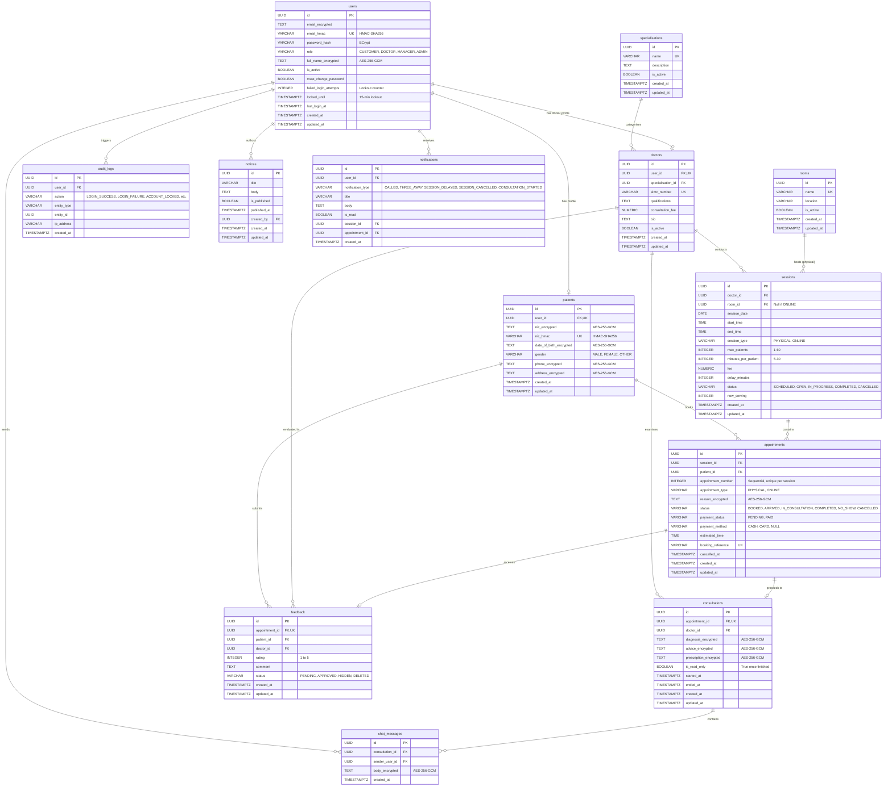

# MediChannel — Entity Relationship Diagram (ERD) & Schema Specifications

This document describes the complete PostgreSQL relational schema (13 tables) conforming strictly to assignment requirements, Sri Lankan medical regulation rules (SLMC), BR-01 to BR-11, and medical privacy boundaries.

---

## 1. Mermaid Entity-Relationship Diagram

---

## 2. Integrity and Business Constraints Summary

| Table | Constraint | Purpose / Rule |
| :--- | :--- | :--- |
| `users` | `uq_users_email_hmac` | Deterministic HMAC-SHA256 uniqueness without decrypting email |
| `users` | `chk_users_role` | Enforces 4 valid roles: `CUSTOMER`, `DOCTOR`, `MANAGER`, `ADMIN` |
| `patients` | `uq_patients_nic_hmac` | Uniqueness of Sri Lankan National Identity Card |
| `sessions` | `chk_sessions_physical_room` | `PHYSICAL` requires a room; `ONLINE` must have null room (BR-01) |
| `sessions` | `chk_sessions_max_patients` | Limit 1 to 60 patients per session |
| `sessions` | `chk_sessions_minutes` | Slot duration 5 to 30 minutes |
| `appointments` | `uq_appointments_number` | Unique slot number per session: no duplicates (BR-03) |
| `appointments` | `uq_appointments_active_patient` | Partial unique index: only 1 active booking per patient per session (BR-04) |
| `audit_logs` | `trg_audit_logs_no_update` | PostgreSQL row-level BEFORE UPDATE/DELETE trigger raising 'audit_logs is immutable' |
| `audit_logs` | `trg_audit_logs_no_truncate` | PostgreSQL statement-level BEFORE TRUNCATE trigger raising 'audit_logs is immutable' |
| `audit_logs` | `REVOKE UPDATE, DELETE, TRUNCATE` | SQL privilege restriction preventing modifications from public/standard roles |

---

## 3. Audit Log Immutability Enforcement (Defense-in-Depth)

The `audit_logs` table represents a non-repudiable record of system events. Immutability is strictly enforced across three architectural layers:

1. **Database Trigger Layer**:
   - `prevent_audit_log_change()` trigger function executed `BEFORE UPDATE OR DELETE ON audit_logs FOR EACH ROW`.
   - Statement-level trigger `BEFORE TRUNCATE ON audit_logs FOR EACH STATEMENT`.
   - Raises PL/pgSQL exception: `'audit_logs is immutable'`.
2. **Database Permissions Layer**:
   - Explicit `REVOKE UPDATE, DELETE, TRUNCATE ON audit_logs FROM PUBLIC;` preventing standard database users from altering the table.
3. **ORM / Application Layer**:
   - Hibernate `@org.hibernate.annotations.Immutable` annotation on the `AuditLog` entity.
   - All `@Column` and `@JoinColumn` attributes mapped with `updatable = false`.
   - `AuditService.record()` is append-only; no modification or deletion methods exist in the service or repository.

